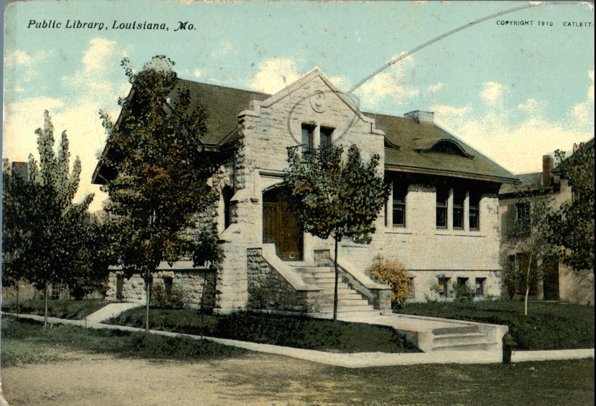
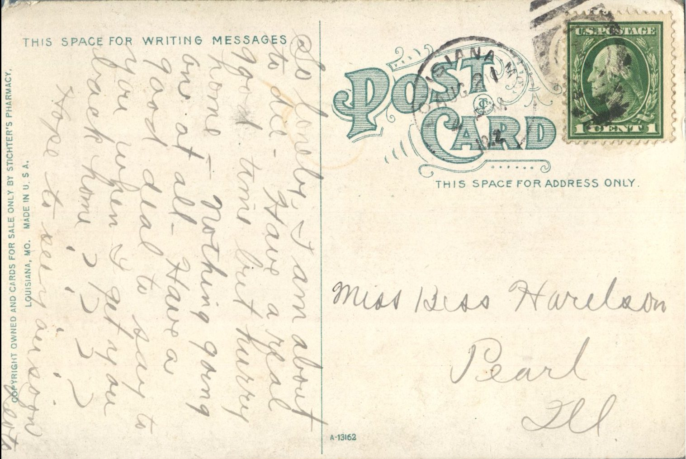

 

From: Leoto, To: Bess Harleson  
Mailed From: Louisiana, MO on August 21, 1912  
Postcard Info: Copyright Owned and Cards for Sale only by Stichter’s Pharmacy, Louisiana, MO. Made in U.S.A.  
Picture Info: Public Library, Louisiana, MO.

Miss Bess Harleson  
Pearl, Illinois

So lonely, I am about to die. Have a real good time but hurry home – nothing going on at all. – Have a good deal to say to you when I get you back home.  
Hope to see you soon.  
Leoto