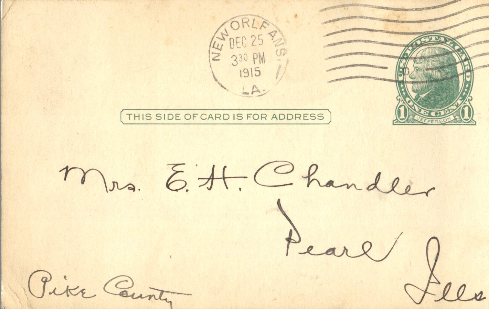
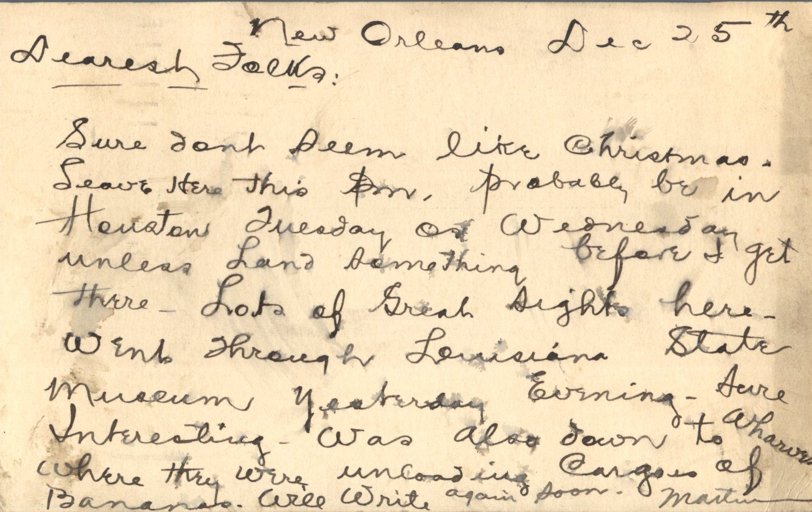

 

From: Martin Chandler, To: Elijah H. Chandler and Family  
Mailed From: New Orleans, LA on December 25, 1915

Mrs. E.H. Chandler  
Pearl, Ills  
Pike County

New Orleans Dec 25th  
Dearest Folks,  
Sure don’t seem like Christmas. Leave here this pm. Probably be in Houston Tuesday or Wednesday unless land something before I get there. Lots of great sights here. Went through Louisiana State Museum yesterday evening. Sure interesting. Was also down to Wharves where they were unloading cargo of bananas. Will write again soon.  
Martin