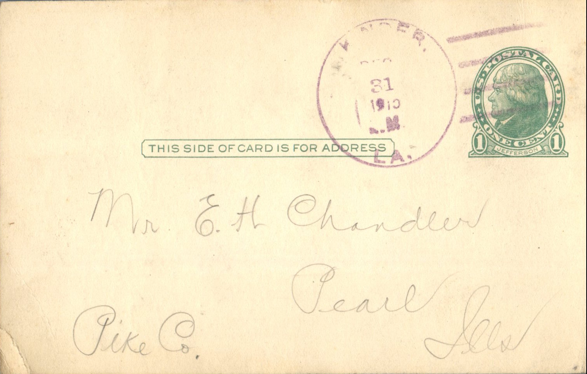
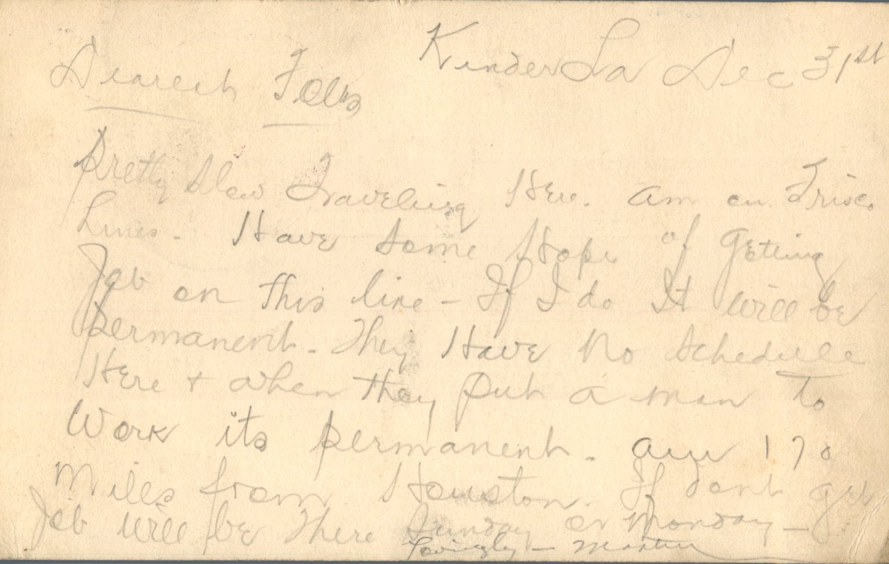

 

From: Martin Chandler, To: Elijah H. Chandler  
Mailed From: Kinder, LA on December 31, 1915

Mr. E.H. Chandler  
Pearl, Ill  
Pike Co

Kinder, LA Dec. 31st  
Dearest Folks,  
Pretty slow traveling here. Am on First Lines. Have some thought of getting job on this line. If I do it will be permanent. They have no schedule here and when they put a man to work its permanent. Am 170 miles from Houston. If don’t get job will be there Sunday or Monday.  
Lovingly,  
Martin