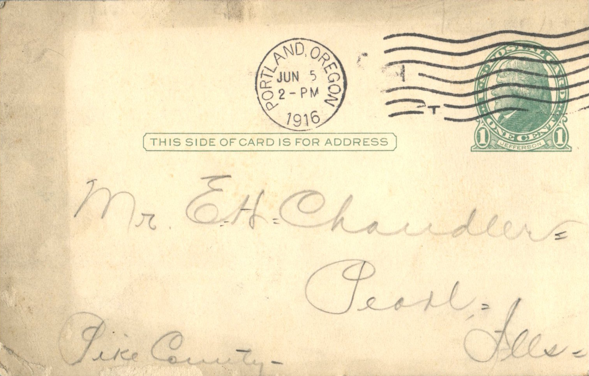
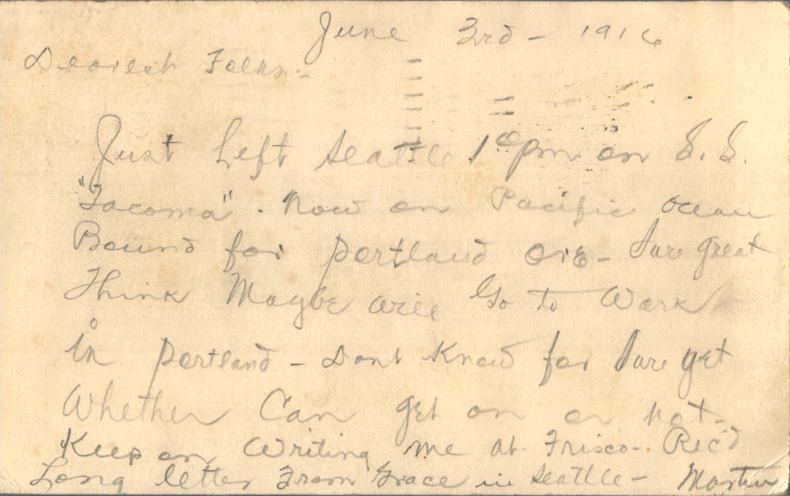

 

From: Martin Chandler, To: Elijah H. Chandler and Family  
Mailed From: June 3, 1916

Mr. E.H. Chandler  
Pearl, Ill  
Pike County

June 3rd, 1916  
Dearest Folks  
Just left Seattle at 1 pm on S.S. “Tacoma.” Now on Pacific Ocean bound for Portland, ore. Sure great think maybe will go to work in Portland. Don’t know for sure yet whether can get on or not. Keep on writing me at Frisco. Received long letter from Grace in Seattle.  
Martin