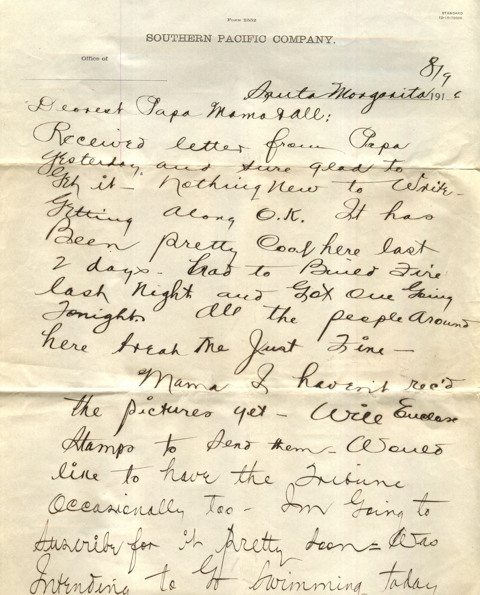
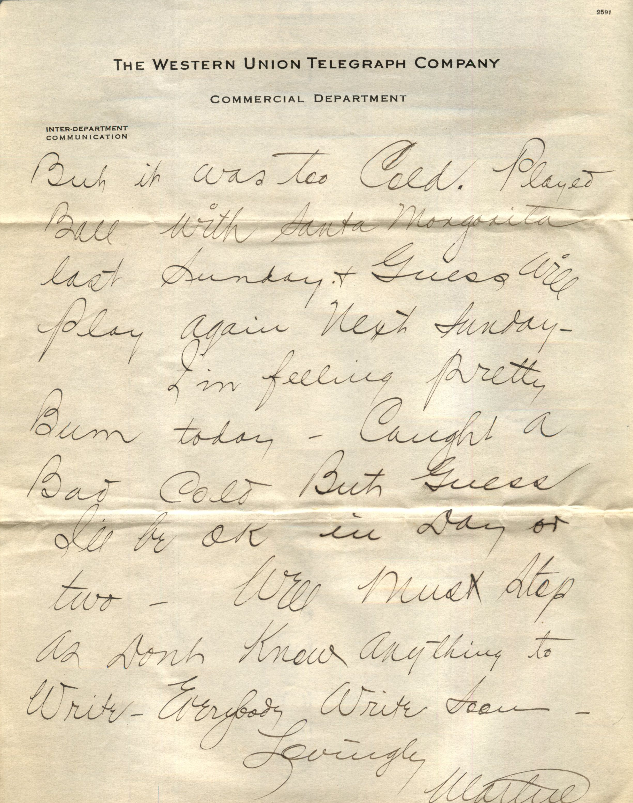

 

From: Martin Chandler, To: Elijah H. Chandler and Family  
Mailed From: Santa Margarita, CA on August 9, 1916

Mr. E.H. Chandler  
Pearl, Ill  
Pike Co

Santa Margarita 8/9 1916  
Dearest Papa, Mama, and all  
Received letter from Papa yesterday and sure glad to get it. Nothing new to write. Getting along OK. It has been pretty cool here last 2 days. Had to build fire last night and got one going tonight. All the people around here treat me just fine.  
Mama I haven’t received the pictures yet. Will enclose stamps to send them. Would like to have the Tribune occasionally too. I’m going to to subscribe for it pretty coon. Was intending to go swimming today but it was too cold. Played ball with Santa Margarita last Sunday and guess will play again next Sunday.  
I’m feeling pretty bum today. Caught a bad cold but guess I’ll be ok in day or two. Well must stop as don’t know anything to write. Everybody write soon.  
Lovingly,  
Martin