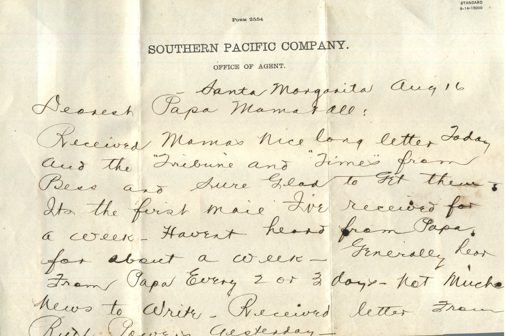
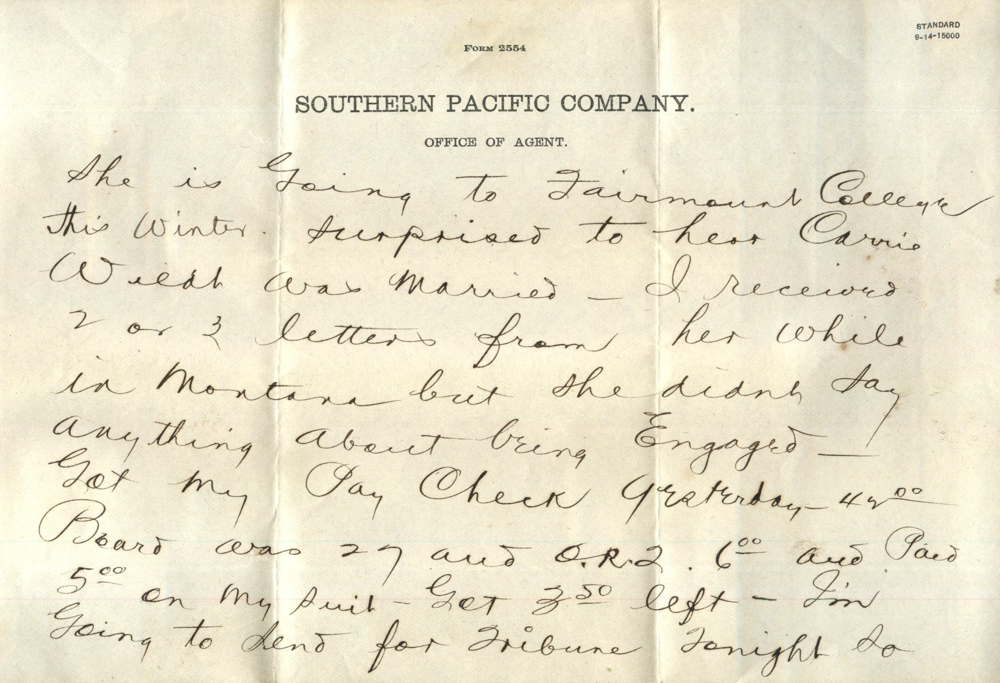
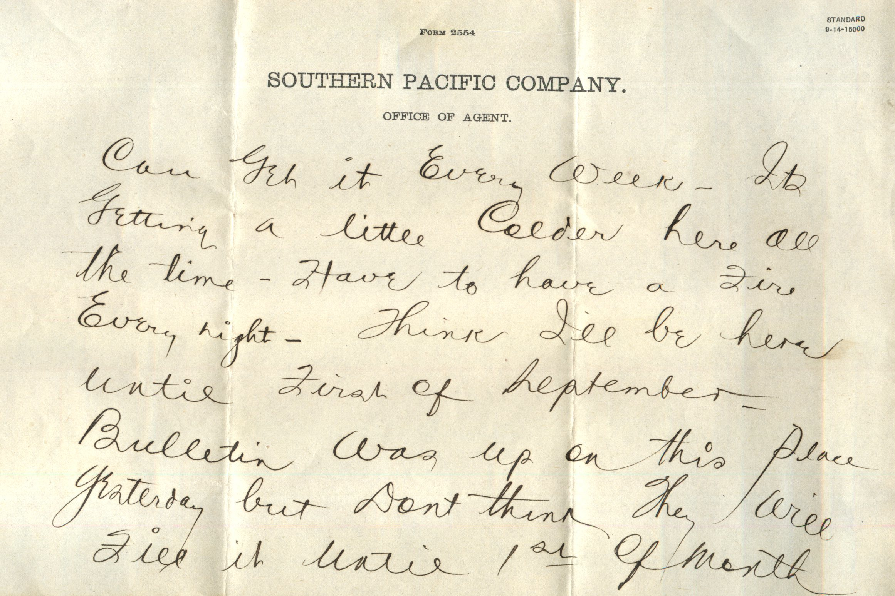
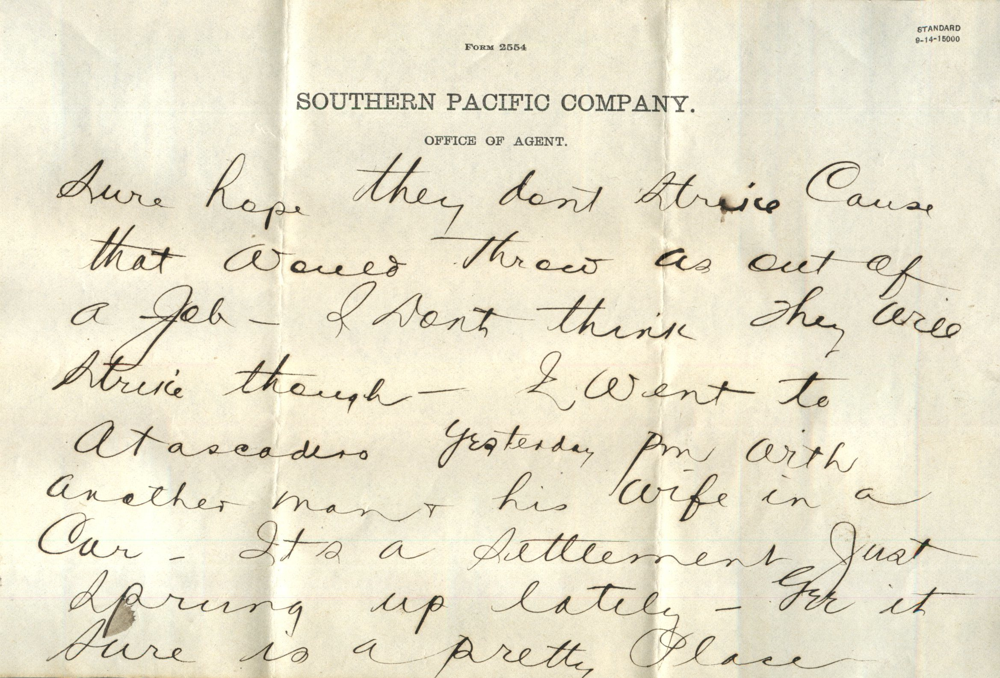
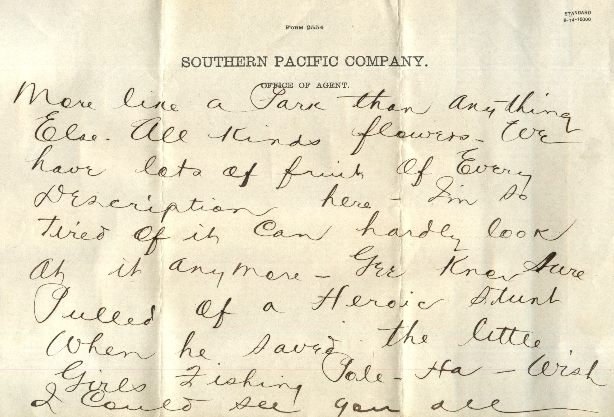
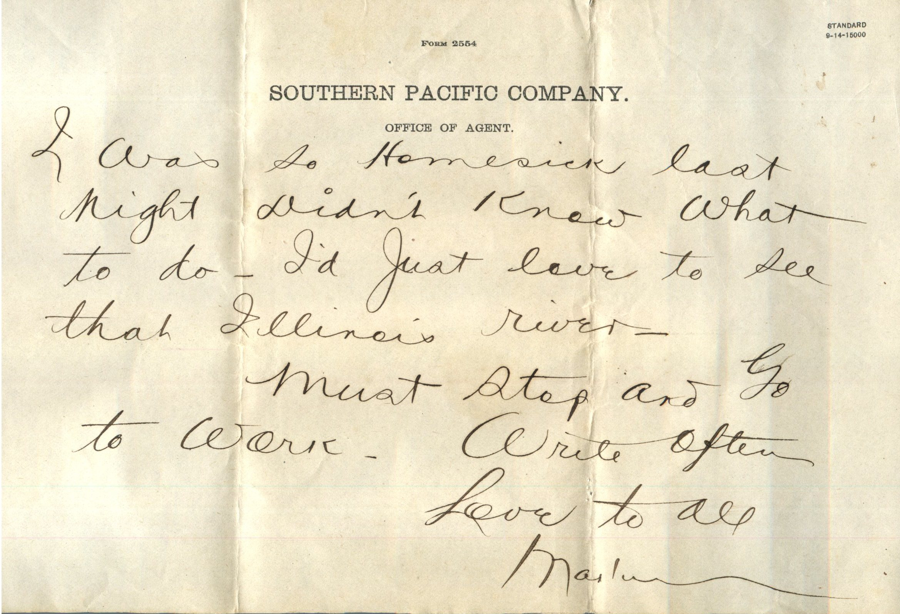
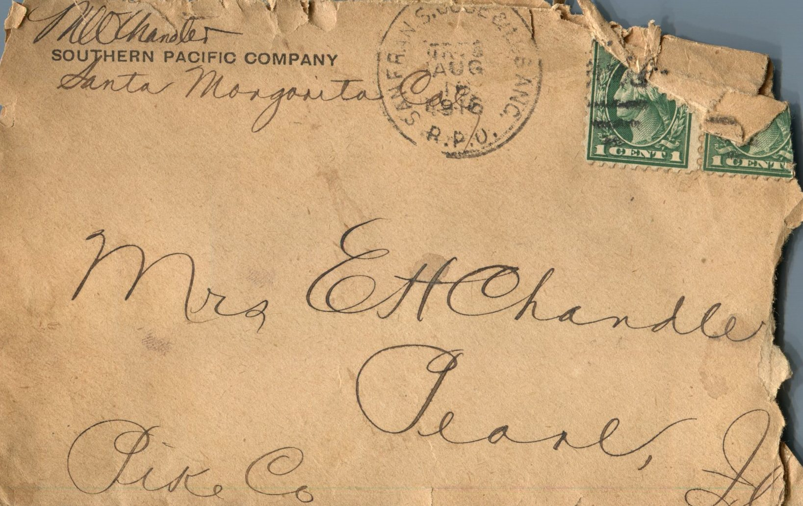

From: Martin Chandler, To: Jeanette Knox Chandler and Family  
Mailed From: Santa Margarita, California on August 16, 1916

Mrs. E.H. Chandler  
Pearl, Ill.  
Pike Co

Santa Margarita Aug 16  
Dearest Papa, Mama, and all  
Received Mama’s nice long letter today and the “Tribune” and “Times” from Bess and sure glad to get them. It’s the first I’ve received for a week. Haven’t heard from Papa for about a week. Generally hear from Papa every 2 or 3 days. Not much news to write. Received letter from Ruth Powers yesterday. She is going to Fairmount College this winter. Surprised to hear Carrie Wild was married. I received 2 or 3 letters from her while in Montana but she didn’t say anything about being engaged. Got my pay check yesterday. $49.00. Board was 27 and O.R. 2 $6.00 and paid $5.00 on my suit. Got $3.50 left. I’m going to send for Tribune tonight so can get it every week. It’s getting a little colder here all the time. Have to have a fire every night. Think I’ll be here until first of September. Bulletin was up on this place yesterday but don’t think they will fill it until 1st of month. Sure hope they don’t strike cause that would throw us out of a job. I don’t think they will strike though. I went to Atascadero yesterday pm with another man and his wife in a car. It’s a settlement just sprung up lately. Yet it sure is a pretty place. More like a park than anything else. All kinds flowers. We have lots of fruit of every description here. I’m so tired of it can hardly look at it anymore. Here Knox sure pulled off a heroic stunt when he saved the little girls fishing pole. Ha- wish I could see you all. I was so homesick last night didn’t know what to do. I’d just love to see that Illinois river.  
Must stop and go to work.  
Write Often  
Love to all,  
Martin