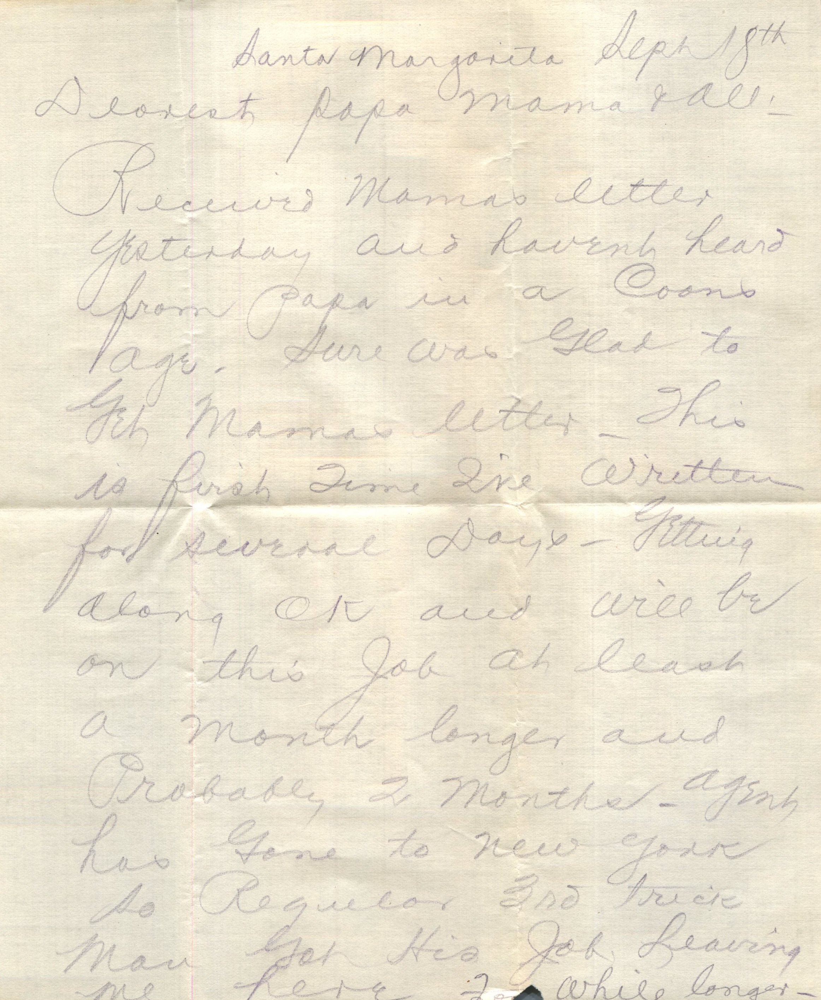
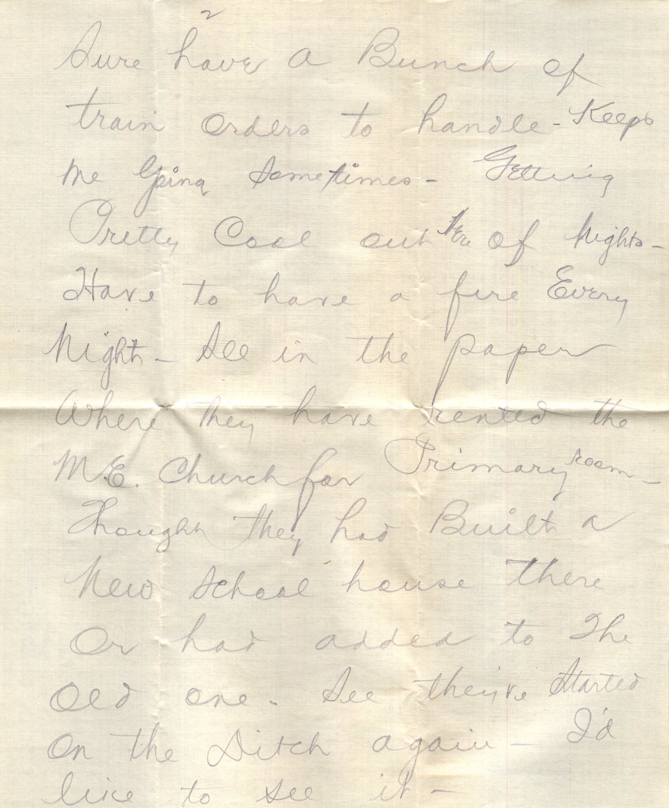
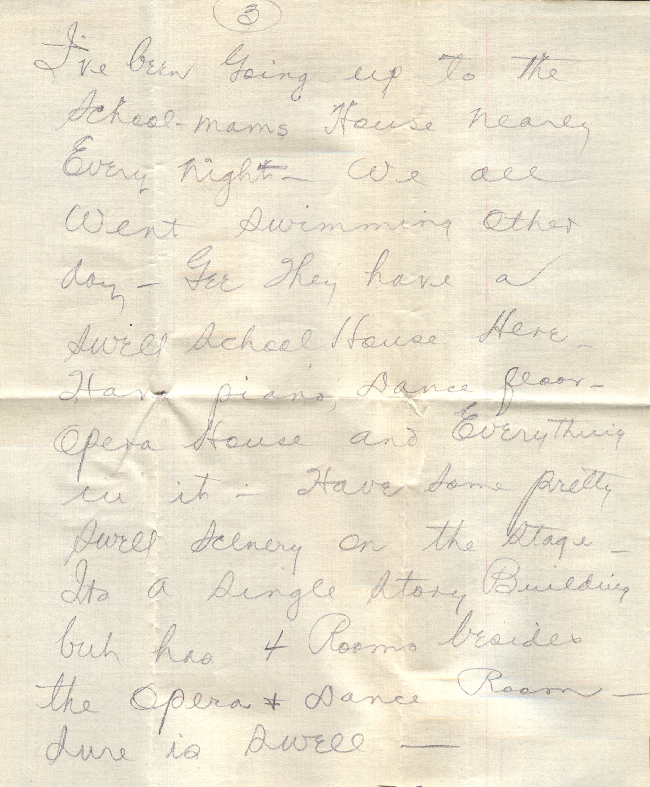
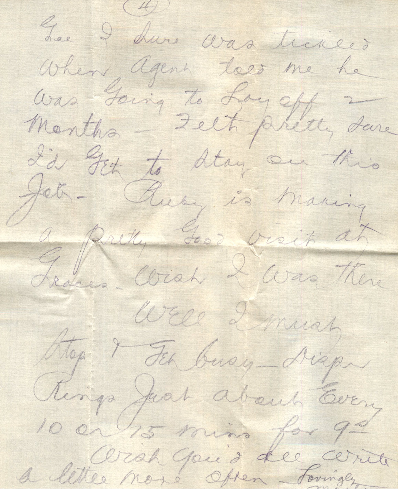
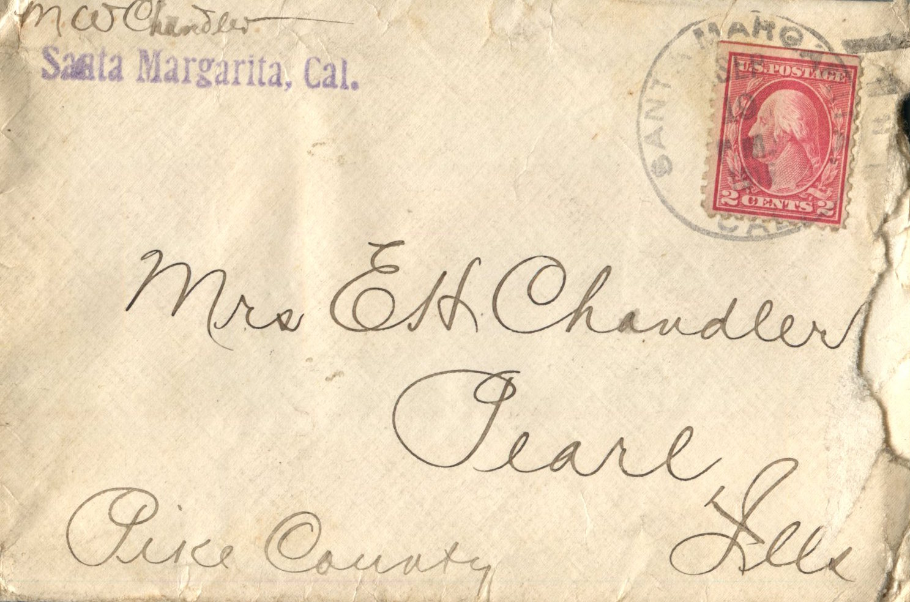

    

From: Martin Chandler, To: Elijah H. Chandler  
Mailed From: Santa Margarita, CA on September 18, 1916

Mr. E.H. Chandler  
Pearl, Illinois  
Pike Co

Santa Margarita Sept 18th  
Dearest Papa, Mama, and all  
Received Mama’s letter yesterday and haven’t heard from papa in a coons age. Sure was glad to get Mama’s letter. This is first time I’ve written for several days. Getting along OK and will be on this job at least a month longer and probably 2 months. Agent has gone to New York so regular 3rd trick man got his job leaving me here for while longer. Sure have a bunch of train orders to handle. Keeps me going sometimes. Getting pretty cool out there at night. Have to have a fire every night. See in the paper where they have rented the M.E. Church for Primary room. Thought they had built a new school house there or had added to the old one. See they’ve started on the ditch again. I’d like to see it.  
I’ve been going up to the school-man’s house nearly every night. We all went swimming other day. Gee they have swell schoolhouse here. Have piano, dance floor, opera house, and everything in it. Have some pretty swell scenery on the stage. It’s a single story building but has 4 rooms besides the opera and dance room. Sure is swell.  
Gee I sure was tickled when agent told me he was going to lay off 2 months. Felt pretty sure I’d get to stay on this job. Ruby is making a pretty good visit at Grace’s. Wish I was there.  
Well I must stop and get busy. Bell rings just about every 10 or 15 min for 9.00. Wish you’d all write a little more often.  
Lovingly,  
Martin