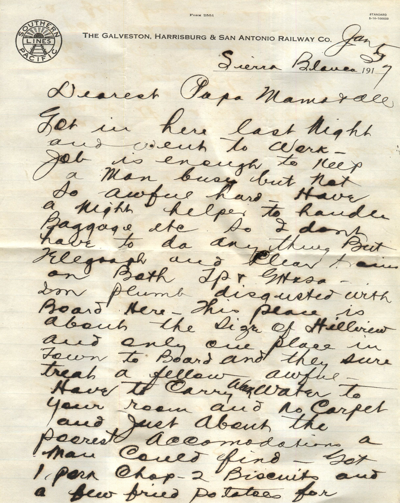
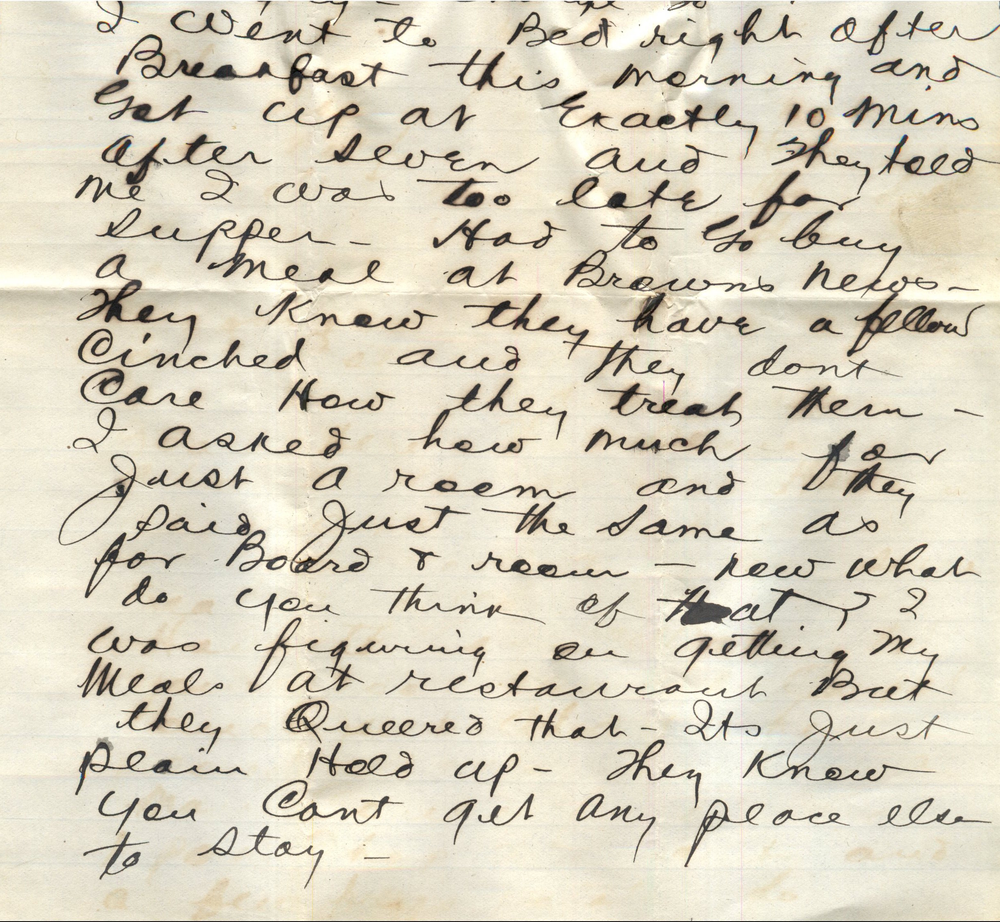
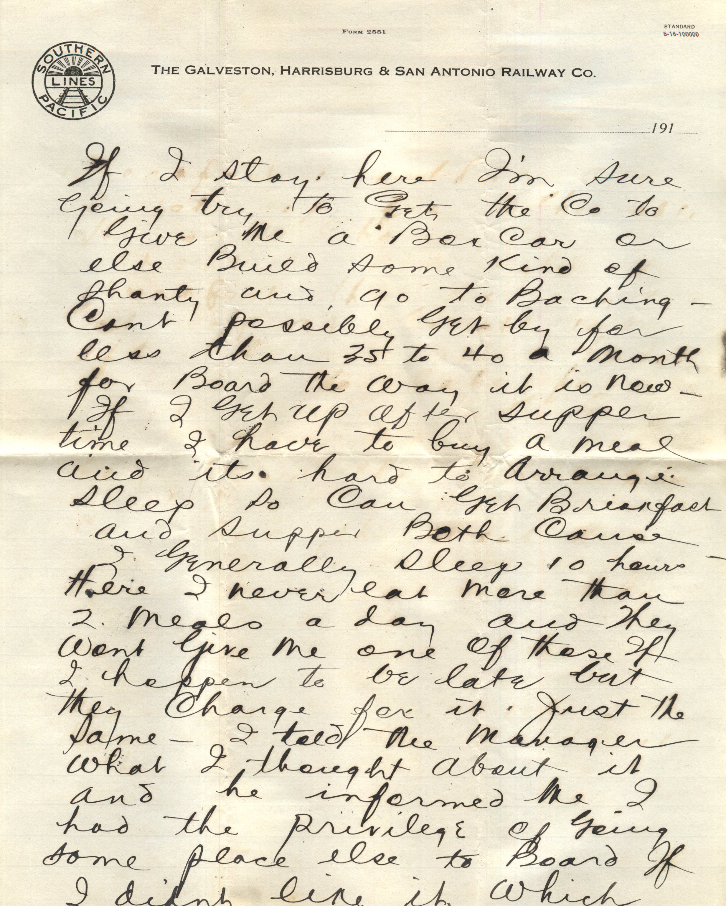
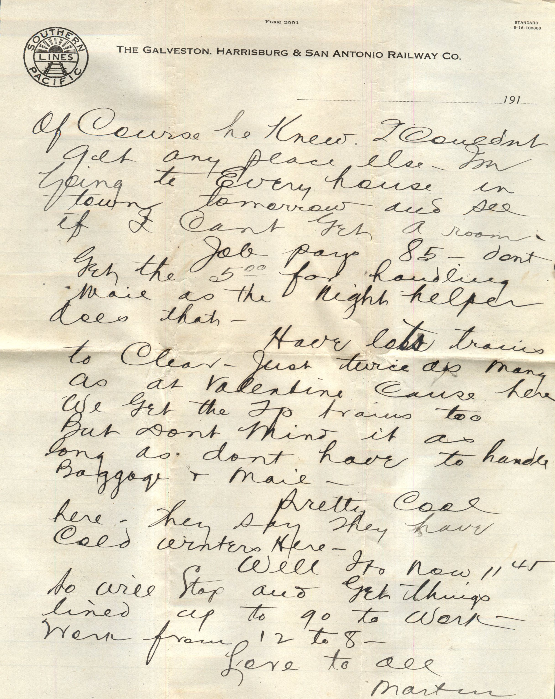
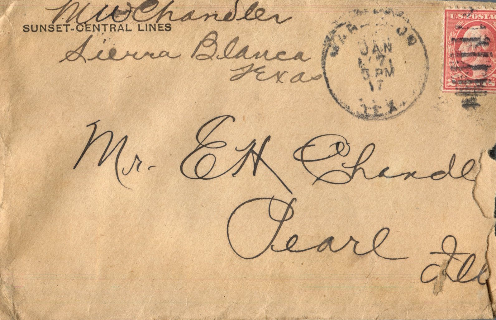

    

From: Martin Chandler, To: Elijah H. Chandler and Family  
Mailed From: Sierra Blanca January 2, 1917

Mr. E.H. Chandler  
Pearl, Ill

Sierra Blanca Jan 2, 1917  
Dearest Papa, Mama, and all,  
Got in here last night and went to work. Job is enough to keep a man busy but not so awful hard. Have a night helper to handle baggage, etc. So I don’t have to do anything but telegraphy and clear trains on Both TP na dishes. I’m plumb disgusted with board here. This place is about the size of Hillview and only one place in town to board and they sure treat a fellow awful. Have to carry wash hater to your room and no carpet and just about the poorest accommodations a man could find. Got 1 pork chap, 2 biscuits and a few friend potatoes for breakfast and thats all. I got up from the table hungry. Charge 30.00 month. I went to bed right after breakfast this morning and got up at exactly 10 minutes after seven and they told me I was too late for supper. Had to go buy a meal at Brown’s News. They know they have a fellow cinched and they don’t care how they treat them. I asked how much for just a room and they said just the same as for board and room. Now what do you think of that? I was figuring on getting my meals at restaurant but they queered that. It’s just plain hold up. They know you can’t get any place else to stay.  
If I stay here I’m sure going to get the Co to give me a box car or else build some kind of shanty and go to Baching. Can’t possibly get by for less than 35 to 40 a month for board the way it is now. If I get up after supper time I have to buy a meal and its hard to arrange sleep so can get breakfast and supper both cause I generally sleep 10 hours. Here I never eat more than 2 meals a day and they wont give me one of those if I happen to be late but they charge for it. Just the same – I told the manager what I thought abut it and he informed me I had the privilege of going some place else to board if I didn’t like it, which of course he knew I couldn’t get any place else. I’m going to every house intern tomorrow and see if I can’t get a room.  
Job pays 85 don’t get the 5.00 for handling mail as the night helper does that.  
Have lots trains to clear. Just twice as many as at Valentine cause here we get the Tp. trains too but don’t mind it as long as don’t have to handle baggage and mail.  
Pretty cool here. They say they have cold winters here.  
Well its now 11:45 s will stop and get things lined up to go to work. Work from 12 to 8.  
Love to all,  
Martin