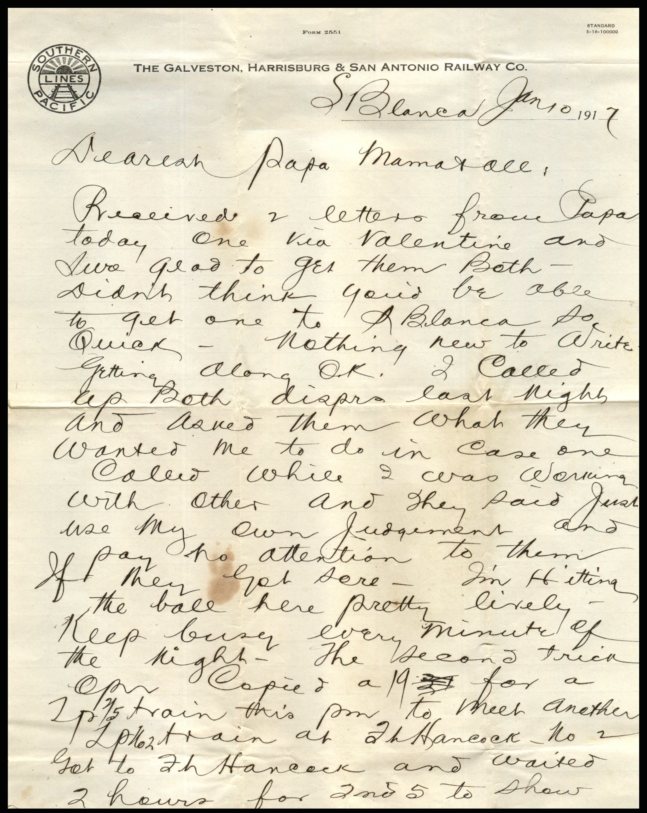
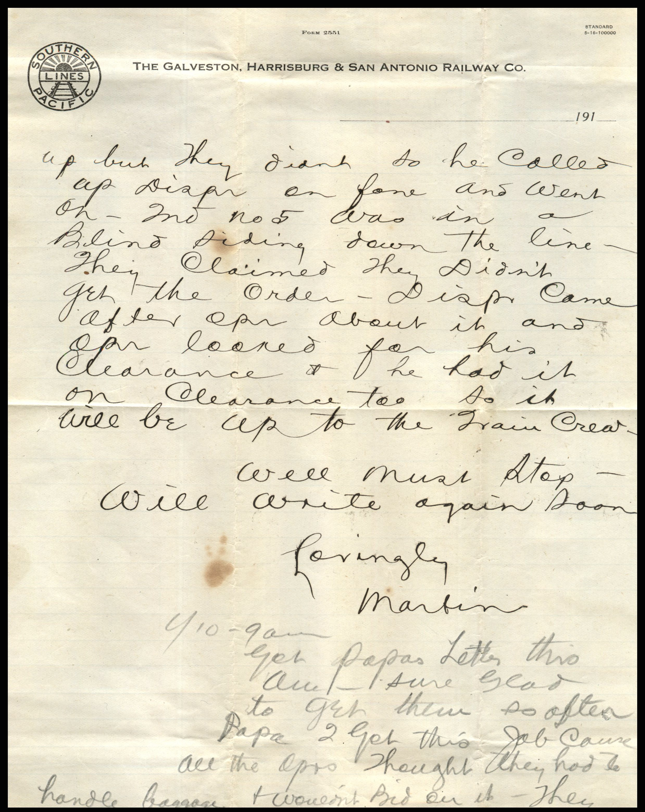
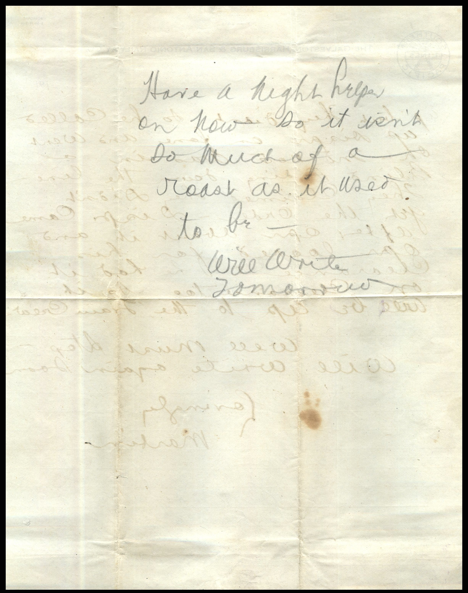
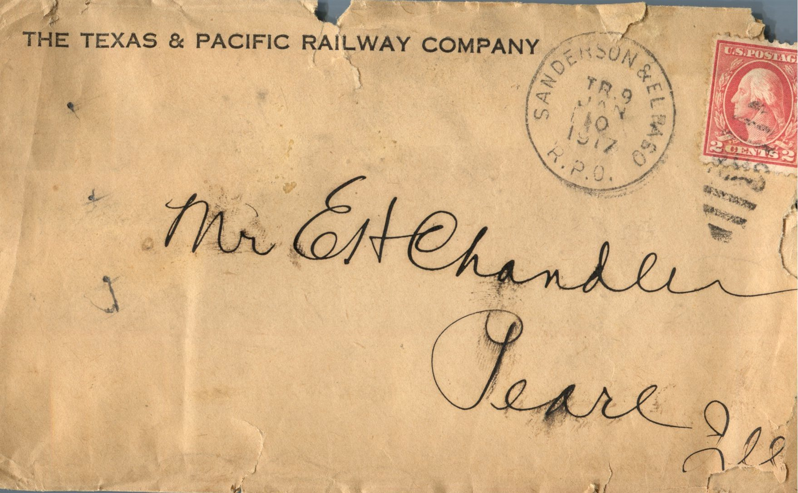

From: Martin Chandler, To: Eliojah H. Chandler and Family  
Mailed From: El Paso, Texas on June 10, 1917

Mr. E.H. Chandler  
Pearl, Illinois

St. Blanca  
January 10, 1917  
Dearest Papa, Mama, and all;  
Received 2 letters from Papa today. One via valentine and I was glad to get them both. Didn’t think you’d be able to get one to St. Blanca so quick. Nothing new to write. Getting along O.K. I called up both last night and asked them what they wanted me to do in case one called while I was working with other and they said just use my own judgement and if I pay no attention to them they get sore. I’m hitting the ball here pretty lively. Keep busy every minute of the night. The depo I trick open copied a 19 for a IP 2/5 train this pm to meet another IP No. 2 train at Fort Hancock. No. 2 got to Fort Hancock and waited 2 hours for the 2nd 5 to show up but they didn’t so he called up Dispr. on phone and went on. 2nd No. 5 was in a blind siding down the line. They claimed they didn’t get the order. Disp. came after open about it and open looked for his clearance and he had it non clearance so it will be up to the train creed.  
Well, must stop. Will write again soon.  
Lovingly,  
Martin

1/10 – 9 am.  
Got Papas letter this am. Sure glad to get them so after Papa, to get this job course all the openers thought they had to handle baggage and wouldn’t bid on it. They have a night help on now so it isn’t so much of a roast as it used to be.  
Will write,  
Martin