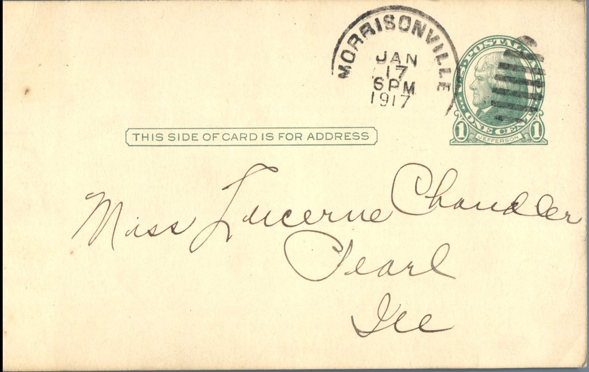
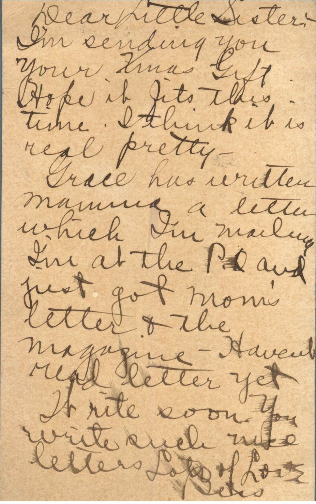

From: Bess Chandler, To: Lucerne Chandler  
Mailed From: Morrisonville, Illinois on January 17, 1917

Miss Lucerne Chandler  
Pearl, Illinois

Dear Little Sister,  
I’m sending you your Christmas gift. Hope it fits this time. I think it is real pretty.  
Grace has written Mamma a letter which I’m mailing. I’m at the P.O. and just got mom’s letter and the magazine. Haven’t read letter yet. Write soon. You write such nice letters.  
Lots of Love,  
Bess