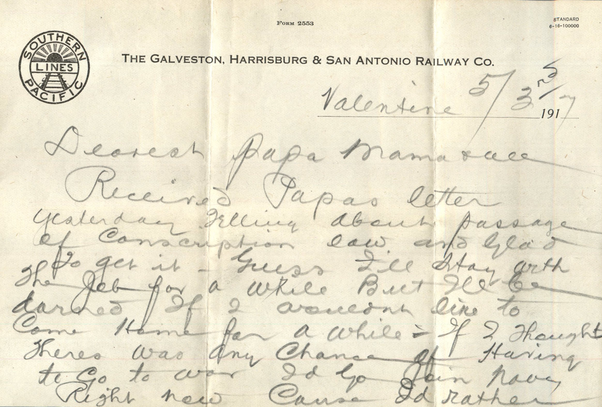
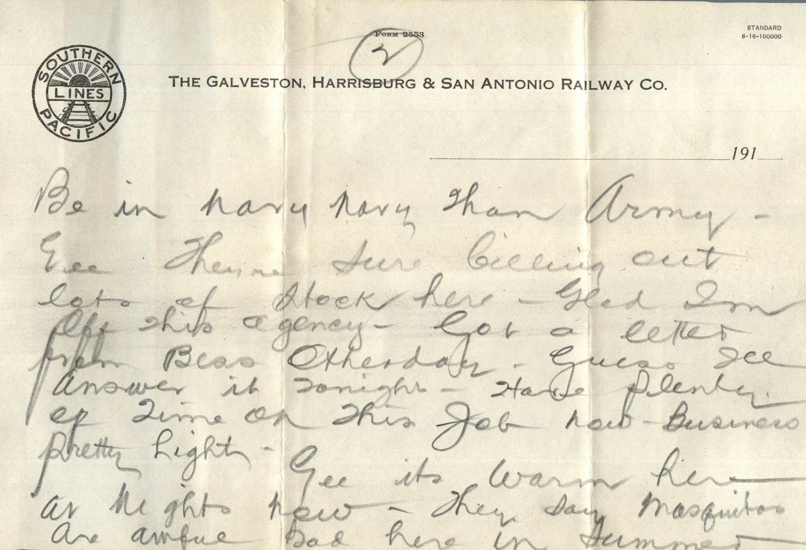
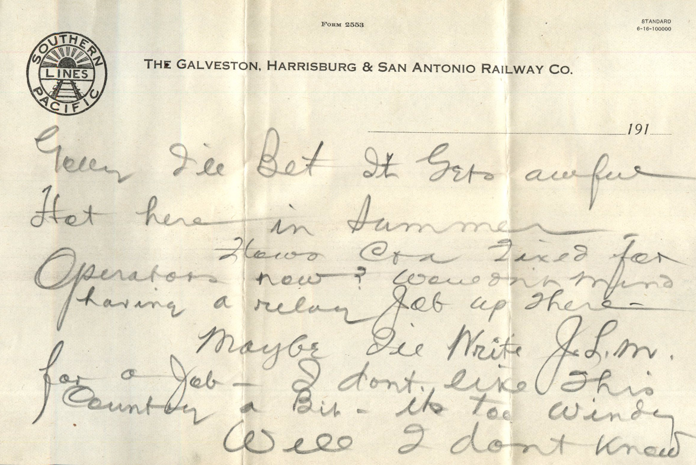
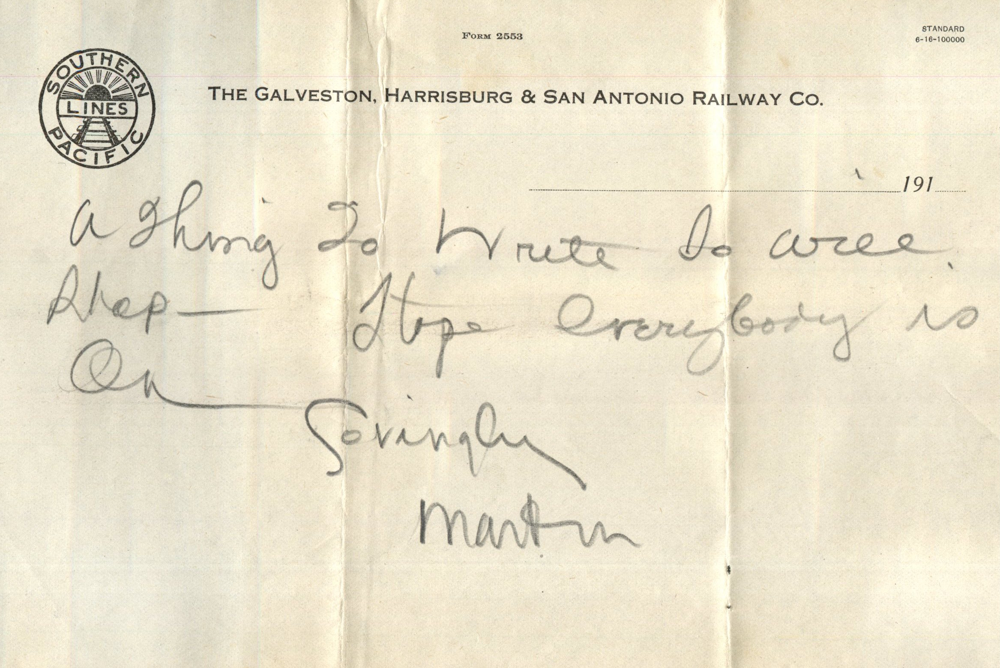

   

From: Martin Chandler, To: Elijah H. Chandler  
Mailed From: Valentine on May 3, 1917

Mr. E.H. Chandler  
Pearl, Ill  
Pike County

Valentine 5/3rd 1917  
Dearest Papa, Mama, and all  
Received Papa’s letter yesterday telling about passage of Conscription law and glad to get it. Guess I’ll stay with the job for a while but I’ll be darned if I wouldn’t like to come home for a while. if I thought there was any chance of having to go to war I’d go join Navy right now cause I’d rather be in navy than in army. Gee they’re sure billing out lots of stock here. Glad I’m off this agency. Got a letter from bess other day. Guess I’ll answer it tonight. Have plenty of time on this job now. Business pretty light.  
Gee it’s warm here at night now. They say mosquitoes are awful bad here in summer. Golly I’ll be it gets awful hot here in summer.  
How’s Coa fixed for operations now? Wouldn’t mind having a relay job up there.  
Maybe I’ll write J.L.M. for a job. I don’t like this County a bit. It’s too windy.  
Well I don’t know a thing to write so will stop. Hope everybody is OK.  
Lovingly,  
Martin