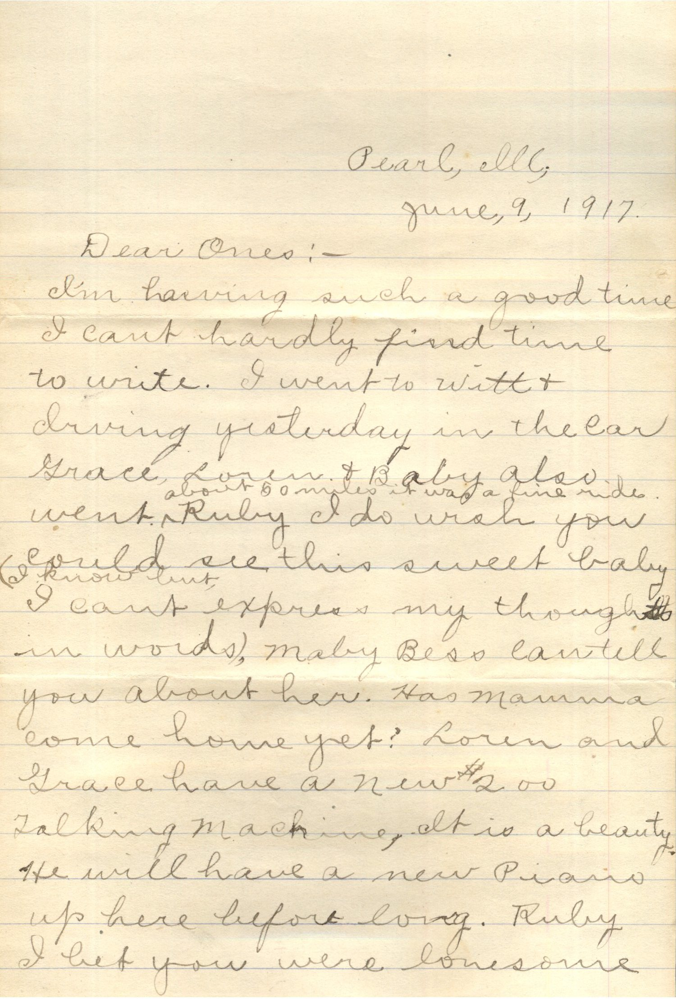
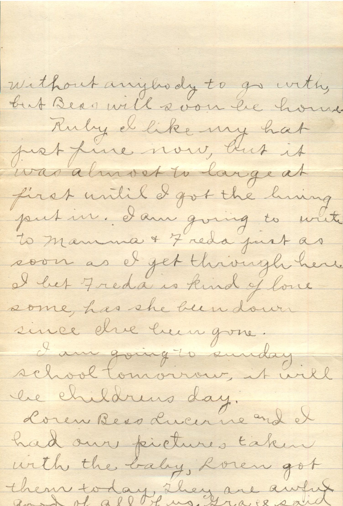
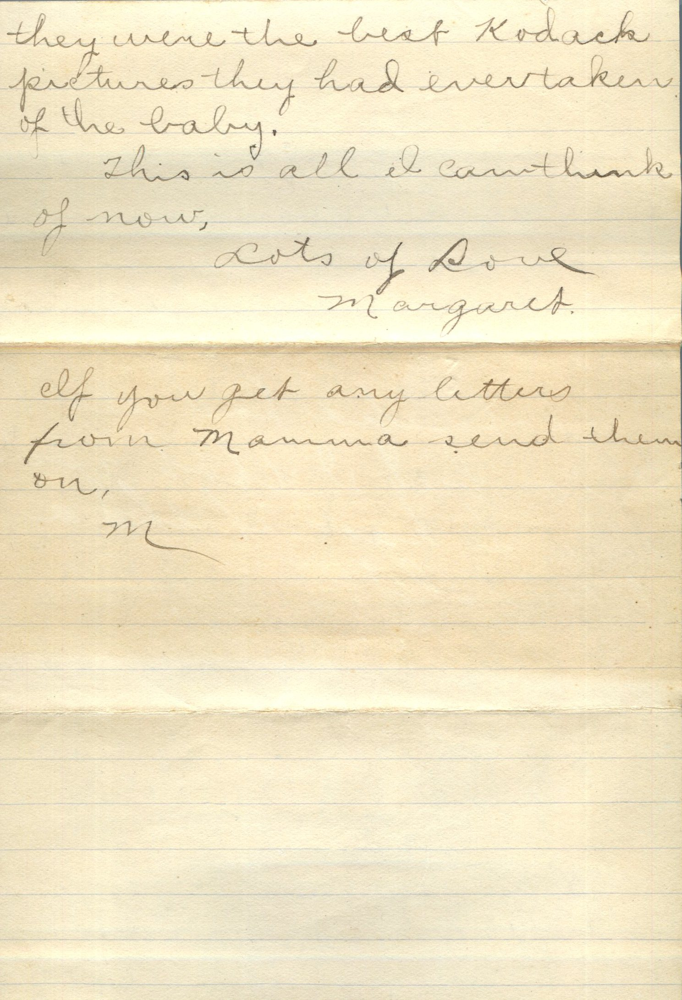

  

From: Margaret Chandler, To: Ruby Chandler  
Mailed From: Pearl, Ill on June 9, 1917

Pearl, Ill  
June, 9, 1917  
Dear Ones:-  
I’m having such a good time I can’t hardly find time to write. I went to Witt and driving yesterday in the car. Grace, Lorin, and Baby also went about 50 miles it was a fine ride. Ruby I do wish you could see this sweet baby. I know but I can’t express my thoughts in words. maybe Bess can tell you about her. Has Mamma come him yet? Loin and Grace have a new $200 talking machine. It is a beauty. He will have a new piano up here before long. Ruby I bet you were lonesome without anybody to go with, but Bess will soon be home.  
Ruby I like my hat just fine now, but it was almost too large at first until I got the lining put in. I am going to write to Mamma &amp; Freda first as soon as I get through here. I bet Freda is kind of lonesome, has she been down since I’ve been gone.  
I am going to Sunday School tomorrow, it will be children’s day.  
Loren, Bess, Lucerne, and I had our pictures taken with the baby. Loren got them today they are awful good of all of us. Grace said they were the best Kodak pictures they had eve taken of the baby.  
This is all I can think of now.  
Lots of love,  
Margaret  
If you get any letters from Mamma send them on.  
M