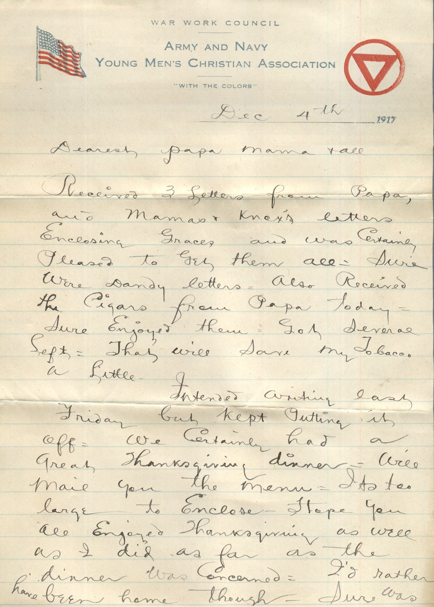
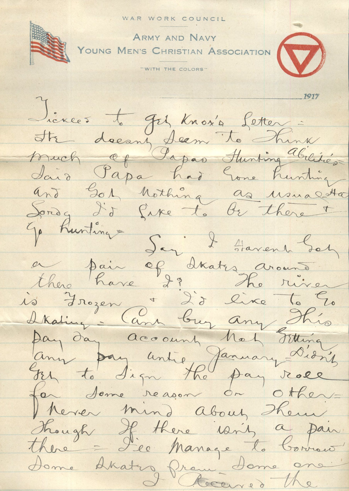
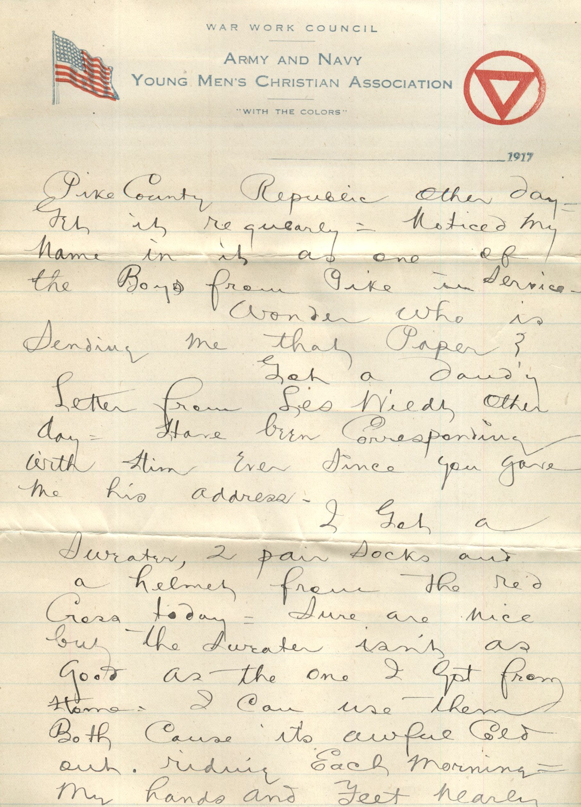
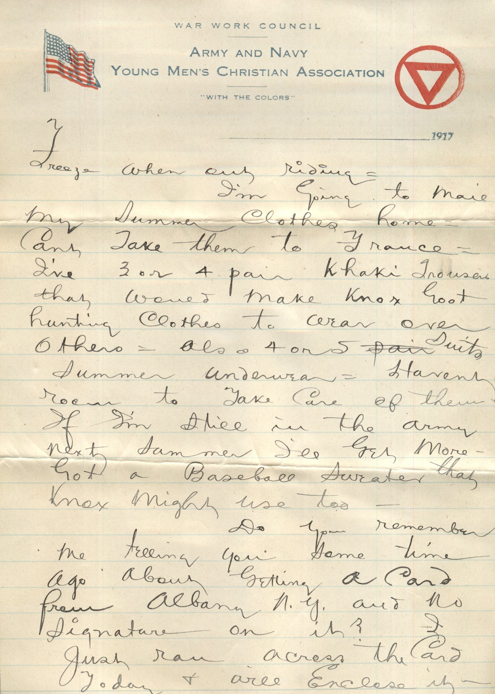
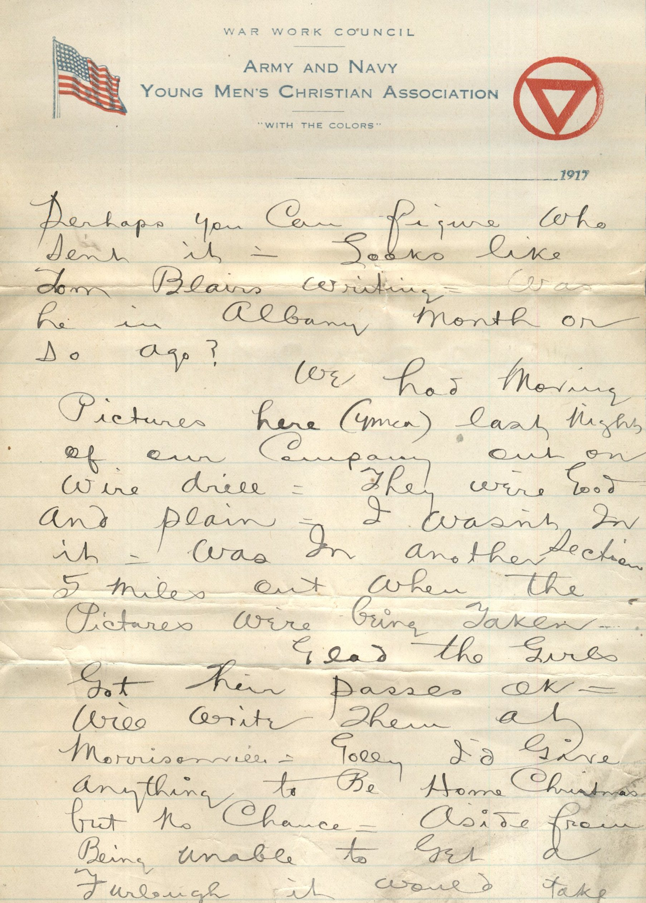
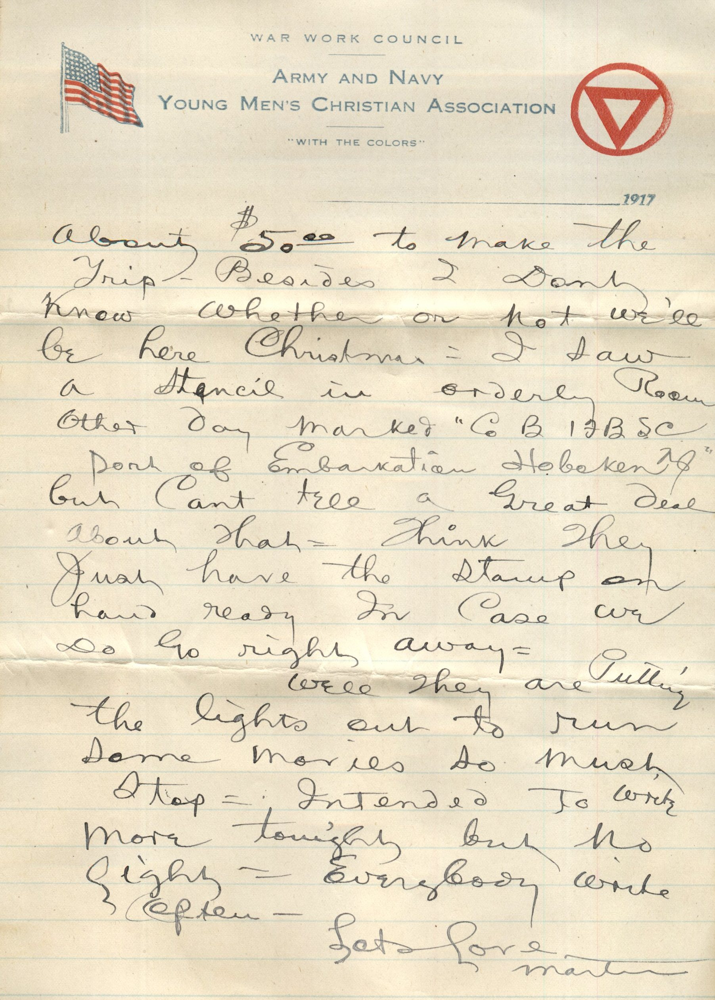

     

From: Martin Chandler, To: Elijah H. Chandler  
Mailed On: December 4th, 1917

Dec 4th 1917  
Dearest Papa, Mama, and All  
Received 3 letters from Papa, and Mama’s and Knox’s letters closing Grace’s and was certainly pleased to get them all. Sure were dandy letters. Also received the cigars from Papa today. Sure enjoyed them. Got several left. That will save my tobacco a little  
Intended writing last Friday but kept putting it off. We certainly had a great Thanksgiving dinner. I’ll mail you the menu. It’s too large to enclose. Hope you all enjoyed Thanksgiving as well as I did as far as the dinner was concerned. I’d rather have been home though. Sure was tickled to get Knox’s letter. He does’t seem to think much of Papa’s hunting abilities. Said Papa had gone hunting and got nothing as usual. Ha. Lordy I’d like to be there and go hunting.  
Say I haven’t got a pair of skates around there have I? The river is Frozen and I’d like to go skating. Can’t buy any this pay day account not getting any pay until January. Didn’t get to sign the pay role for some reason or other. Never mind about them though if there isn’t a pair there. I’ll manage to borrow some skates from some one.  
I received the Pike County Republic other day. Get it regularly. Noticed my name in it as one of the boys from Pike in service.  
Wonder who is sending me that paper?  
Got a dandy letter from Les Wildt other day. Have been corresponding with him ever since you gave me his address.  
I get a sweater, 2 pair socks and a helmet from the Red Cross today. Sure are nice but the sweater isn’t as good as the one I got from home. I can use them both cause its awful cold out riding each morning. My hands and feet nearly freeze when out riding. I’m going to mail my summer clothes home. Can’t take them to France. I’ve 3 or 4 pair Khaki trousers that would make Knox good hunting clothes to wear over others. Also 4 or 5 suits summer underwear. Haven’t room to take care of them. If I’m still in the army next summer I’ll get more. Got a baseball sweater that Knox might use too.  
Do you remember me telling you some time ago about getting a card from Alabama N.Y. and no signature on it? I just ran across the card today and will enclose it. Perhaps you can figure who sent it. Looks like Tom Blair’s writing. Was he in Albany month or so ago?  
We had moving pictures here (YMCA) last night of our company out on wire drill. They were good and plain. I wasn’t in it. Was in another section 5 miles out when the pictures were being taken.  
Glad the girls got their passes ok. Will write them at Morrisonville. Golly I’d give anything to be home Christmas but no chance. Aside from being unable to get a furlough it would take about $50.00 to make the trip. Besides I don’t know whether or not we’ll be here Christmas. I saw a stencil in orderly room other day marked “Co B 17BSC” port of Embarkation Hoboken, NY but can’t tell a great deal about that. Think they just have the stamp on hand ready in case we do go right away.  
Well they are putting the lights out to run some movies so must stop. Intended to write more tonight but no light. Everybody write often.  
Lots Love,  
Martin