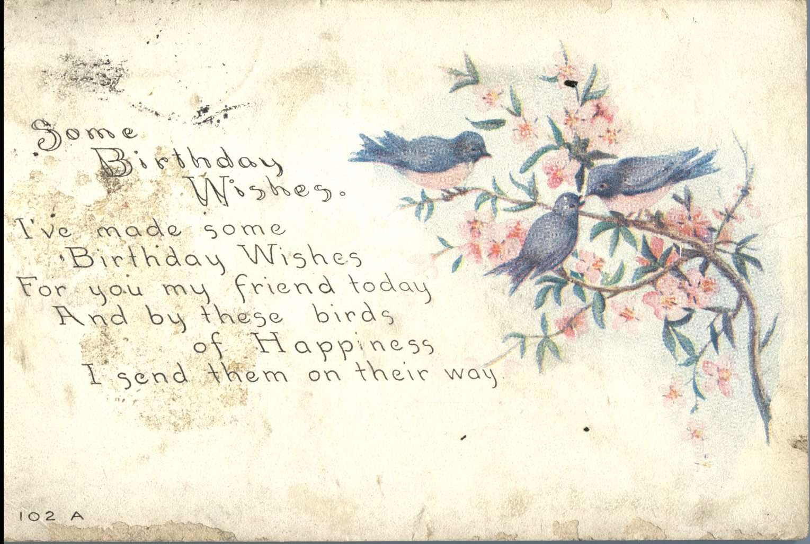
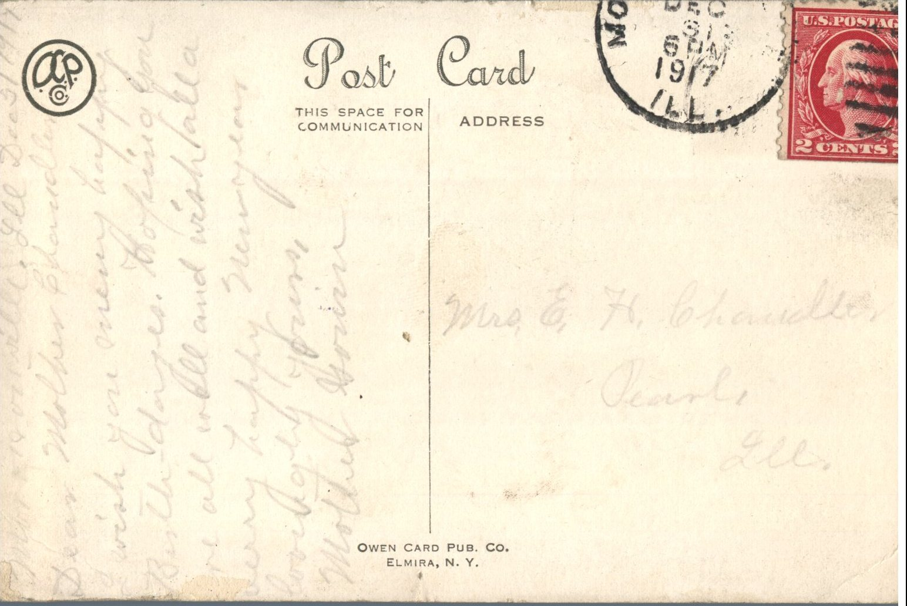

 

From: Mother Gowin, To: Jeanette Knox Chandler  
Mailed From: Morrisonville, Illinois on December 31, 1917

Mrs. E.H. Chandler  
Pearl, Illinois

Morrisonville, Illinois Dec 31, 1917  
Dear Mother Chandler,  
I wish you many happy birthdays. Hoping you are all well and wish for a very happy holiday.  
Lovingly yours,  
Mother Gowin