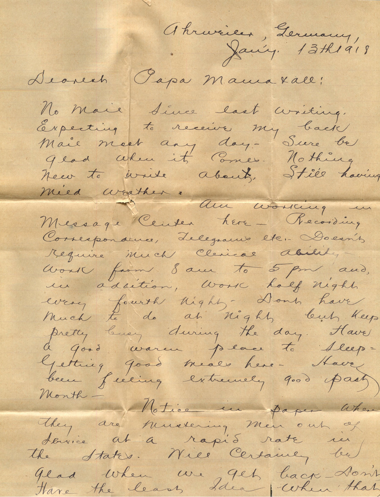
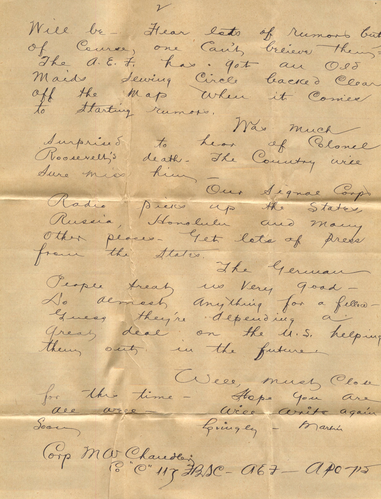

 

From: Martin Chandler, To: Elijah H. Chandler and Family  
Mailed From: Ahrweiler, Germany on January 13, 1918

Mr. E.H. Chandler  
Pearl, Ill  
USA

Ahrweiler, Germany  
Jan 13th, 1918  
Dearest Papa, Mama, and all,  
No mail since last writing. Expecting to receive my back mail most any day. Sure be glad when it comes. Nothing new to write about. Still having mild weather.  
Am working in Message Center here. Recording correspondence, telegrams, etc. Doesn’t require much clerical ability. Work from 8 am to 5 pm and in addition, work half night every fourth night. Don’t have much to do at night but keep pretty busy during the day. have a good warm place to sleep. Getting good meals here. Have been feeling extremely good past month.  
Notice in paper when they are busting men out of service, at a rapid rate in the states. Will certainly be glad when we get back. Don’t have the least idea when that will be. Hear lots of rumors but, of course, one can’t believe them. The A.E.F. has got an Old Maids sewing circle backed clear of the map when it comes to starting rumors.  
Was much surprised to hear of Colonel Roosevelt’s death. The Country will sure miss him.  
Our signal Corps Radio picks up the states, Russia, Honolulu and many other places. Get lots of press from the states.  
The German people treat us very good. Do almost anything for a fellow. Guess they’re depending a great deal on the U.S. helping them out in the future.  
Well must close for this time. Hope you are all well. Will write again soon.  
Lovingly,  
Martin