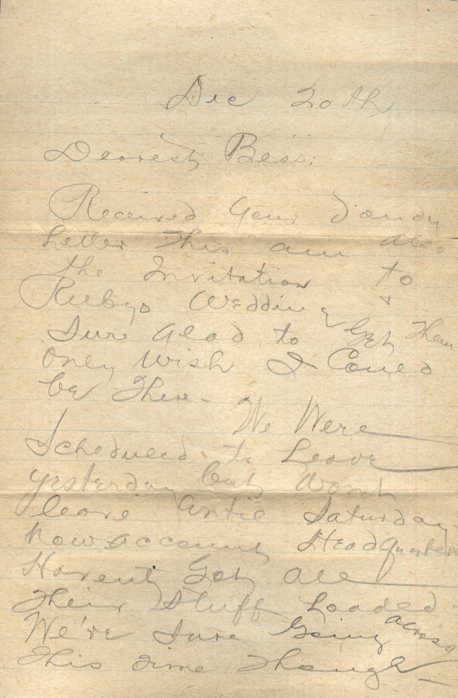
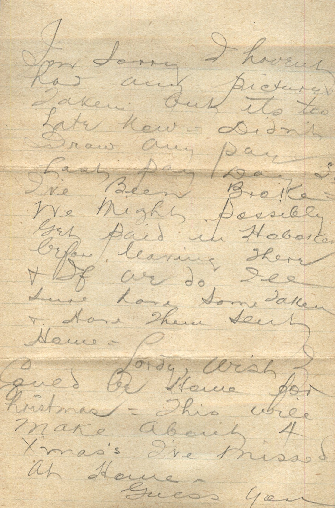
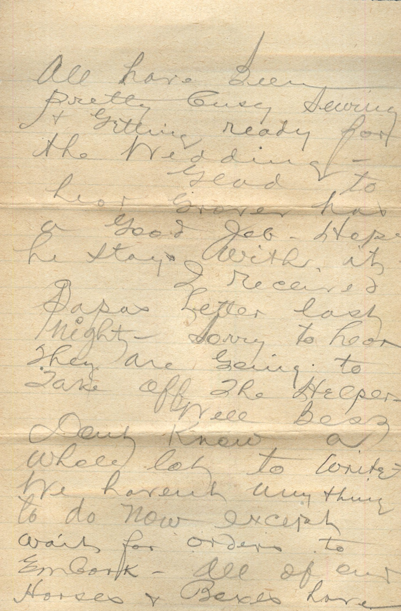
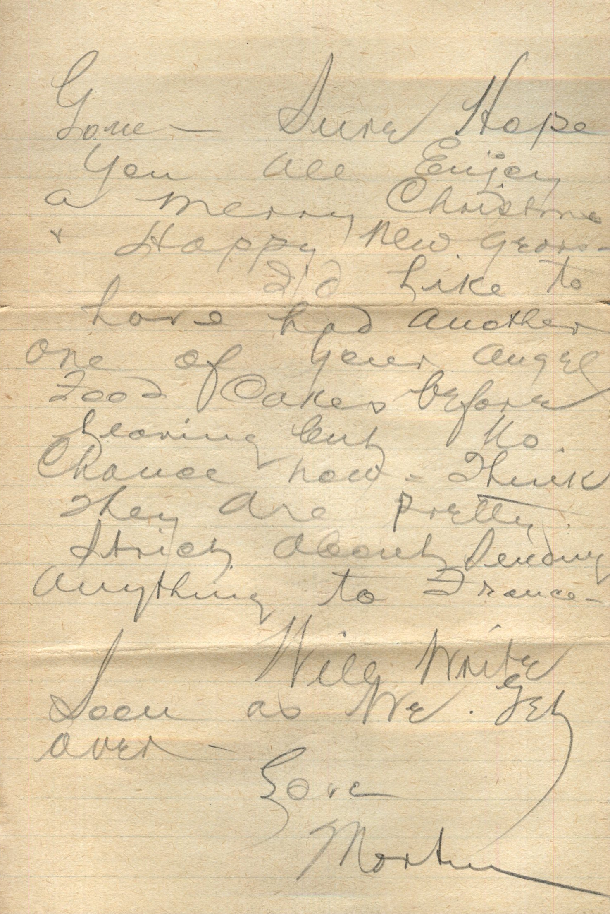
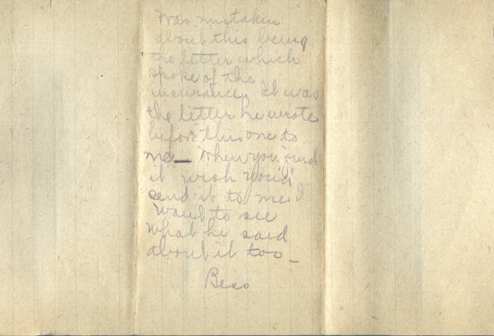
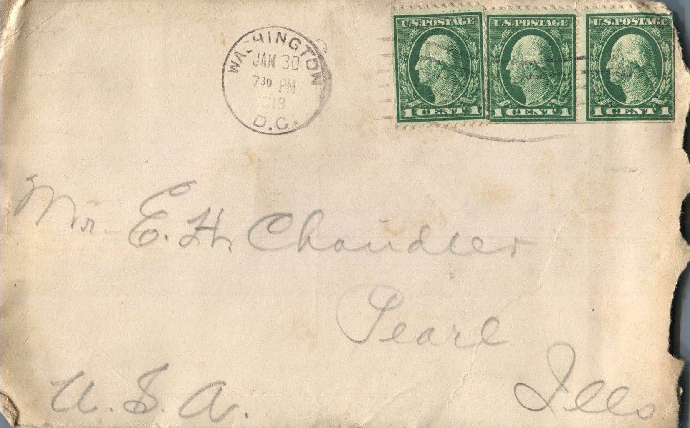

    

From: Bess Chandler, To: Elijah H. Chandler  
Mailed From: Washington, DC on January 30, 1918 (Letter was originally sent to Bess Chandler from Martin Chandler on December 20, and then sent to Elijah H. Chandler from Bess Chandler on January 30, 1918)

Mr. E.H. Chandler  
Pearl, Ill  
USA

Dec 20th  
Dearest Bess,  
Received your dandy letter this am and the invitation to Ruby’s wedding and sure glad to get them. Only wish I could be there.  
We were scheduled to leave yesterday but wont leave until Saturday now on account headquarters haven’t got all their stuff loaded. We’re sure going across this time though. I’m sorry I haven’t had any pictures taken but its too late now. Didn’t draw any pay last paw day so I’ve been broke. We might possibly get paid in Hoboken before leaving there and if we do I’ll sure have some taken and have them sent home.  
Lordy wish I could be home for Christmas. This will make about 4 Xmas’ I’ve missed at home.  
Guess you all have been pretty busy sewing and getting ready for the wedding.  
Glad to hear Grove has a good job. Hope he stays with it.  
I received Papa’s letter last night. Sorry to hear they are going to take off the Helper.  
Well Bess don’t know a whole lot to write. We haven’t any thing to do now except wait for orders to embark. All of our horses and boxes have gone. Sure hope you all enjoy a merry Christmas and happy New Year.  
I’d like to have had another one of those angel good cakes before leaving but no chance now. Think they are pretty strict about sending anything to France.  
Will write soon as we get over.  
Love,  
Martin

On back of last page:  
Was mistaken about this being the letter which spoke of this instance. It was the letter he wrote before this one to me. When you find it wish you’d send it to me. I want to see what he said about it too.  
Bess