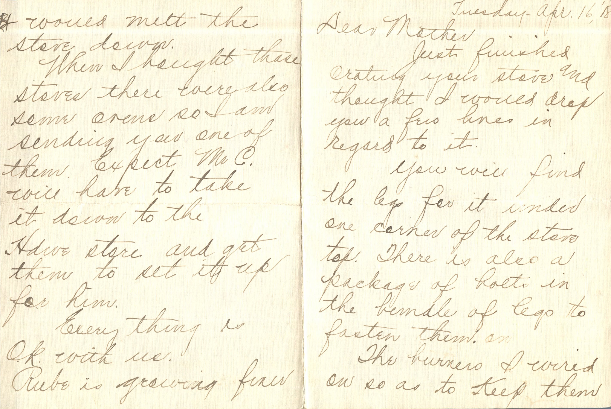
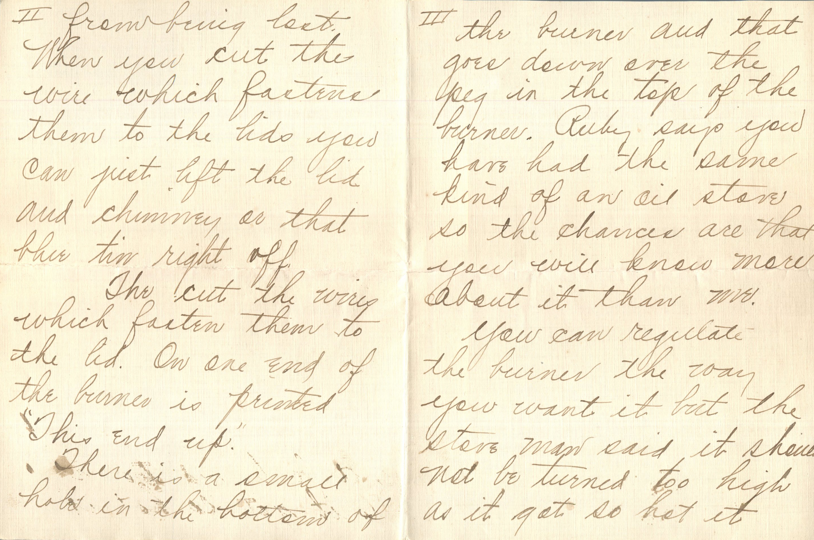
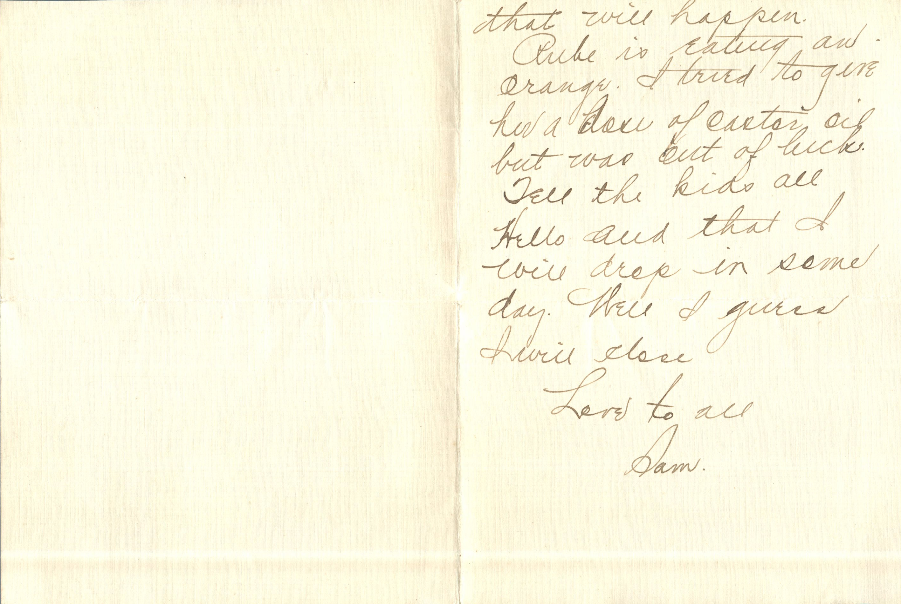
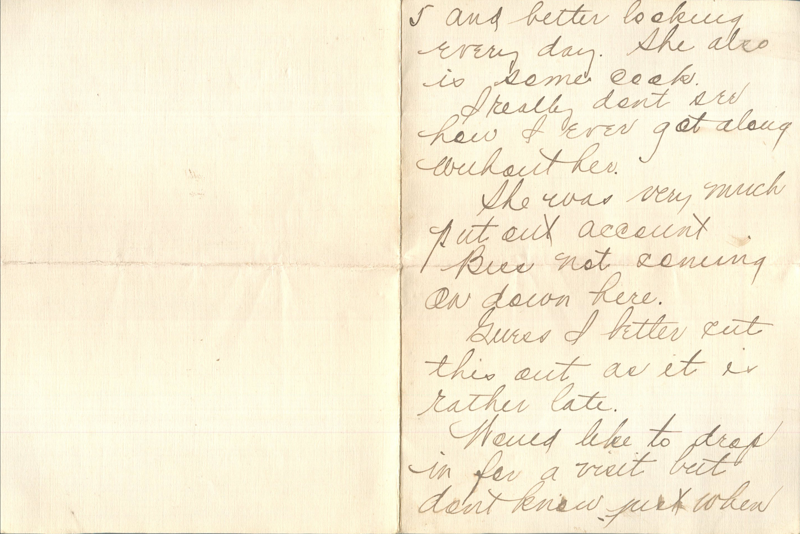
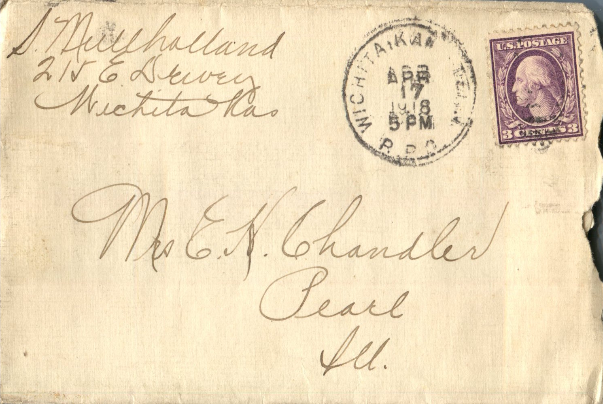

    

From: Sam Mullholland, To: Jeanette Knox Chandler  
Mailed From: Wichita, Kansas on April 17, 1918

Mrs. E.H. Chandler  
Pearl, Ill

S. Mullholland  
215 E. Dewey  
Wichita, Kas.

Tuesday- Apr. 16, ’18  
Dear Mother  
Just finished grating your stove and thought I would drop you a few lines in regards to it.  
You will find the lefts for it under one corner of the stove top. There is also a package of holts in the bungle of legs to fasten them.  
The burners I wired on so as to keep them from being lost. When you cut the wire which fasts them to the lids you can just lift the lid and chimney or that blue tin right off.  
They cut the wires which fasten them to the lid. On one end of the burner is printed “This end up.”  
There is a email hold in the bottom of the burner and that goes down over the peg in the top of the burner. Ruby says you have had the same kind of an oil stove so the chances are that you will know more about it than me.  
You can regulate the burner the way yu want it but the stove man said it should not be turned too high as it got so hot it would melt the stove door.  
When I brought those stoves there whereas some ovens so I am sending you on of them. Expect Mr. C. will have to take it down to the Hardware store and get them to set it up for him.  
Every thing is OK with us. Ruby is growing finer and better looking every day. She also is some cook.  
I really don’t see how I ever got along without her.  
She was very much put out account Bess not coming on down here.  
Guess I better cut this out as it is rather late.  
Would like to drop in for a visit but don’t know just when that will happen.  
Ruby is eating an orange. I tried to I’ve her a dose of Castor Oil but was out of luck. Tell the kids all hello and that I will drop in some day. Well i guess I will close.  
Love to all,  
Sam