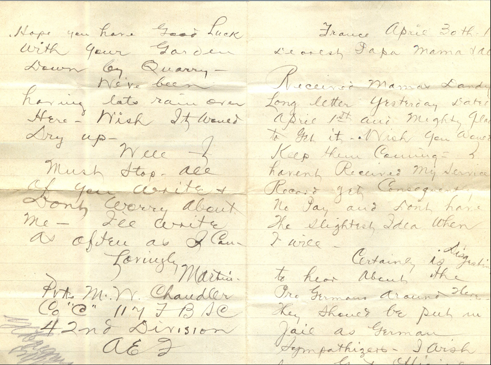
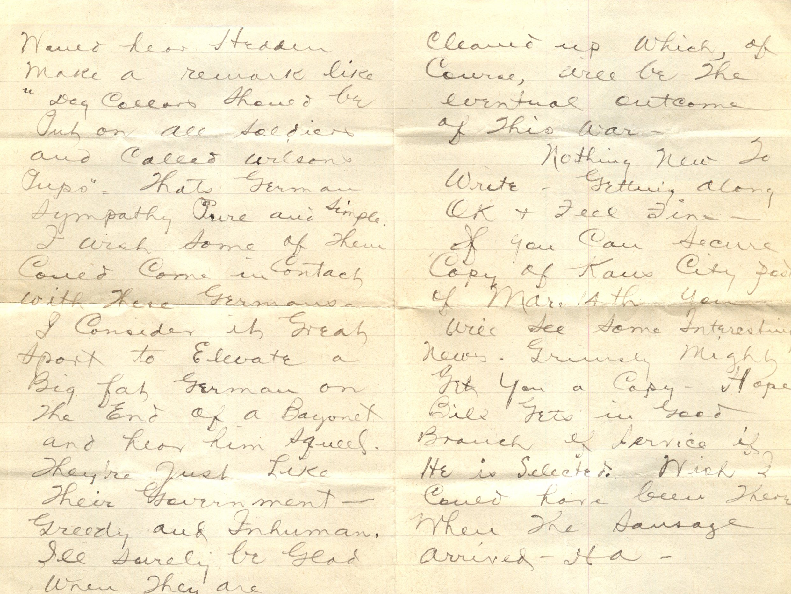

 

From: Martin Chandler, To: Elijah H. Chandler and Family  
Mailed From: France on April 30th, 1918

Pvt. M. W. Chandler  
Co “C” 117 F.B.S.C  
42nd Division=A.E.F.

Mr. E.H. Chandler  
Pearl, Illinois  
USA

France April 30th, 1918  
Dearest Papa, Mama, and all  
Received Mama’s dandy long letter yesterday dated April 1st and mighty glad to get it. Wish you would keep them coming. I haven’t received my serve record yet consequently no pay and don’t have the slightest idea when I will.  
Certainly is disgusting to hear about the Pro Germans around there. They should be put in jail as German sympathizers. I wish some Govt. official would hear Heddler make a remark like “Dog collars should be put on all soldiers and called Wilson’s pups.” That’s German sympathy pure and simple. I wish some of them could come in contact with these Germans. I consider it great sport to elevate a big fat german on the end of a Bayonet and hear him squeal. They’re just like their government – greedy and inhuman. I’ll surely be glad when they are cleaned up which, of course, will be the eventual outcome of this war.  
Nothing new to write. Getting along OK and feeling fine. If you can secure copy of Kansas City post of Mar. 14th you will see some interesting news. Grinsley might get you a copy. Hope Bill gets in good branch of service if he is selected. Wish I could have been there when the sausage arrived. Ha.  
Hope you have good luck with your garden down by Quarry.  
We’ve been having lots rain over here. Wish it would dry up. Well I must stop, all of you write and don’t worry about me. I’ll write as often as I can.  
Lovingly,  
Martin