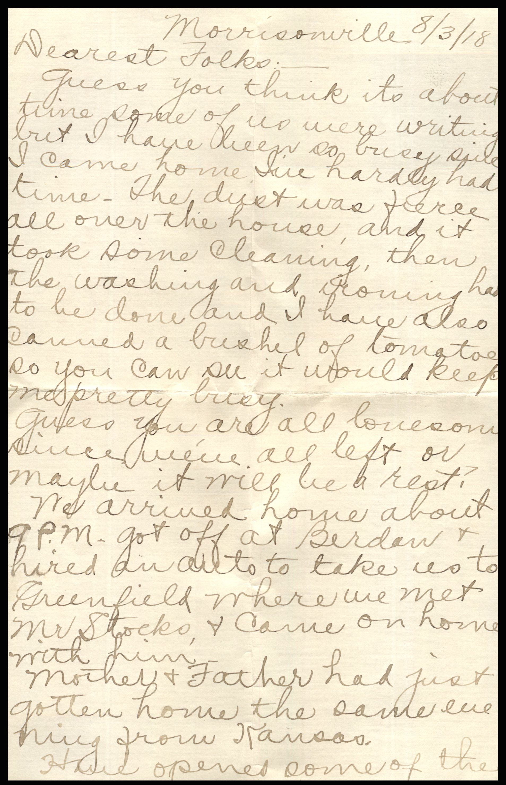
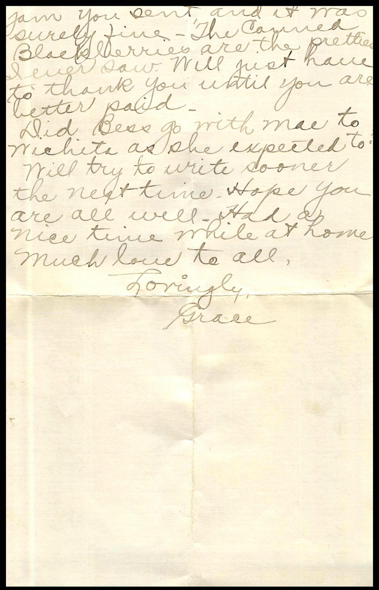

From: Grace Chandler, To: Jeanette Knox Chandler and Family  
Mailed From: Morrisonville, Illinois on August 3, 1918

Mrs. E.H. Chandler  
Pearl, Illinois

Morrisonville 8/3/18  
Dearest Folks,  
Guess you think its about time some of us were writing but I have been so busy since I came home. I’ve hardly had time. The dust was force all over the house and it took some cleaning, then the washing and ironing had to be done and I have also canned a bushel of tomatoes so you can see it would keep me pretty busy.  
Guess you are all lonesome since we’ve all left or maybe it will be a rest?  
We arrived home about 9p.m., got off at Berdan and hired an auto to take us to Greenfield where we met Mr. Stocks and came on home with him.  
Mother and Father had just gotten home the same evening from Kansas.  
Have opened some of the jam you sent and it was surely fine. The canned Blackberries are the prettiest I ever saw. Will just have to thank you until you are better paid.  
Did Bess go with Mae to Wichita as she expected to?  
Will try to write sooner the next time. Hope you are all well. Had a nice time while at home. Much love to all.  
Lovingly,  
Grace