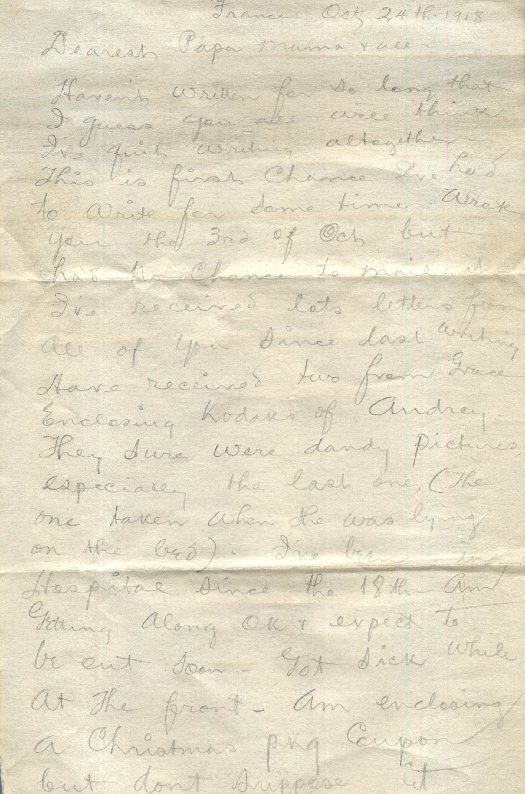
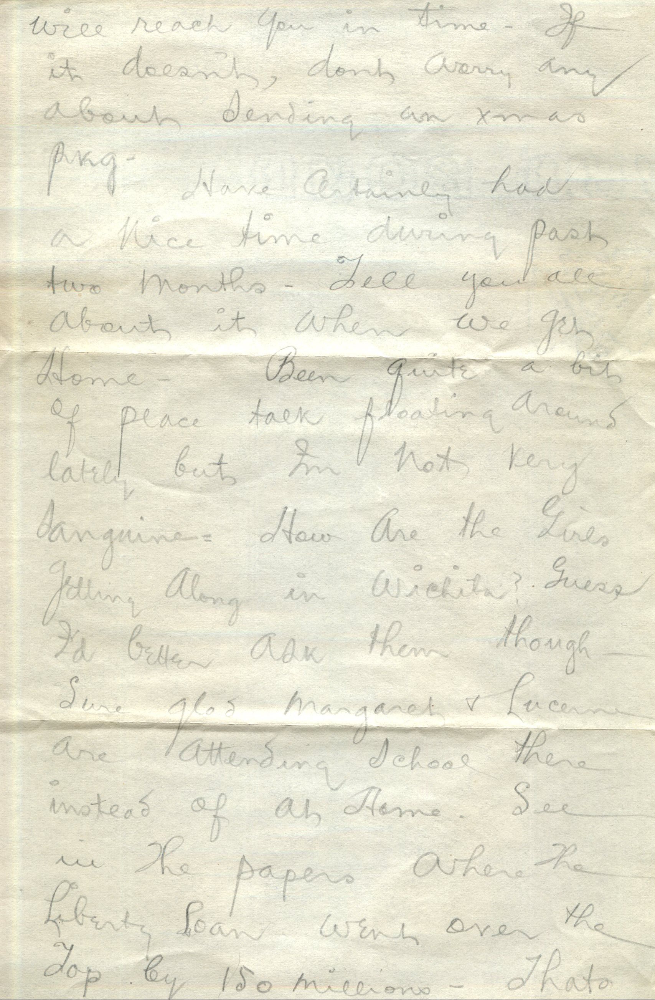
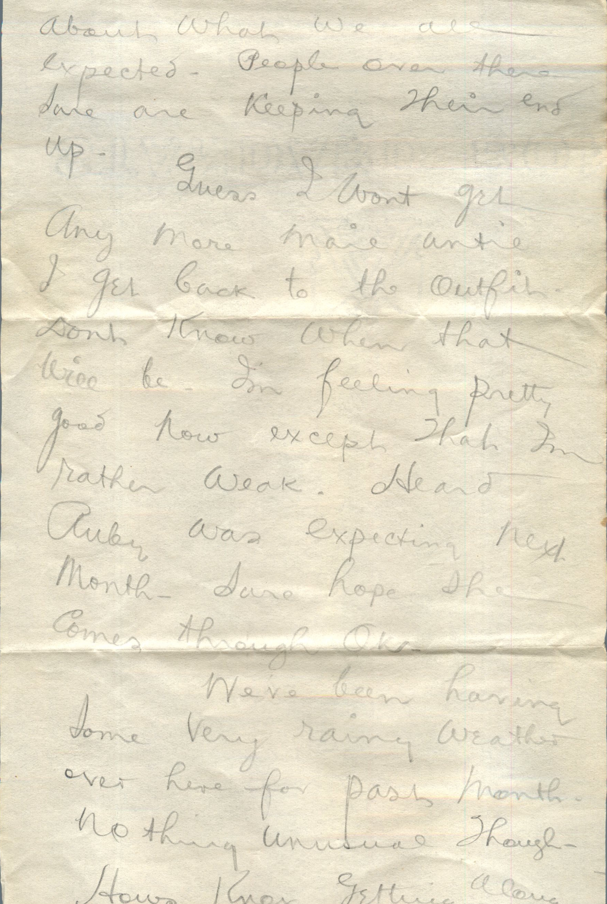
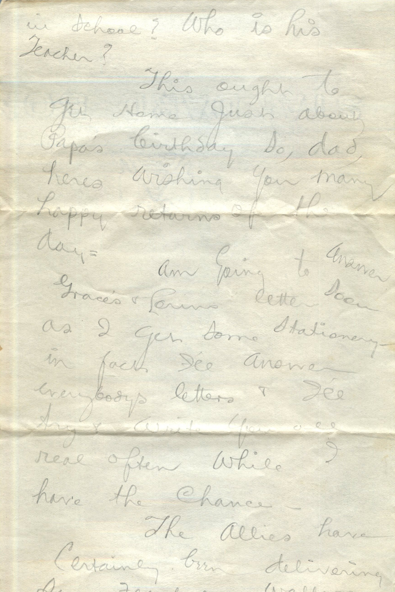
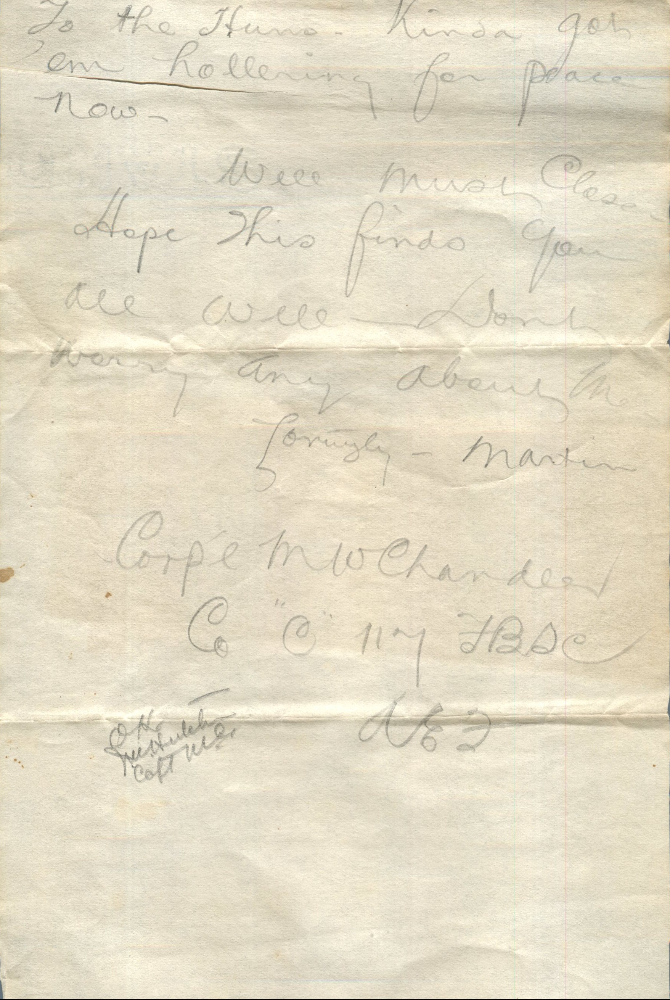

    

From: Martin Chandler, To: Elijah H. Chandler and Family  
Mailed From: France on October 24, 1918

France Oct. 24th – 1918  
Dearest Papa, Mama, and all  
Haven’t written for so long that I guess you all will think I’ve quit writing altogether. This is first chance I’ve had to write for some time. Wrote you the 3rd of Oct. but had no chance to mail it. I’ve received lots letters from all of you since last writing. Have received two from Grace enclosing Kodaks of Audrey. They sure were dandy pictures especially the last one (the one taken when she was lying on the bed) I’ve been in hospital since the 18th. Am getting along OK and expect to be out soon. Got sick while at the front. Am enclosing a christmas pkg. coupon but don’t suppose it will reach you in time. If it doesn’t, don’t worry any about sending an xmas pkg.  
have certainly had a nice time during past two months. Tell you all about it when we get home. Been quite a bit of peace talk floating around lately but I’m not very sanguine. How are the girls getting along in Wichita? Guess I’d better ask them though. Sure glad Margaret and Lucerne are attending school there instead of at home. See in the paper where the Liberty Loan went over the top by 150 million. That’s about what we all expected. People over there sure are keeping their end up.  
Guess I wont get any more mail until I get back to the outfit. Don’t know when that will be. I’m feeling pretty good now except that I’m rather weak. Heard Ruby was expecting next month. Sure hope she comes through ok.  
We’ve een having some very rainy weather over here for past month. Nothing unusual though. How’s Knox getting along with school? Who is his teacher?  
This ought to get home just about Papa’s birthday so dad, here’s wishing you many happy returns of the day.  
Am going to Answer Grace and Lorin’s letter soon as I get some stationary. In fact I’ll answer everybody’s letters and I’ll try and write you all real often while I have the chance.  
The Allies have certainly been delivering some fearful wallops to the Huns. Kinda got ’em hollering for peace now.  
Well must close. Hope this finds you all well. Don’t worry any about me.  
Lovingly,  
Martin