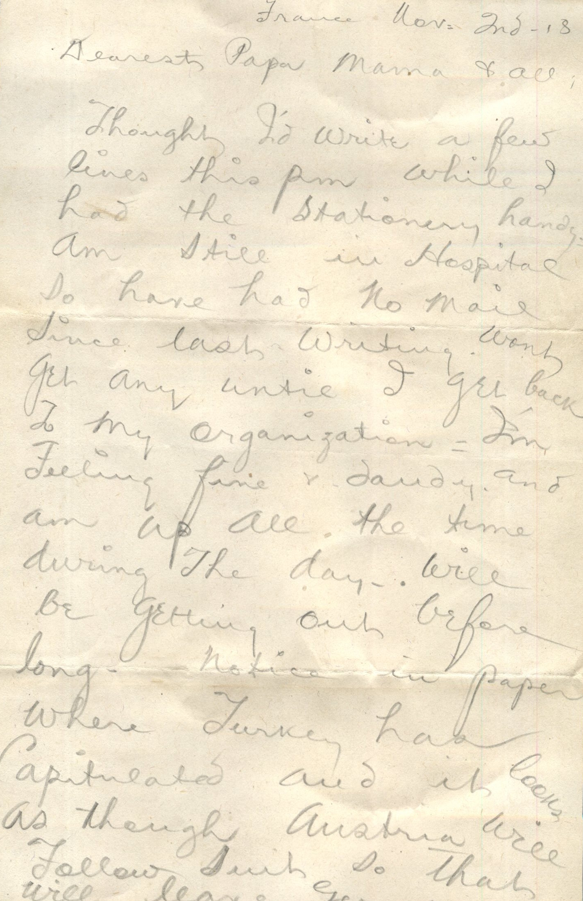
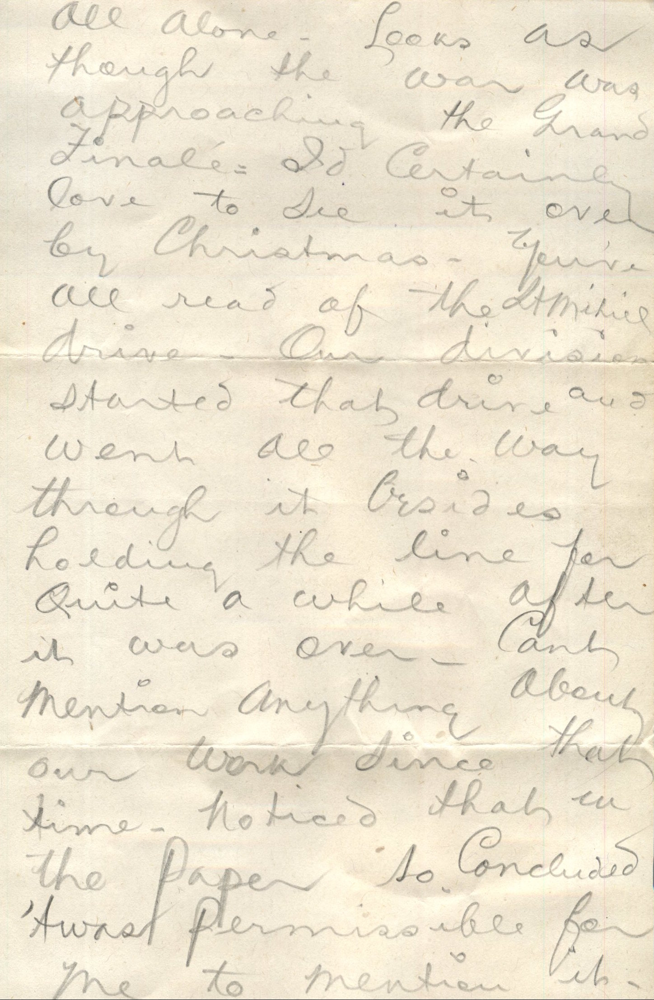
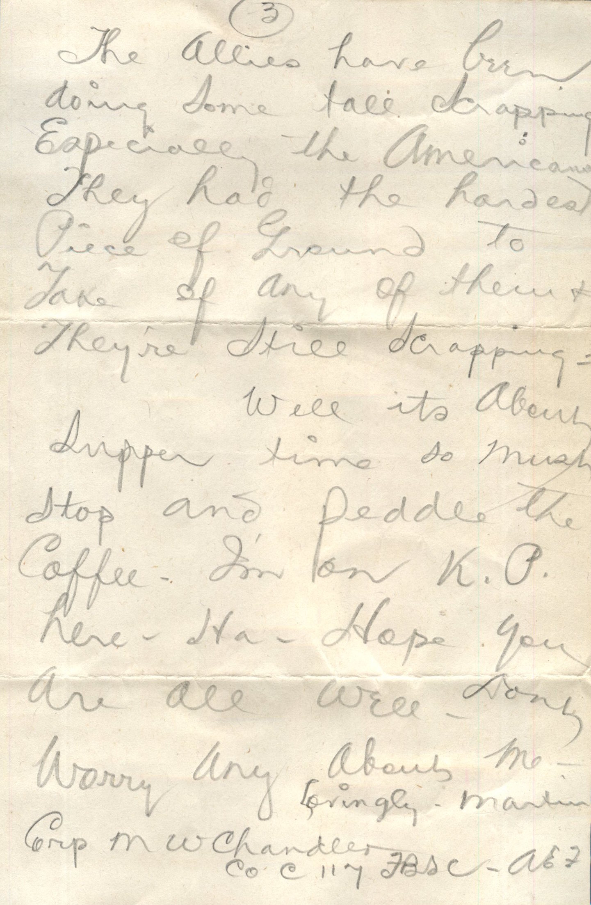

  

From: Martin Chandler, To: Elijah H. Chandler and Family  
Mailed From: France on November 2, 1918

France Nov. 2nd ’18  
Dearest Papa, Mama, and all,  
Thought I’d write a few lines this pm while I had the stationary handy. Am still in hospital so have had no mail since last writing. Wont get any until I get back to my organization. I’m feeling fine and dandy and am up all the time during the day. Will be getting out before long. Notice in paper where Turkey has capitulated and it looks as though Austria will follow suit so that will leave Germany all alone. Looks as though the war was approaching the grand finale. I’d certainly love to see it over by Christmas. You’ve all read of the Lt. Mitice drive. Our division started that drive and went all the way through it besides holding the line for quite a while after it was over. Can’t mention anything about our work since that time. Noticed that in the paper so concluded ’twas permissible for me to mention it. The allies have been doing some tall scrapping, especially the Americans. They had the hardest piece of ground to take of any of them and they’re still scrapping.  
Well its about supper time so must stop and peddle the coffee. I’m on K.P. here. ha. Hope you are all we’ll. Don’t worry any about me.  
Lovingly,  
Martin  
Crp M. W. Chandler  
Co “C” 117 FBSC – AEF