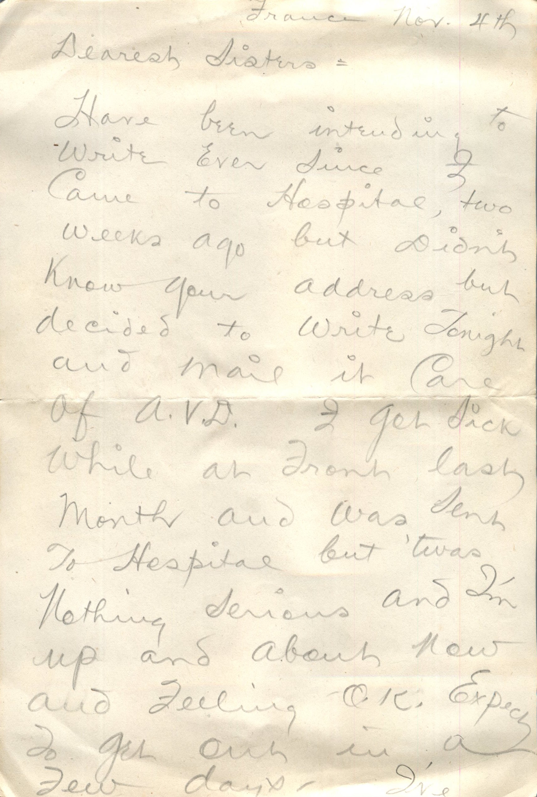
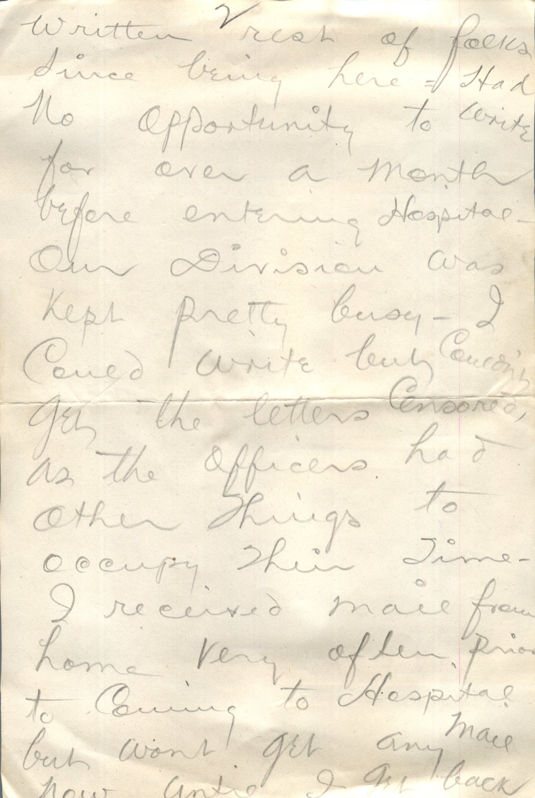
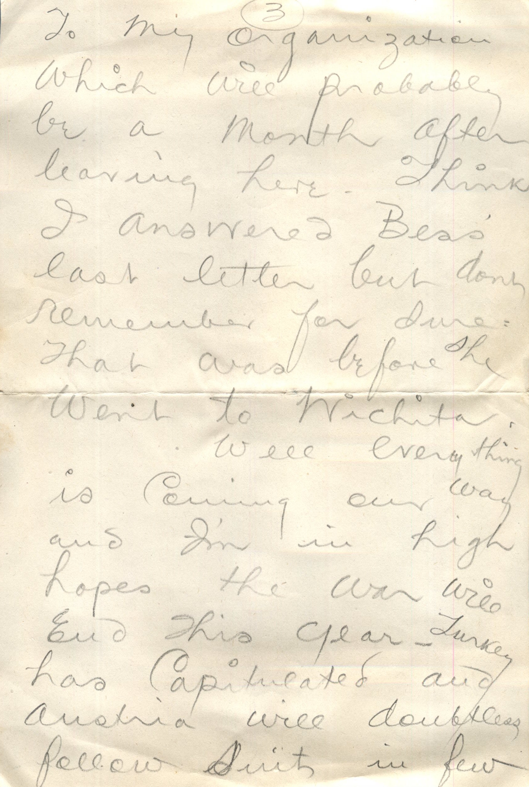
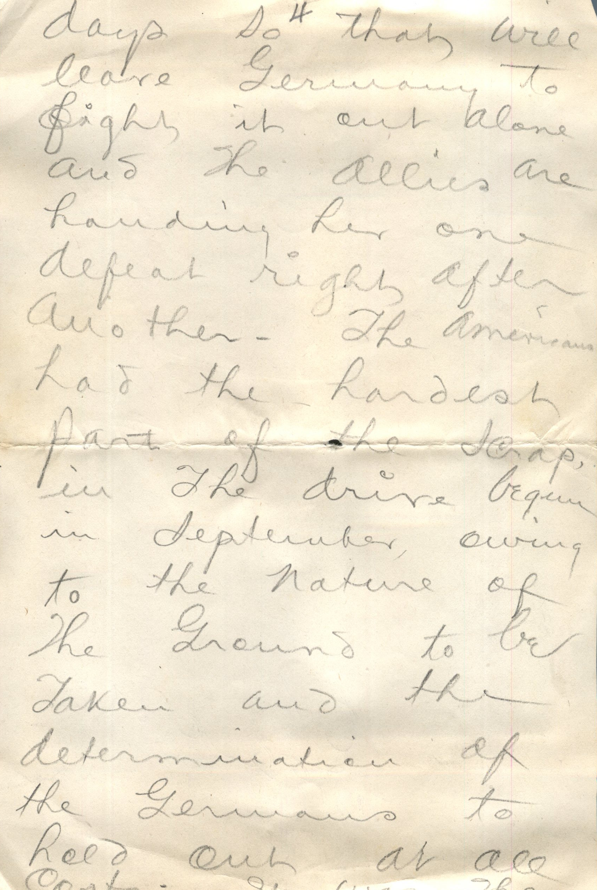
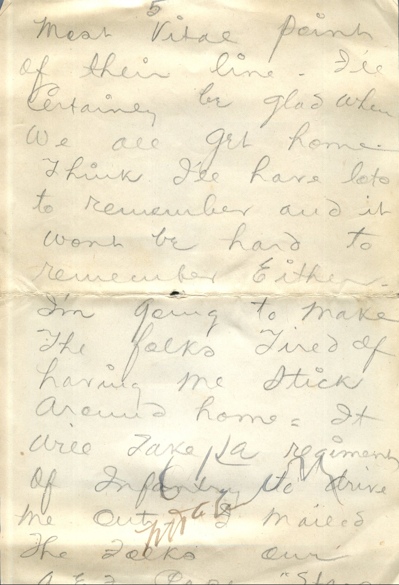
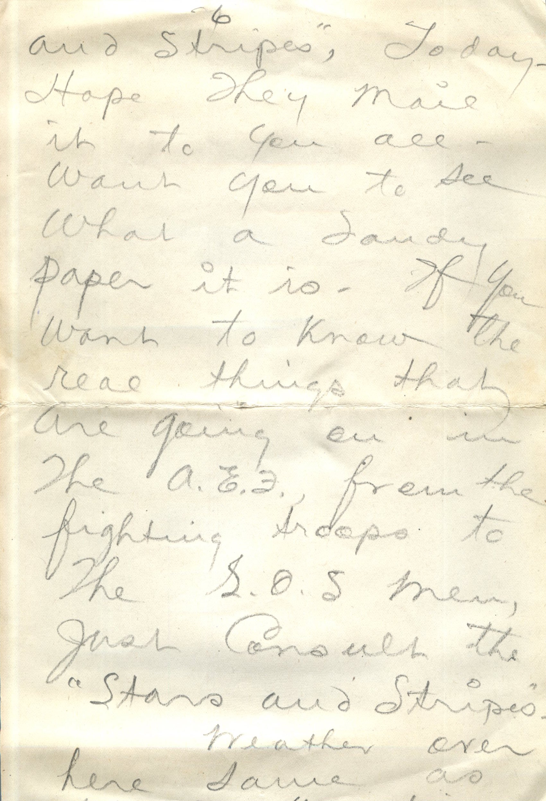
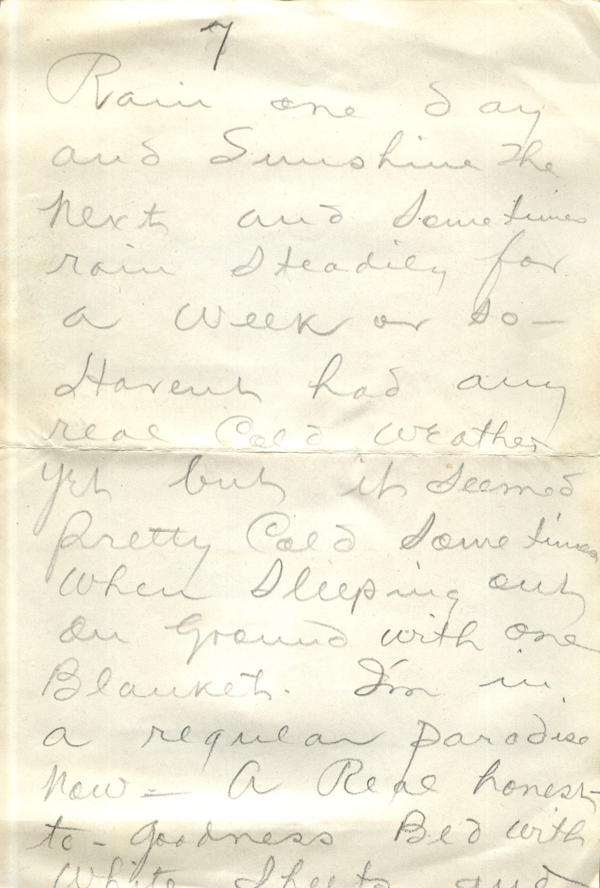
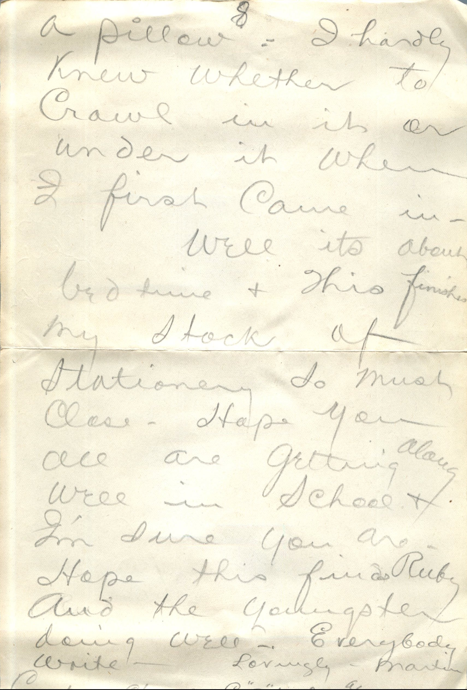
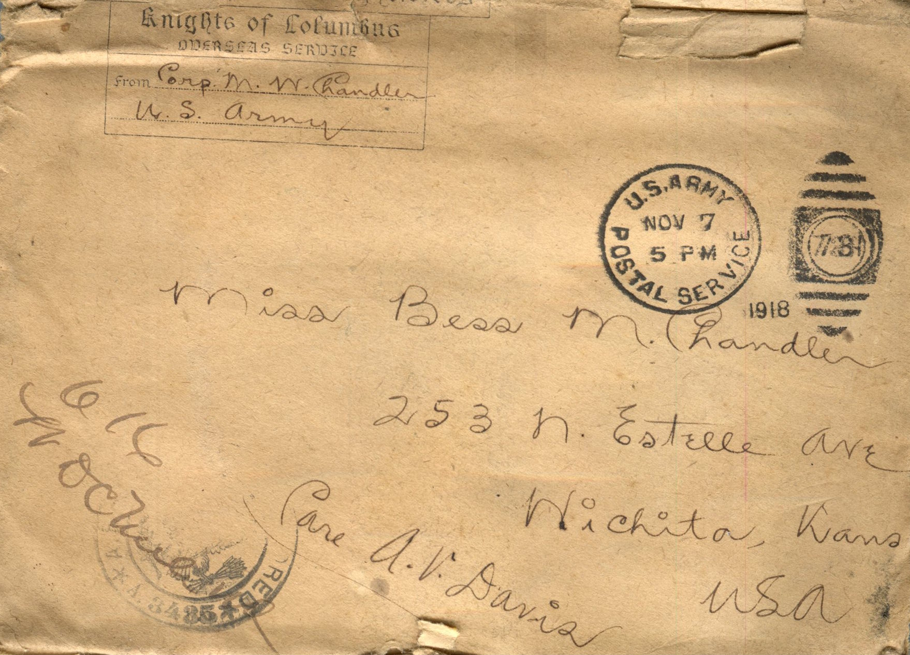

        

From: Martin Chandler, To: Bess Chandler  
Mailed From: France on November 4, 1918

France Nov. 4th  
Dearest Sisters,  
Have been intending to write ever since I came to hospital, two weeks ago but didn’t know your address but decided to write tonight and mail it care of A.V.D. I got sick while at front last month and was sent to hospital but ’twas nothing serious and I’m up and about now and feeling ok. Expect to get out in a few days. I’ve written rest of folks since being here. Had no opportunity to write for over a month before entering the hospital. Our division was kept pretty busy – I could write but couldn’t get the letters censored, as the officers had other things to occupy their time. I received mail from home very often, prior to coming to hospital but wont get any mail now until I get back to my organization which will probably be a month after leaving here. Think I answered Bess’ last letter but don’t remember for sure. That was before she went to Wichita.  
Well everything is coming out way and I’m in high hopes the war will end this year. Turkey has capitulated and Austria will doubtless follow suit in few days so that will leave Germany to fight it out alone and the Allie’s are handing her one defeat right after another. The Americans had the hardest part of the scrap, in the drive begun in departure, owing to the nature of the ground to be taken and the determination of the Germans to hold out at all costs. It was the most vital point of their line. I’ll certainly be glad when we all get home. Think I’ll have lots to remember and it wont be hard to remember either. I’m going to make the folks tired of having me stick around home. It will take a regiment of infantry to drive me out. I mailed the folks our A.E.F. paper, “Stars and Stripes,” today. Hope they mail it to you all. Want you to see what a dandy paper it is. If you want to know the real things that are going on in the A.E.F. from the fighting troops to the S.O.S. men, just consult the “Stars and Stripes.”  
Weather over here same as usual-uncertain. Rain one day and sunshine the next and sometimes rain steady for a week or so. Haven’t had any real cold weather yet but it seemed pretty cold sometimes when sleeping out on ground with one blanket. I’m in a regular paradise now. A real honest to goodness bed with white sheets and a pillow. I hardly knew whether to crawl in it or under it when I first came in.  
Well it’s about bedtime and this finishes my stock of stationary so must close. Hope you all are getting along well in school and I’m sure you are. Hope this finds Ruby and the youngster doing well. Everybody write.  
Lovingly,  
Martin