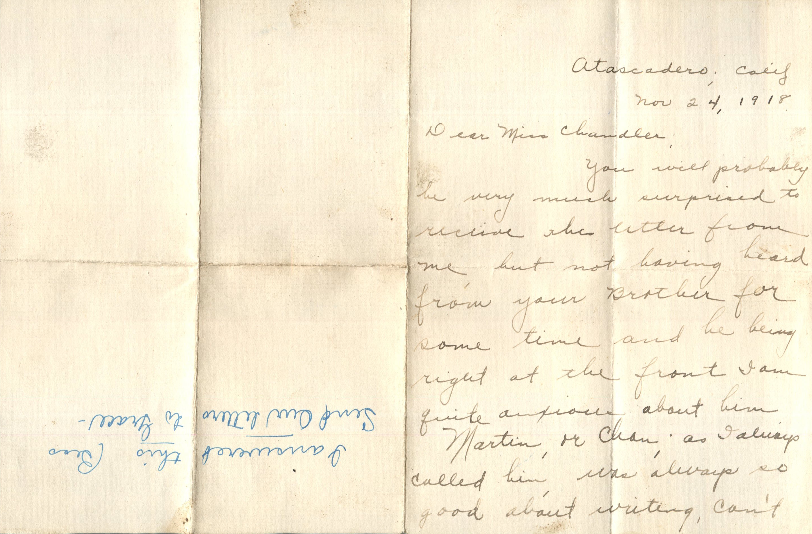
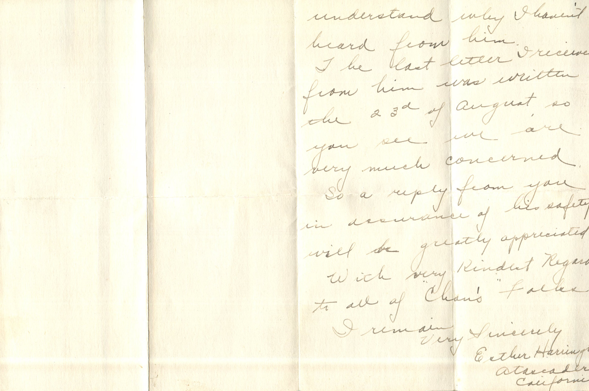

 

From: Esther Harrington, To: Jeanette Knox Chandler  
Mailed From: Atascadero, California on November 24, 1918

Atascadero, Calif  
Nov 24, 1918

Dear Miss Chandler,  
You will probably be very much surprised to receive this letter from me, but not having heard from your Brother for some time and he being right at the front I am quite anxious about him.  
Martin, or Chan as I always called him, was always so good about writing, can’t understand why I haven’t heard from him.  
The last letter I received from him was written the 23rd of August, so you see we are very much concerned.  
So a reply from you in assurance of his safety will be greatly appreciated.  
With very kindest regards to all of “Chan’s” folks.  
I remain very sincerely,  
Esther Harrington  
Atascadero, California