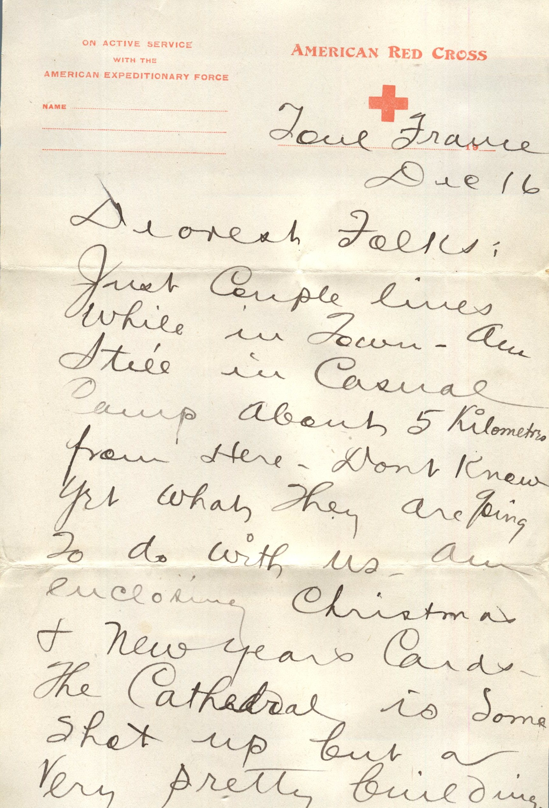
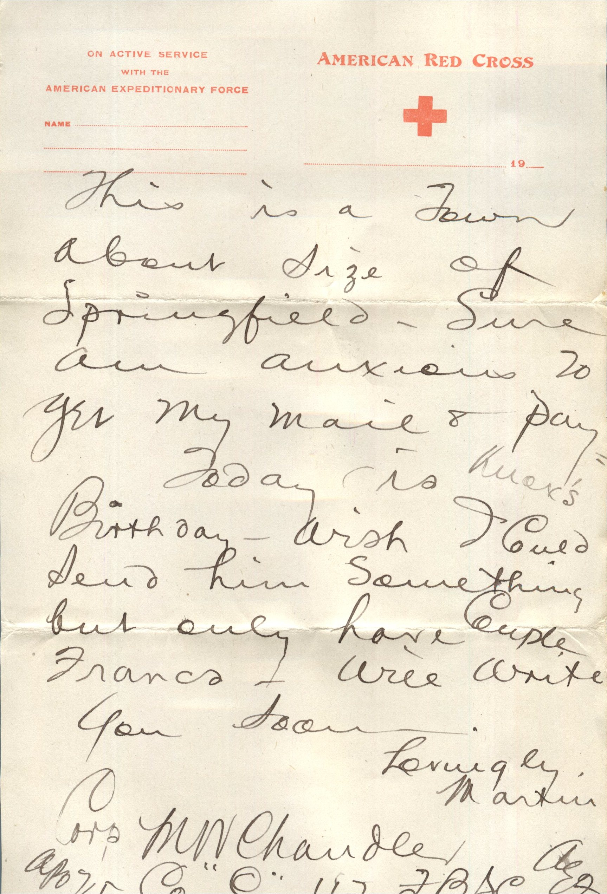
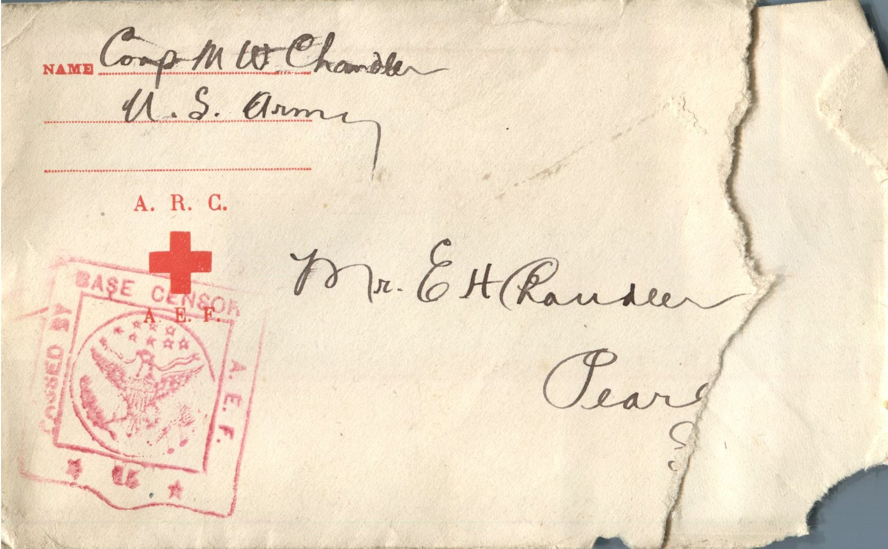

  

From: Martin Chandler, To: Elijah H. Chandler  
Mailed From: France, on December 16, 1918

Corp. M.W. Chandler  
US Army

Mr. E.H. Chandler  
Pearl, Ill.

France  
Dec. 16  
Dearest Folks,  
Just couple of lines while in Town. Am still in Casual Camp about 5 kilometers from here. Don’t know yet what they are planning to do with us. Am enclosing Christmas and New Years cards. The Cathedral is some shot up but a very pretty building. This is a town about size of Springfield. Sure am anxious to get my mail and pay.  
Today is Knox’s birthday – wish I could send him something but only have couple francs. Will write you soon.  
Lovingly,  
Martin  
Corp M.W. Chandler  
Apo 715 Co “C” 117 FBSC AEF