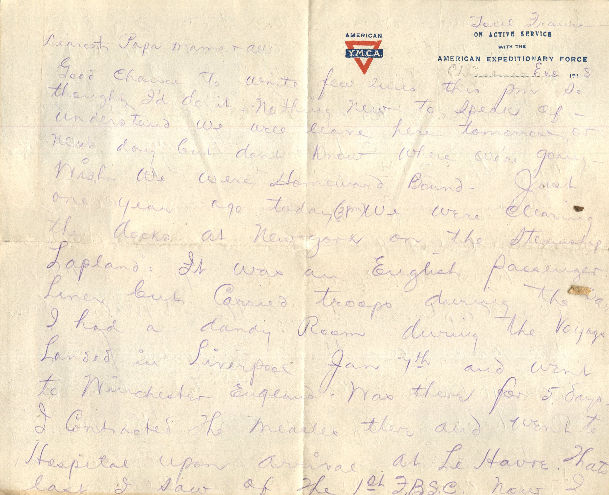
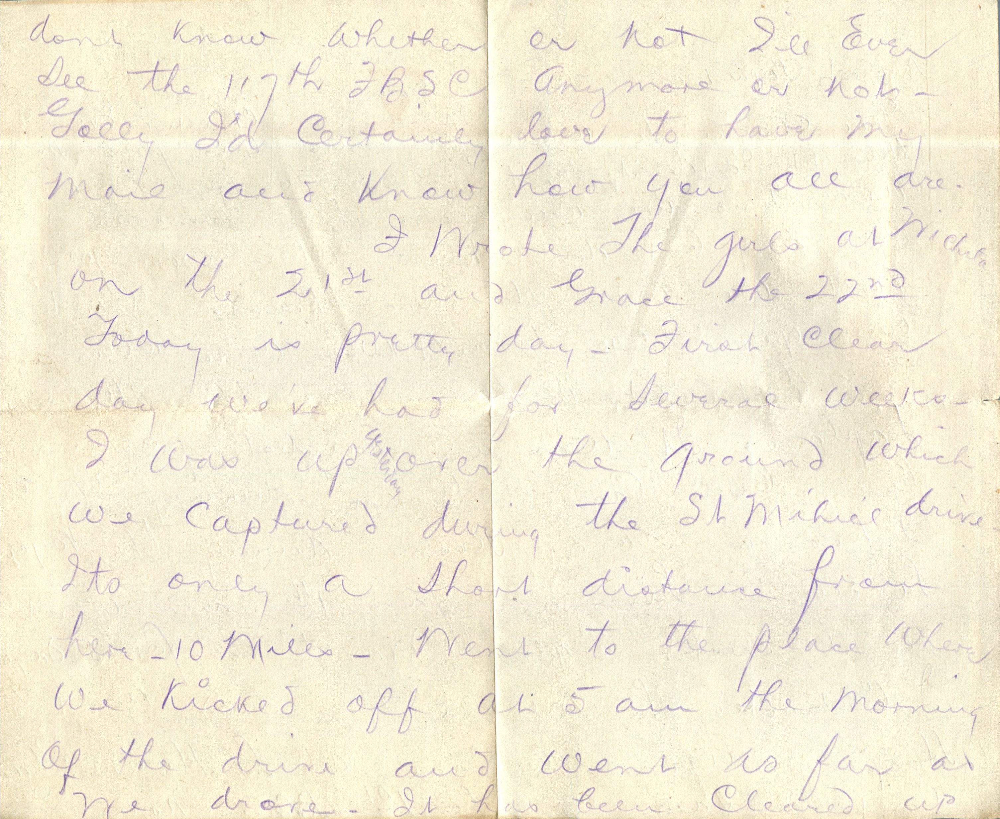
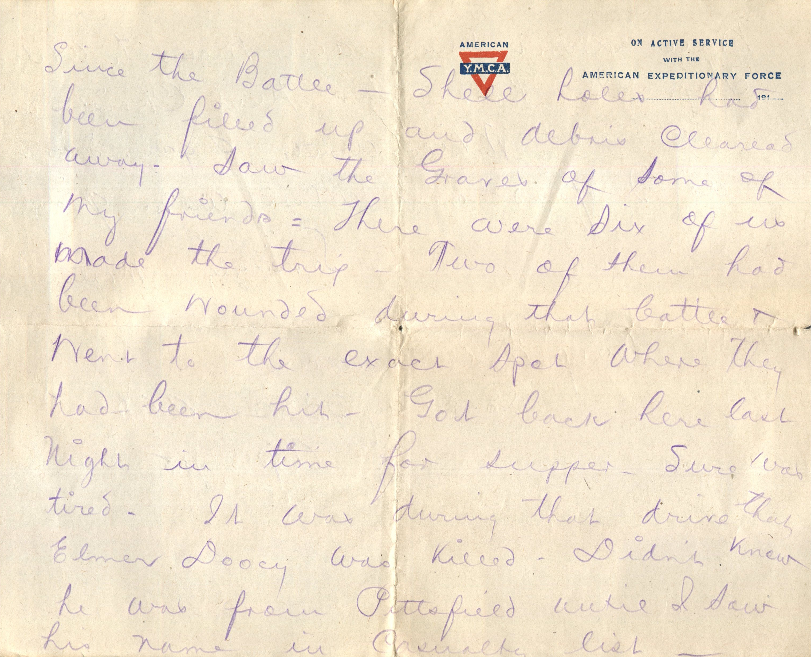
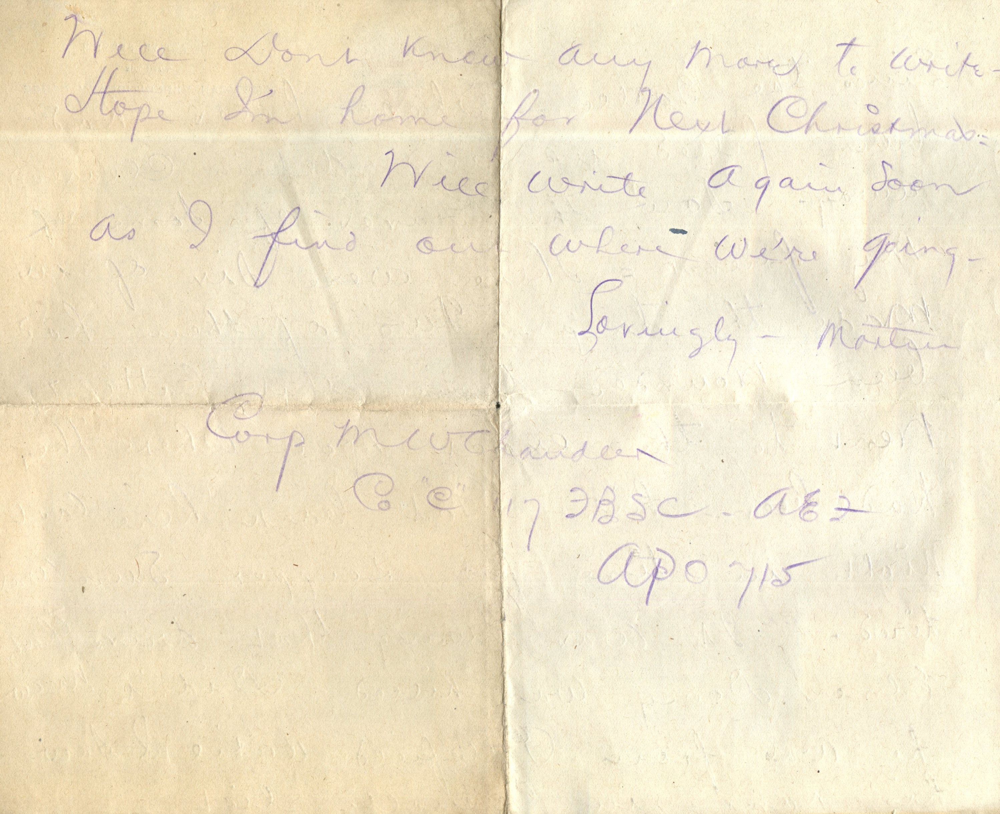
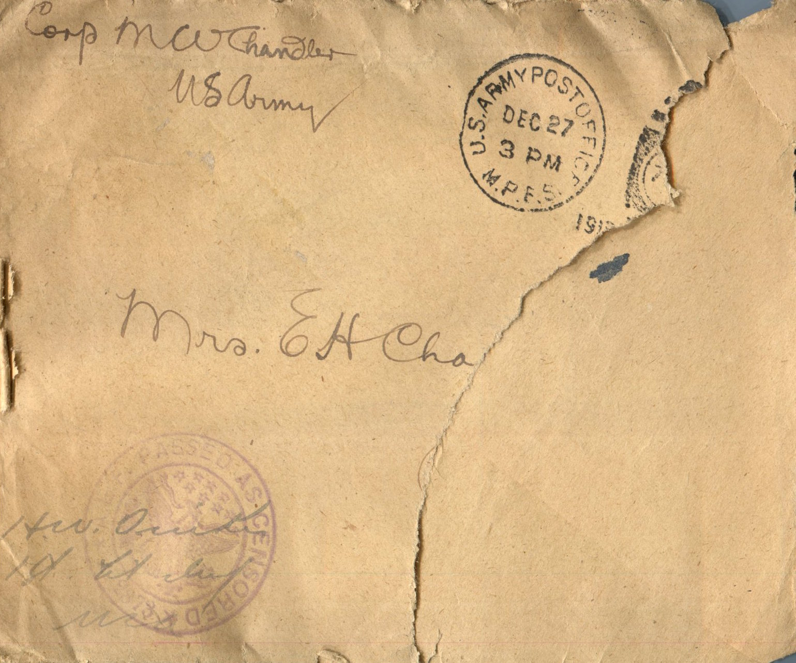

    

From: Martin Chandler, To: Jeanette Knox Chandler and Family  
Mailed From: France on December 24, 1918

Mrs. E.H. Chandler

Corp M.W. Chandler  
US Army

Christmas Eve, 1918  
Dearest Papa, Mama, and all  
Good chance to write few lines this pm so thought I’d do it. Nothing new to speak of. Understand we will leave here tomorrow or next day but don’t know where we’re going. Wish we were homeward bound. Just one year ago today (3 pm) we were clearing the docks at New York on the Steamship, Lapland. It was an English passenger liner but carried troops during the war. I had a dandy room during the voyage. Landed in Liverpool Jan 7th and went to Winchester, England. Was there for 5 days. I contracted the measles there and went to the hospital upon arrival at Le Havre. That’s last I saw of the 1st F.B.S.C. Now I don’t know whether or not I’ll ever see the 117th F.B.S.C. anymore or not. Golly I’d certainly love to have my mail and know how you all are.  
I wrote the girls at Wichita on the 21st and Grace the 22nd. Today is pretty day. First clear day we’ve had for several weeks. I was up yesterday over the ground which we captured during the St. Michael drive. It’s only a short distance from here. 10 miles. Went to the place where we kicked off at 5 am the morning we drove. It has been cleared up since the battle. Shell holes had been filled up and debris cleared away. Saw the graves of some of my friends. There were six of us made the trip. Two of them had been wounded during that battle and went to the exact spot where they had been hit. Got back here last night in time for supper. Sure was tired. It was during that drive that Elmer Dooey was killed. Didn’t knew he was from Pittsfield until I saw his name in Casualty list.  
Well don’t know any more to write. Hope I’m home for next Christmas.  
Will write again soon as I find out where we’re going.  
Lovingly,  
Martin