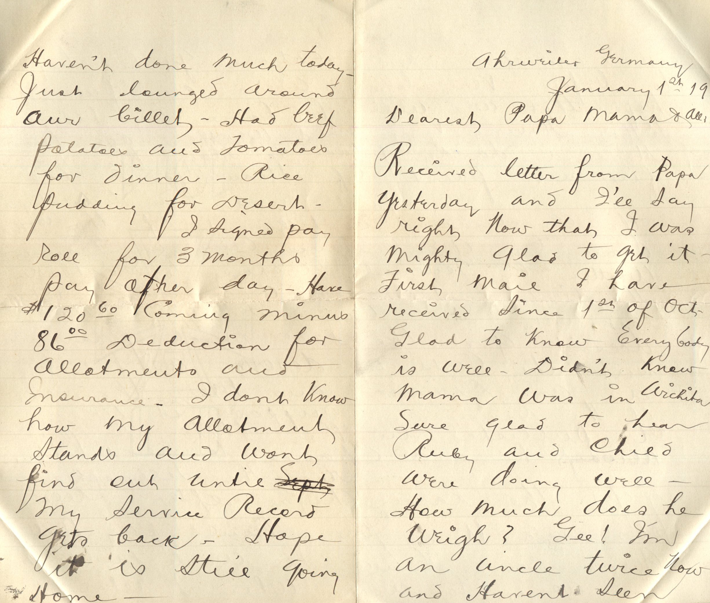
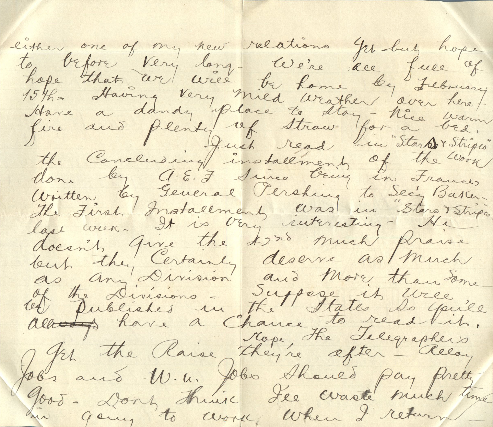
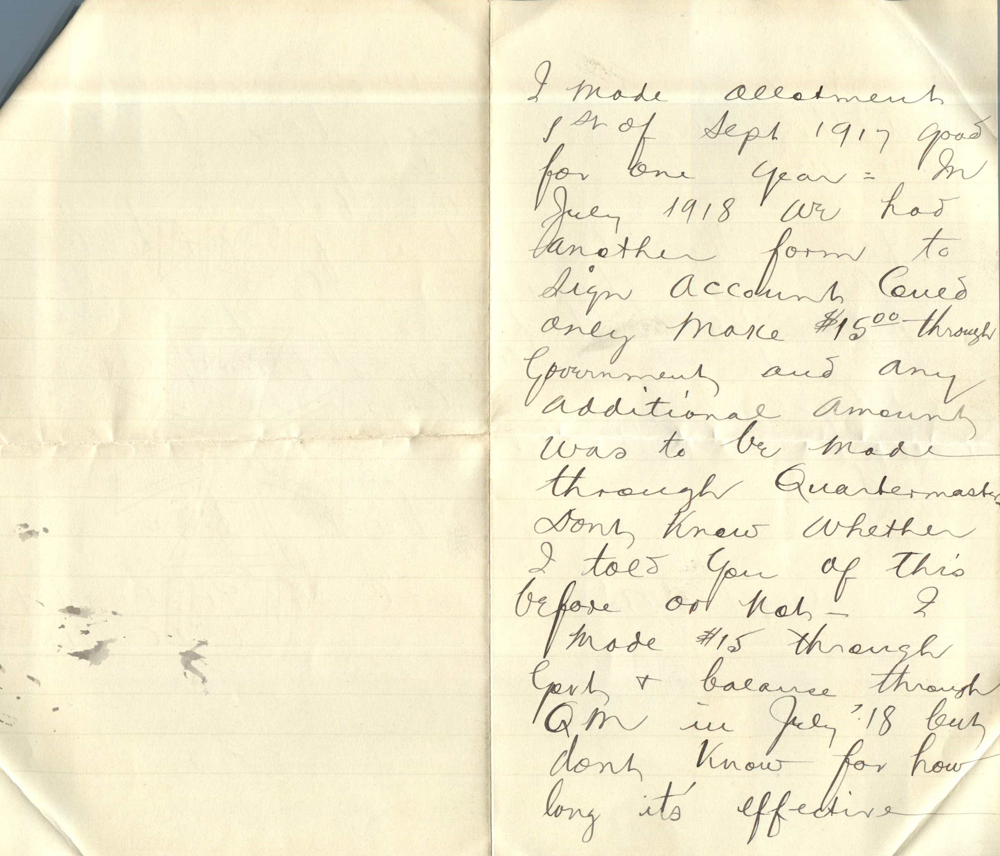
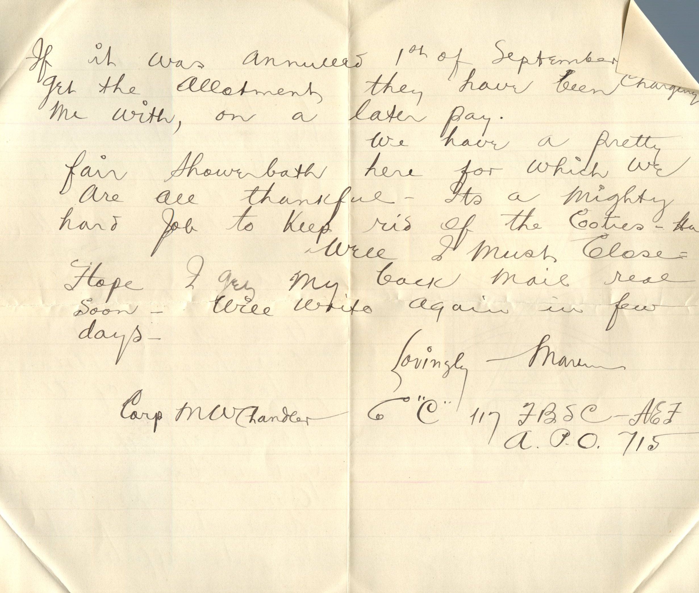

   

From: Martin Chandler, To: Elijah H. Chandler and Family  
Mailed From: Ahrweiler, Germany on January 1, 1919

Mr. E.H. Chandler  
Pearl, Illinois  
USA

Ahrweiler, Germany  
January 1st, ’19  
Dearest Papa, Mama, and all,  
Received letter from Papa yesterday and I’ll say right now that I was mighty glad to get it. First mail I have received since 1st of Oct. Great to know everybody is well. Didn’t know Mama was in Wichita. Sure glad to hear Ruby and child were doing well. How much does he weigh? Gee! I’m an Uncle twice now and haven’t seen either one of my new relations yet but hope to before very long. We’re all full of hope that we will be home by February 11th. Having very mild weather over here. Have a dandy place to stay. Nice warm fire and plenty of straw for a bed.  
Just read in “Stars and Stripes” the concluding installment of the work done by A.E.F. since being in France. Written by General Pershing to Sec’y Baker. The first installment was in “Stars and Stripes” last week. It is very interesting. He doesn’t give the 42nd much praise but they certainly deserve as much as any Division and more than some of the Divisions. Suppose it will be published in the Hate’s so you’ll have a chance to read it.  
Hope the telegraphers get the raise they’re after. Relay jobs and W.U. jobs should pay pretty good. Don’t think I’ll waste much time in going to work when I return. Haven’t done much today. Just lounged around our billet. Had beef potatoes and tomatoes for dinner. Rice pudding for dessert.  
I signed pay roll for 3 months pay other day. Have $120.60 coming minus 86.00 for allotments and insurance. I dont know how my allotment stands and wont find out until my service record gets back. Hope it is still going home. I made allotment 1st of Sept. 1917 good for one year. In July 1918 we had another form to sign account could only make $15.00 through government and any additional amount was to be made through Quartermaster. Don’t know whether I told you of this before or not. I made $15 through QM in July 18 but don’t know for how long its effective. If it was annulled 1st of September I’ll get the allotment they have been charging me with, on a later pay.  
We have a pretty fair shower bath here for which we are all thankful. It’s a mighty hard job to keep rid of the cooties-Ha.  
Well I must close. Hope I get my back mail real soon. Will write again in few days.  
Lovingly,  
Martin  
Corp M.W.Chandler  
Co “C” 117 F.B.S.C. AEF  
A.P.O. 715