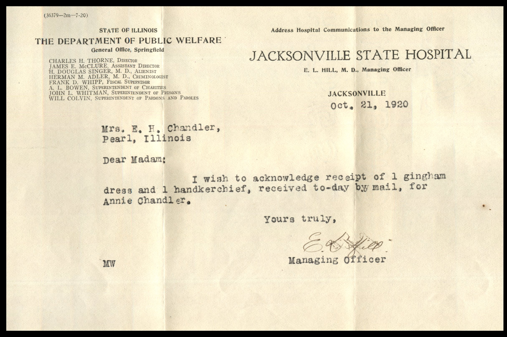
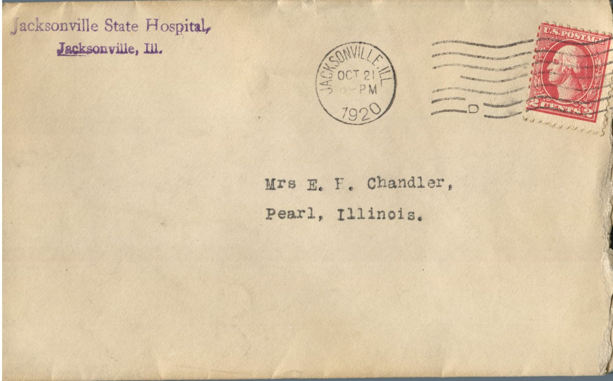

From: Jacksonville State Hospital, To: Jeanette Knox Chandler  
Mailed From: Jacksonville, Illinois on October 21, 1920

Mailing Address:  
Mrs. E.H. Chandler  
Pearl, Illinois

Return Address:  
Jacksonville State Hospital  
Jacksonville, Ill.

Jacksonville  
Oct. 21, 1920  
Mrs. E. H. Chandler  
Pearl, Illinois  
Dear Madam,  
I wish to acknowledge receipt of 1 gingham dress and 1 handkerchief, received today by mail, for Annie Chandler.  
Yours truly,  
E. L. Hill, M.D.  
Managing Officer