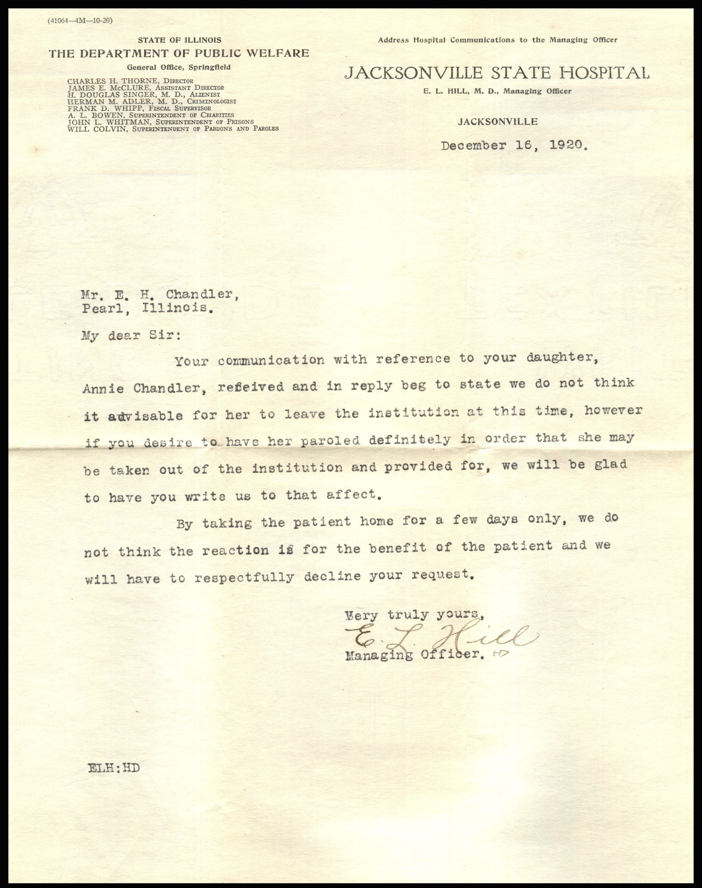
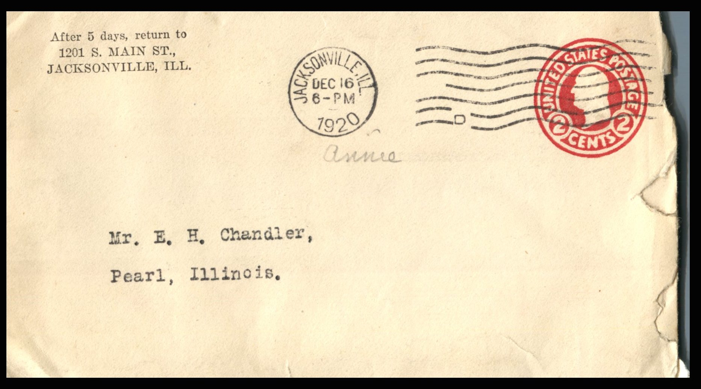

From: Jacksonville State Hospital, To: Elijah H. Chandler  
Mailed From: Jacksonville, Ill. on December 16, 1920

Mailing Address:  
Mr. E.H. Chandler  
Pearl, Illinois

Return Address:  
After 5 days, return to  
1201 S. Main St.  
Jacksonville, Ill.

Mr. E.H. Chandler,  
Pearl, Illinois.  
My Dear Sir:  
Your communication with reference to your daughter, Annie Chandler, received and in reply beg to state we do not think it advisable for her to leave the institution at this time, however if you desire to have her paroled defiantly in order that she may be taken out of the institution and provided for, we will be glad to have you write us to that affect.  
By taking the patient home for a few days only, we do not think the reaction is for the benefit of the patient and we will have to respectfully decline your request.  
Very truly yours,  
E. L. Hill  
Managing Officer