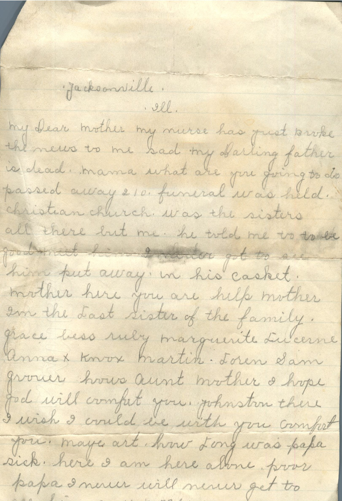
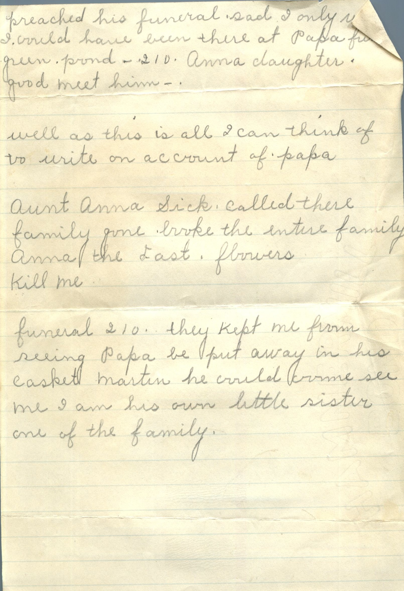

 From: Anna Chandler, To: Jeanette Knox Chandler  
Mailed From: Jacksonville State Hospital, Ill.

Jacksonville, Ill.  
My Dear Mother my nurse has just broke the news to me that my darling father is dead. Mama what are you going to do passed away 210. funeral was held. Christian church. was the sisters all there but me. he told me to be good meet him I never got to see him put away in his casket. mother here you are help mother I’m the last sister of the family. grace bess ruby marquerite lucerne anna knox martin. loren sam grover hows aunt mother I hope god will comfort you. johnston there i wish i could e with you comfort you. maybe art. how long was papa sick. here i am here alone. poor papa i never will never get to see him any more. preached his funeral sad i only wish i could have been here at Papa funeral. green pond – 210. Anna daughter good meet him.

well as this is all I can think of to write on account of papa.

Aunt Anna sick. called there family gone. broke the entire family. Anna the last. flowers kill me.

funeral 210. they kept me from seeing papa be put away in his casket martin he could come see me I am his won little sister one of the family.