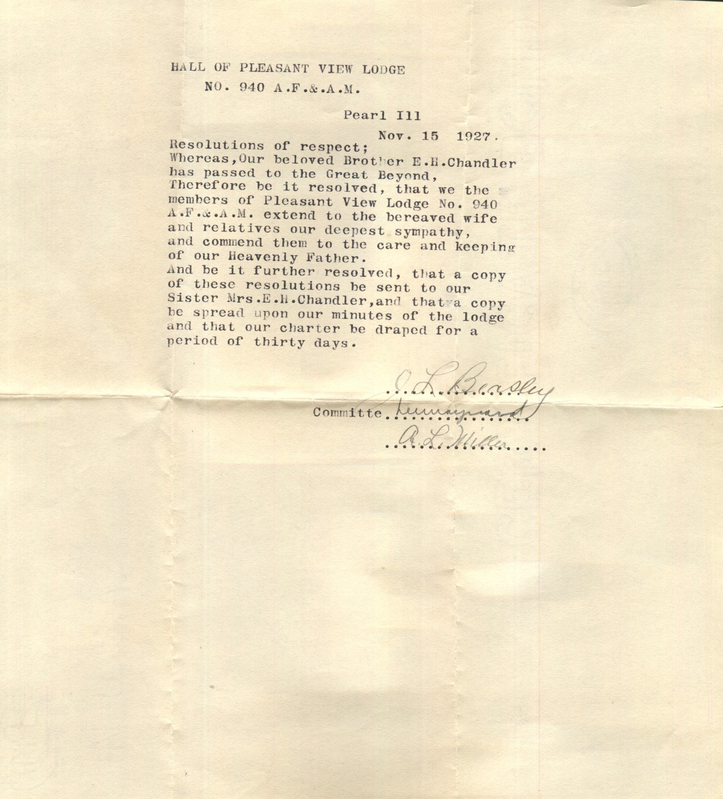
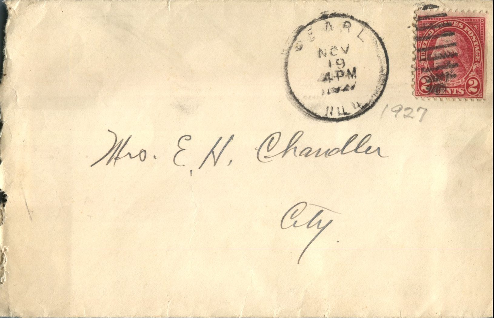

From: Hall of Pleasant View Lodge, To: Jeanette Knox Chandler and Family  
Mailed From: Pearl, Illinois on November 19, 1927

Mrs. E.H. Chandler  
City.

Hall of Pleasant View Lodge  
No. 940 A.F.&amp;.A.M.  
Pearl Ill  
Nov. 15 1927  
Resolution of respect;  
Whereas, Our beloved Brother E.H. Chandler has passed to the Great Beyond,  
Therefore be it resolved, that we the members of Pleasant View Lodge No. 940 A.F.&amp;.A.M. extended to the bereaved wife and relatives our deepest sympathy,  
and commend them to the care and keeping of our Heavenly Father.  
And be it further resolved, that a copy of these resolutions she sent to our Sister Mrs.E.H.Chandler, and that a copy be spread upon our minutes of the lodge and that our charter be draped for a period of thirty days.  
J.l Beasley  
Committee: Lennengard  
A.L. Miller