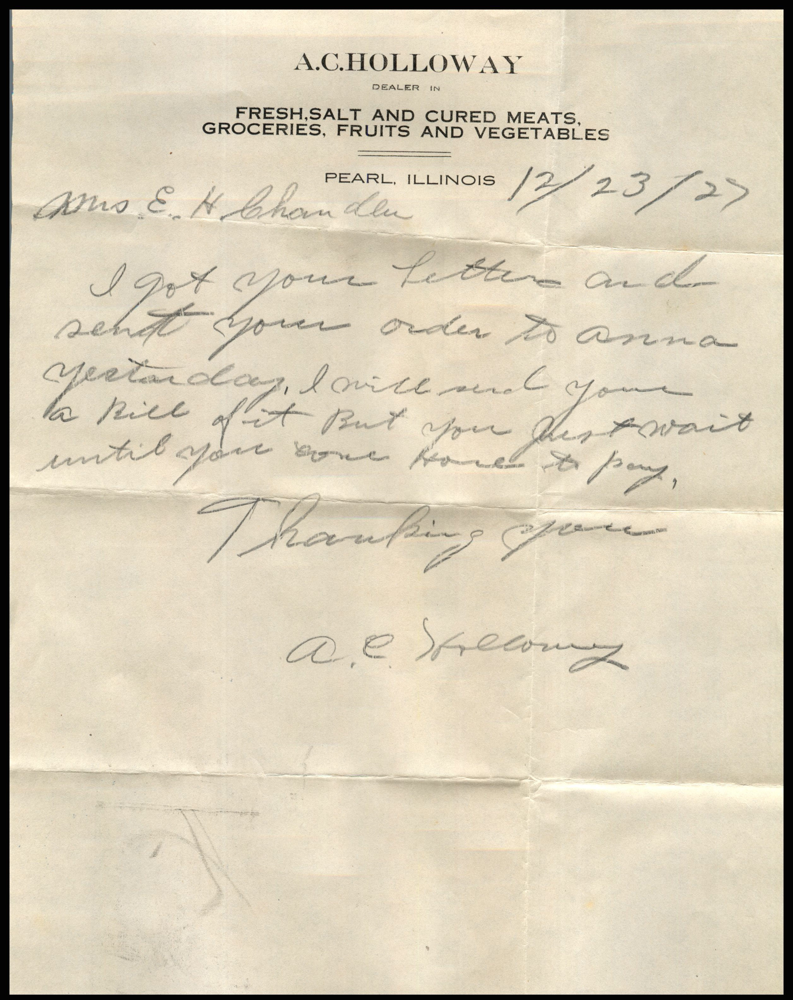
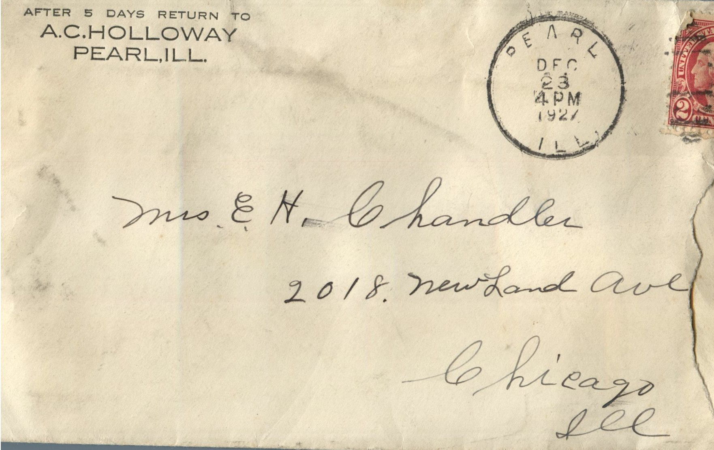

From: A.C. Holloway, To: Jeanette Knox Chandler  
Mailed From: Pearl, Illinois on December 23, 1927

Mailing Address:  
Mrs. E. H. Chandler  
2018 Newland Ave.  
Chicago, Illinois

Return Address:  
After 5 days return to  
A.C.. Holloway  
Pearl, Illinois

12/23/27  
Mrs. E.H. Chandler,  
I got your letter and sent your order to Anna yesterday. I will send you a bill of it. But you just wait until you come home to pay.  
Thanking you,  
A.C. Holloway