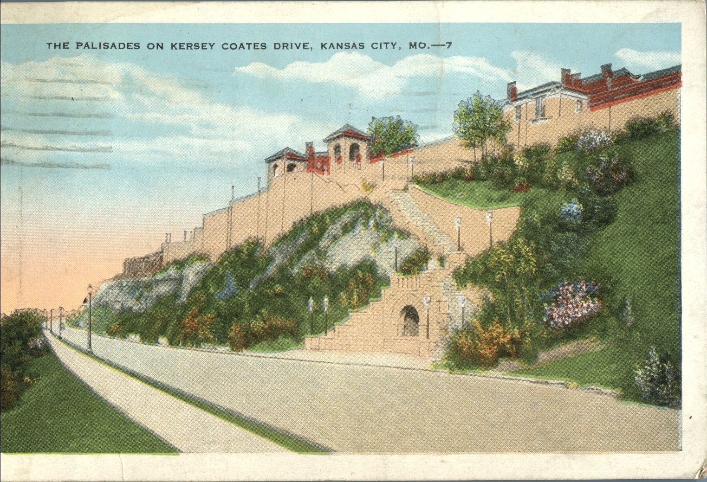
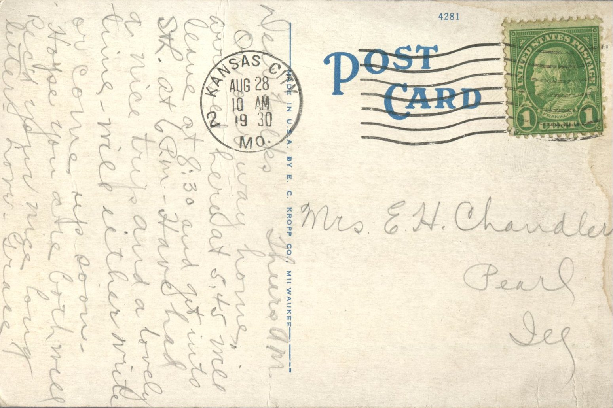

 

From: Grace Chandler, To: Jeanette Knox Chandler  
Mailed From: Kansas City, MO. on August 28, 1930  
Postcard Info: Made in U.S.A. by E.C. Kropp Co., Milwaukee  
Picture Info: The Palisades on Kersey Coates Drive, Kansas City, Mo.

Mrs. E.H. Chandler  
Pearl, Illinois

Thursday a.m.  
Dear Folks,  
On our way home, arrived here at 5:45 will leave at 8:30 and get into St. Louis at 6 p.m. Have had a nice trip and a lovely time – will either write or come up soon. Hope you are both well. Received your nice long letter.  
Love,  
Grace