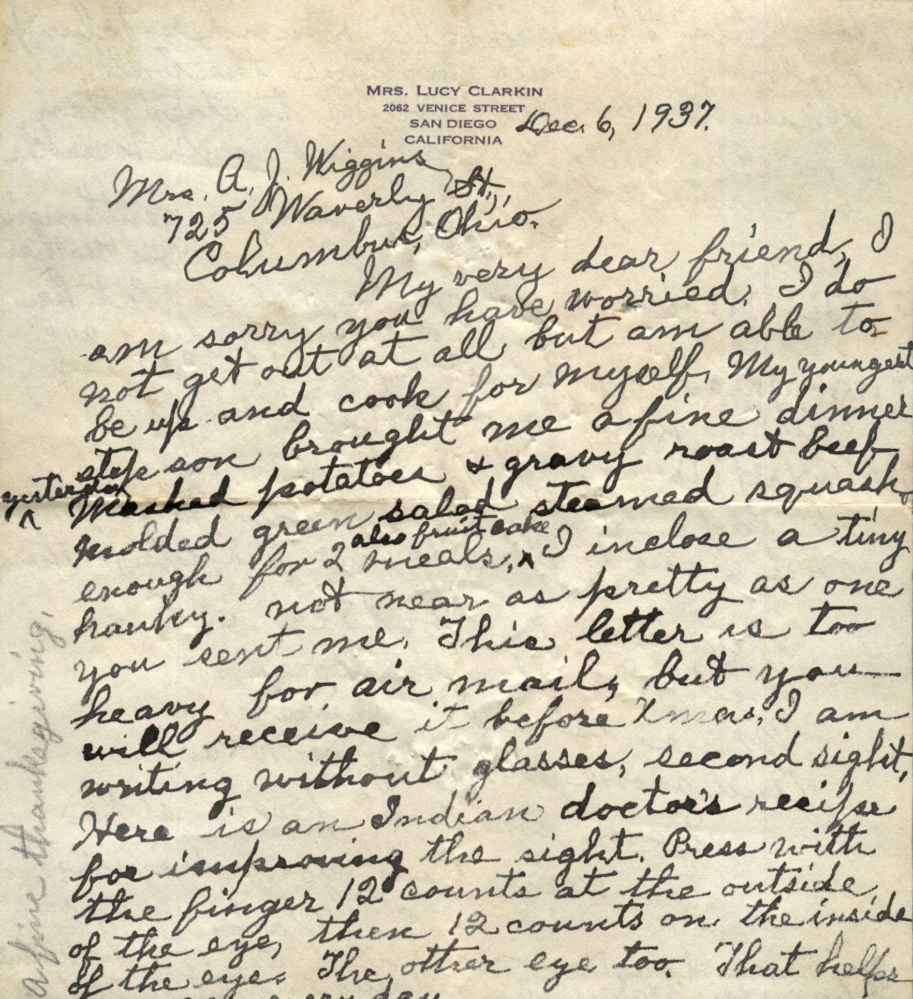
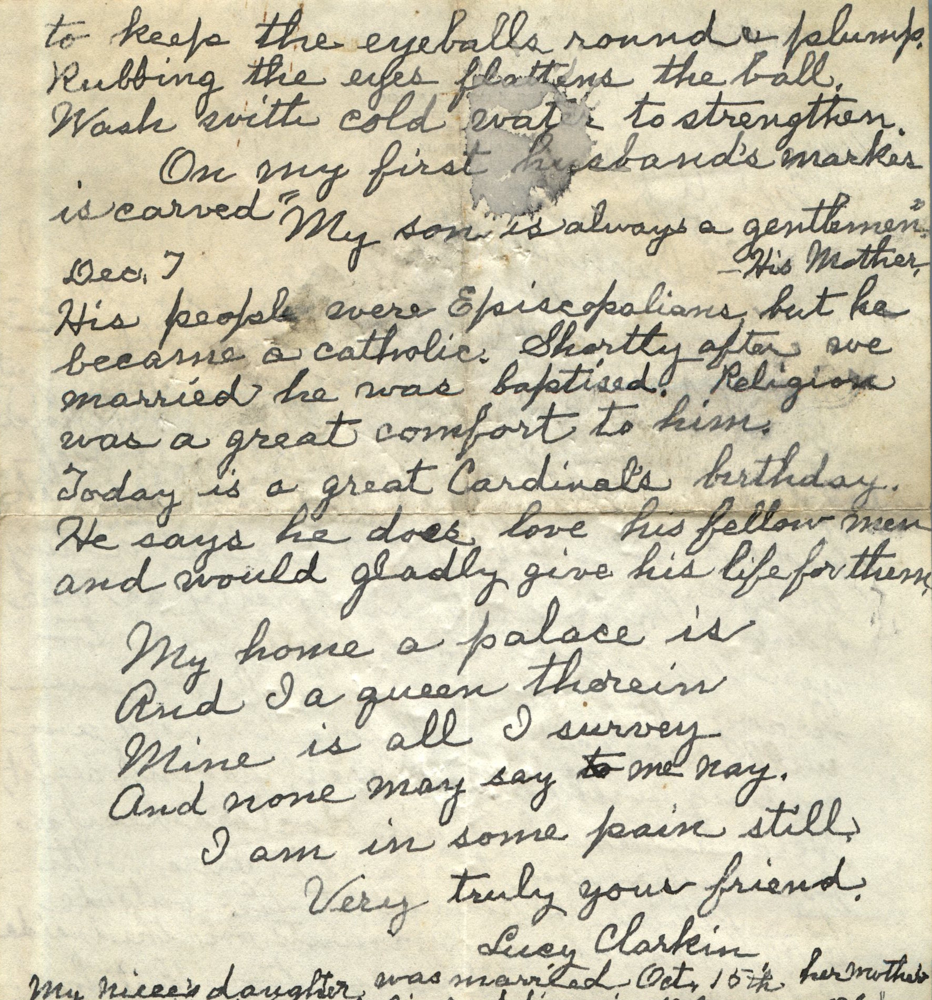

 

From: Lucy Clarkin, To: Amelia J. Wiggins  
Mailed From: San Diego, California on December 6, 1937

Mrs. Lucy Clarkin  
2062 Venice Street  
San Diego, California

Mrs. A.J. Wiggins  
725 Waverly St.  
Columbus, Ohio

December 6, 1937

My very dear friend,  
I am sorry you have worried. I do not get out at all but am able to be up and cook for myself. My youngest step son brought me a fine dinner yesterday. mashed potatoes and gravy, roast beef, mixed green salad, steamed squash enough for 2 meals. I inclose a tiny hanky. Not near as pretty as one you sent me. This letter is too heavy for air mail, but you will receive it before Xmas. I am writing without glasses, second sight. Here is an Indian doctor’s recipe for improving the sight. Press with the finger 12 counts at the outside of the eye, then 12 counts on the inside of the eye. The other eye too. That helps once every day to keep the eyeballs round and plump. Rubbing the eyeballs flattens the ball. Wash with cold water to strengthen.  
On my first husband’s marks is carved, “My son is always a gentlemen” – His mother, Dec. 7  
His people were Episcopalians but he became a Catholic. Shortly after we married he was baptized. Religion was a great comfort to him. Today is a great Cardinal’s birthday. He says he does love his fellow men and would gladly give his life for them.  
My home a palace is  
And I a queen therein  
Mine is all I survey  
And none may say to me nay

I am in some pain still  
Very truly your friend,

Lucy Clarkin  
My niece’s daughter was married Oct. 15th. Her mother sister’s wedding day a Catholic wedding in Delaware.  
Lucy