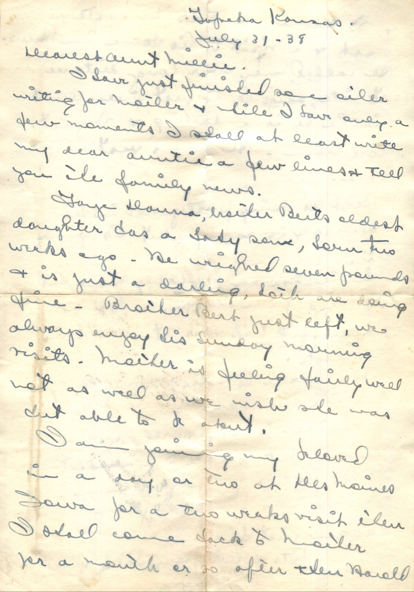
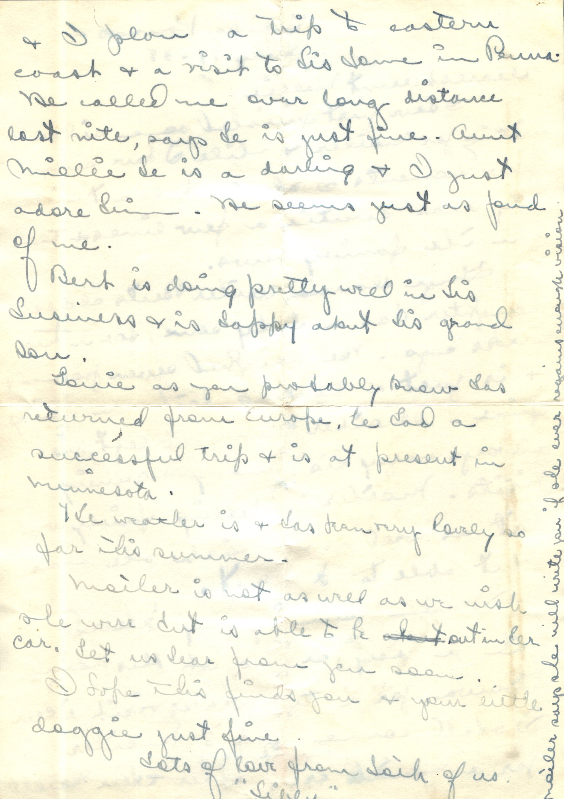

 

From: Betty Tilley, To: Amelia J. Wiggins  
Mailed From: Topeka Kansas on July 31, 1938

Dearest Aunt Millie,  
I have just finished some other writing for Mother and now I have only a few moments. I shall at least write my dear Auntie a few lines and tell you the family news.  
Faye Donna, Mister Bert’s oldest daughter has a lady babe, born two weeks ago. She weighed seven pounds and is just a darling. Both are doing fine. Besides Bert just ;eft, we always enjoy his Sunday morning visits. Mother is feeling fairly well, not as well as we wish she was but able to be about.  
I am joining my beloved in a day or two at Les Moines, Iowa fora two weeks visit then I shall come back to mother for a month or so after then Harold and I plan a trip to eastern coast and a visit to his home in Penna. He called me over long distance last night, says he is just fine. Aunt Millie, he is a darling and I just adore him. He seems just as fond of me.  
Bert is doing pretty well in his business and is happy about his grandson.  
Louie as you probably knew has returned from Europe, he had a successful trip and is at present in Minnesota.  
The weather is and has been very lovely so far this summer.  
Mother is not as well as we wish she were but is able to be out in her car. Let us hear from you soon.  
I hope this finds you and your little doggie just fine.  
Lots of love from both of us,  
“Hibly”  
Mother says she will write you if she ever regains enough vision.