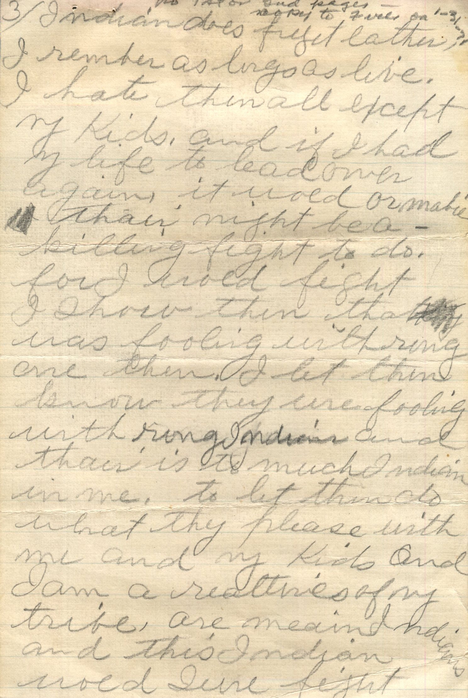
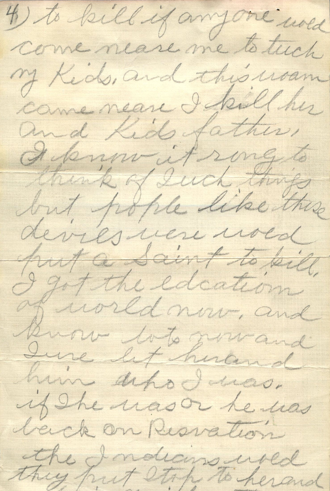
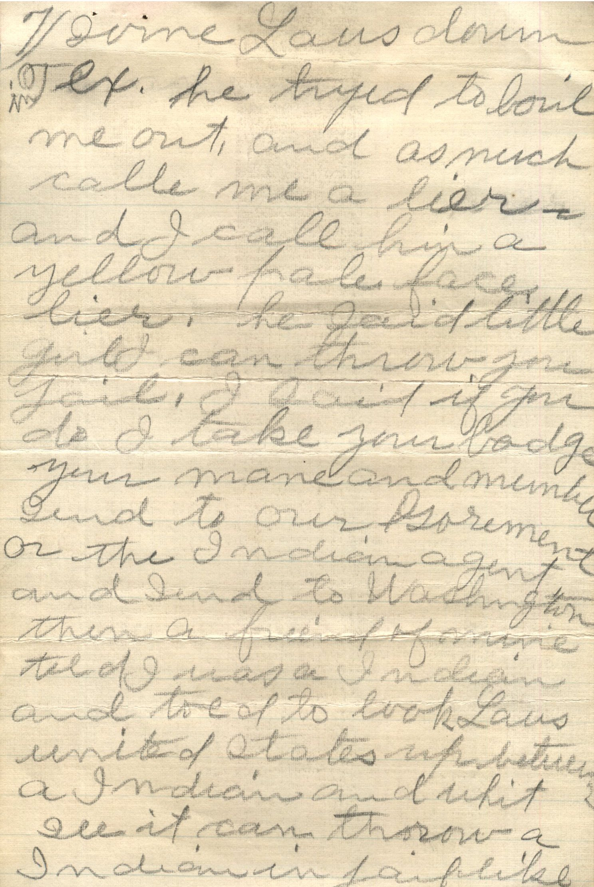
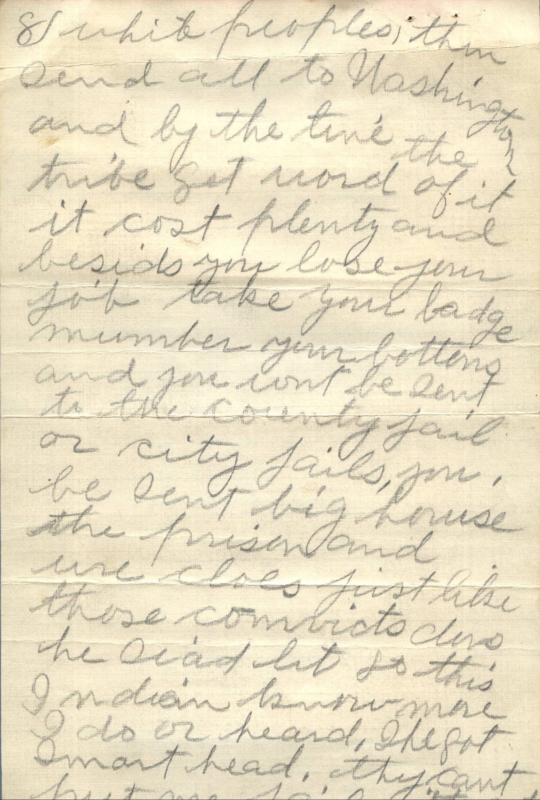
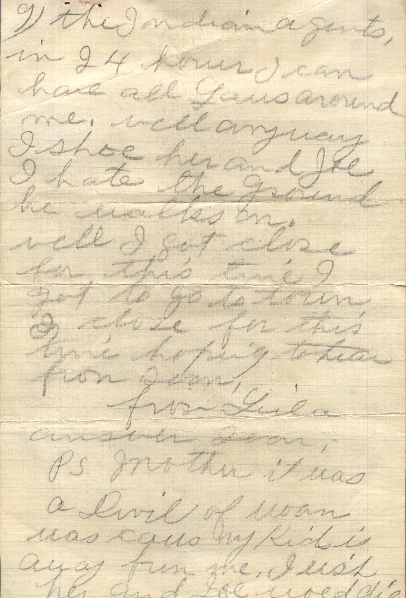
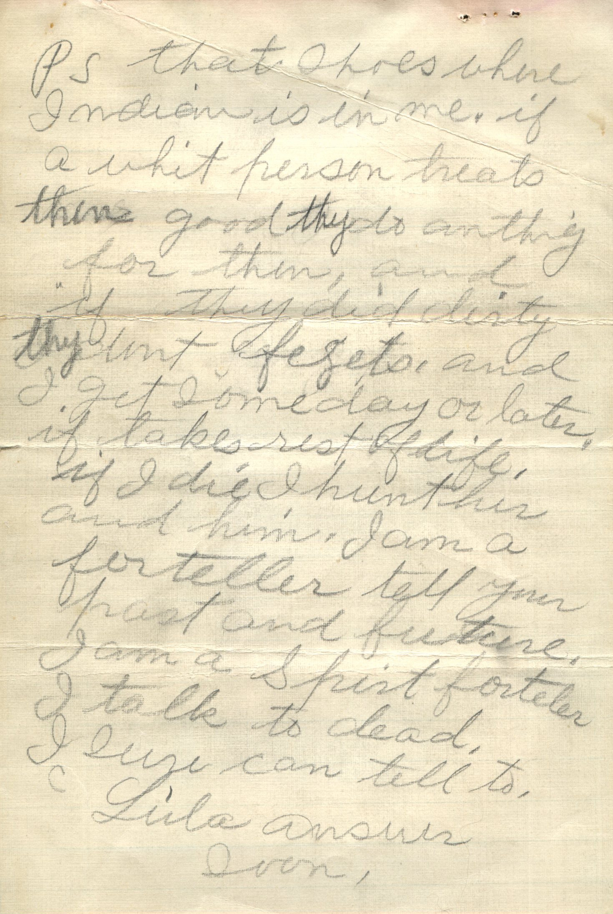

     

From: Luila, To: Unknown

Partial Letter:

Page 3 and 4  
No 1st or 2nd pages-forgot to send on 1-31-1971  
Indian does forget each other. I remember as long as live. I hate them all except my kids, and if I had my life to lead over again, it wold or maybe there might be a killing fight to do. For I would fight. I show them that was with ring are them. I let them know they are fooling with wrong Indian and there is too much Indian in me. To let them do what they please with me and my kids and I am a relatives of my tribe, are mean Indians and this Indian would sure fight to kill if any one would come near me to touch me kids, and this woman could be mean. I kill her and kids father. I know – it rong to think of such things but people like these deviles sure wold put a Saint to kill. I got the edcation of world now, and know lots now and sure let her and him who I was. If she was or he was back on reservation the Indians wold they put stop to her and him quick. They

Page 7 through Page 10  
Im down in Texas. He tried to leave me out and as much calle me a lier. and I call him a yellow-pale face lier. He said little girl can throw you fail. I said if you do I take your badge, your name and member send it to our Government or the Indian agent and send to Washington then a friend of mine told I was a Indian and told to look Laus United States up because I a Indian and whit I’ll it can throw a Indian in jail like white people, them send all to Washington and by the time the tribe got word of it it cost plenty and besides you lose your job, take your badge number and you wont be sent to the county jail or city jails, you be sent big house the prison and we close up with the like those convicts does. He said but so this Indian know more I do or heard. She got smart head. They can’t put me jail without the Indian agents in 24 hours. I can have all Laus around me. Well anyway I show her and Joe. I hate he ground he walks on.  
Well I got close for this time. I got to go to town. I close for this time hoping to hear from soon,  
From Luila  
answer soon  
PS. Mother it was a devil of woman was calls my kids is away from me. I wish her and Joe would die  
PS. that shows where Indian is in me. If a whit person treats them good they do anything for them, and if they did dirty thy dont forgets and I get someday or later, if takes rest of life, if I die I hunt her and him. I am a forteller tell your past and future. I am a spirit foretell. I talk to dead. I sure can tell to.  
Luila  
Answer soon