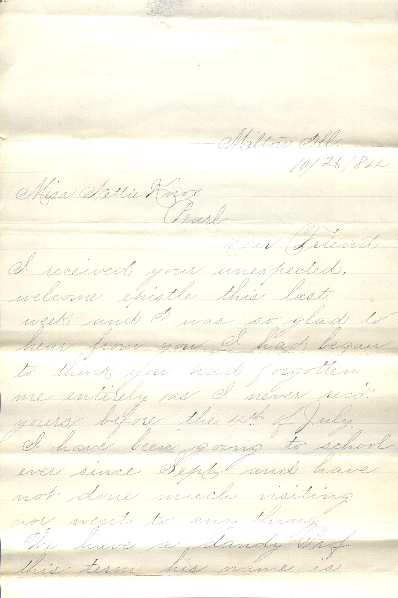
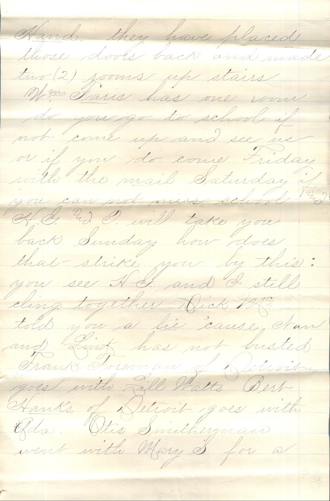
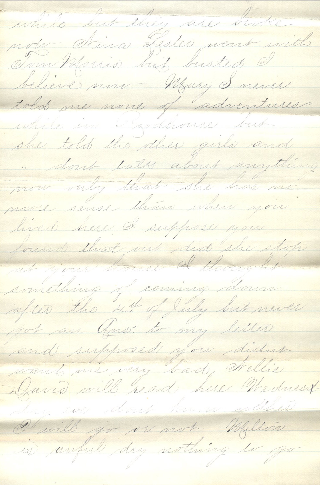
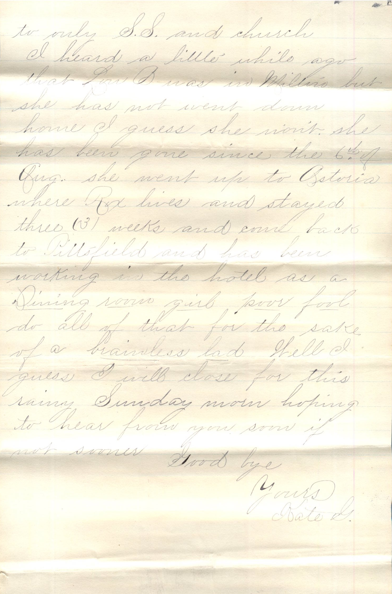
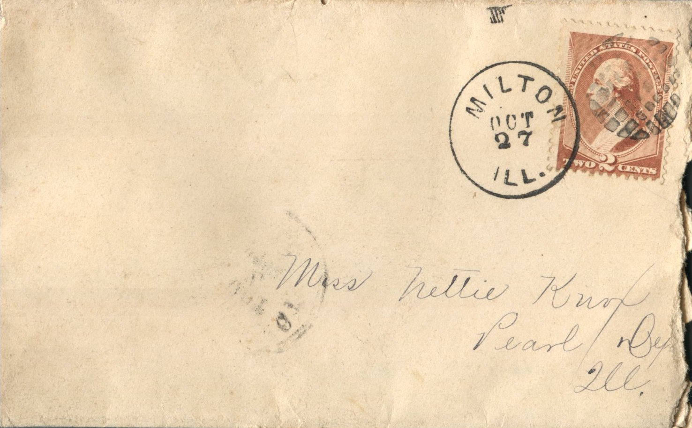
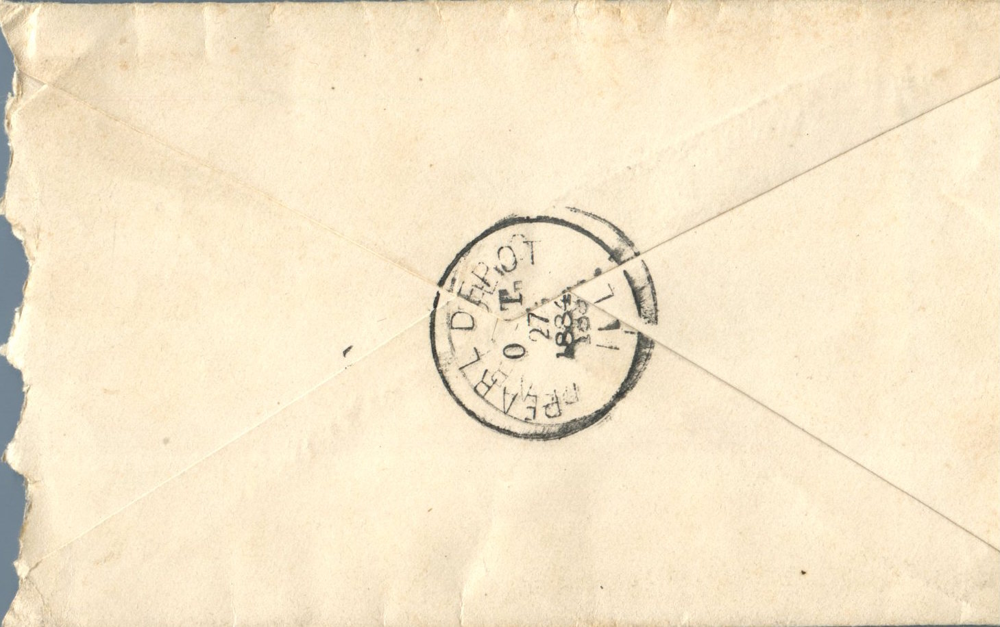

     

From: Kate G., To: Jeanette Knox Chandler  
Mailed From: Milton, Illinois on October 27, 1884

Milton, Ill.  
10/28/84

Miss Nettie Knox  
Pearl

Dear Friend,  
I received your unexpected, welcome epistle this last week and I was so glad to hear from you. I had begun to think you had forgotten me entirely as I never received yours before the 4th of July. I have been going to school ever since Sept. and have no done much visiting not went any thing. We have a dandy Professor this term. His name is Hand. They have placed those looks back and made two rooms up stairs. Mr. Farris has one room. Do you go to school if not come up and see me or if you do come Friday with the mail Saturday if you can not miss school and H.G. and I will take you back Sunday. How does that strike you by this; you see H.G. and I still cling together. Dick Mc told you a he ’cause Stan and Link has not busted. Frank Foreman of Detroit goes with Lill Watts. Bert Hanks of Detroit goes with Ada. Otis Smitherman went with Mary S for a while but they are broke now. Nina Lester went with Tom Morris but bused I believe now. Mary S never told me none of adventures while in Roadhouse but she told the other girls and she don’t talk about anything now only that she has no more sense than when you hired her. I suppose you found that out did she stop at your house. I thought something of coming down after the 4th of July but never got an answer to my letter and supposed you didn’t want me very bad. Nellie Davis will read here Wednesday eve. DOn’t know whether I will go or not. Milton is awful dry nothing to go to only S.S. and church.  
I heard a little while ago that Lori B was in Milton but she has not went down home, I guess she wont. She has been done since the 6th of Aug. she went up to Astoria where Rox lives and stayed three (3) weeks and came back to Pittsfield and has been working in the hotel as a dining room girl. Poor fool do all of that for the sake of a brainless lad. Well I guess I will close for this rainy Sunday morn hoping to hear from you soon if not sooner.  
Good bye  
Yours,  
Kate G.