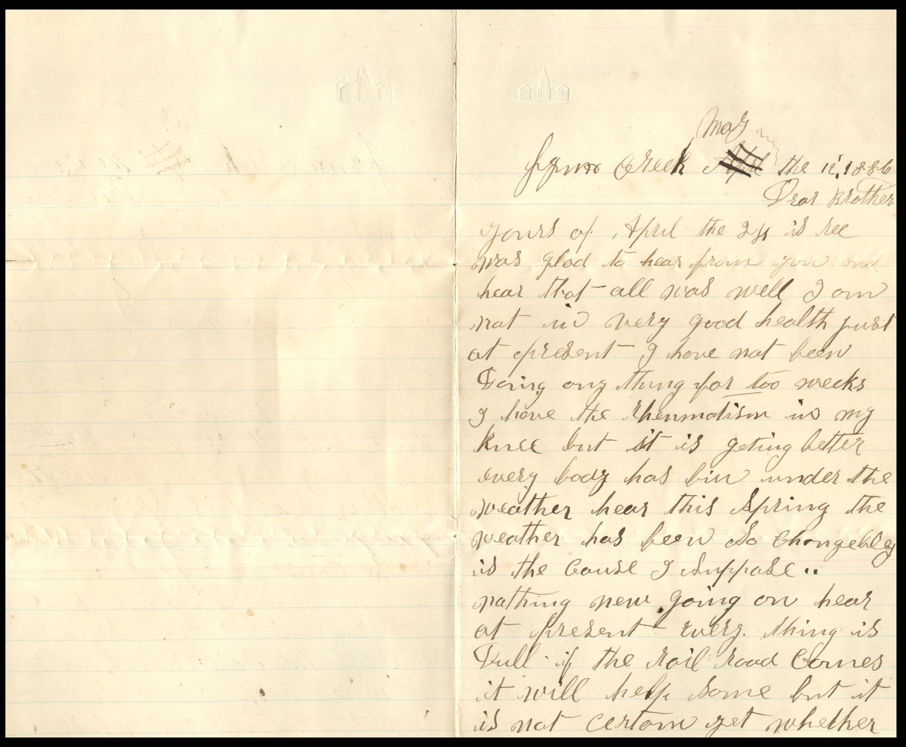
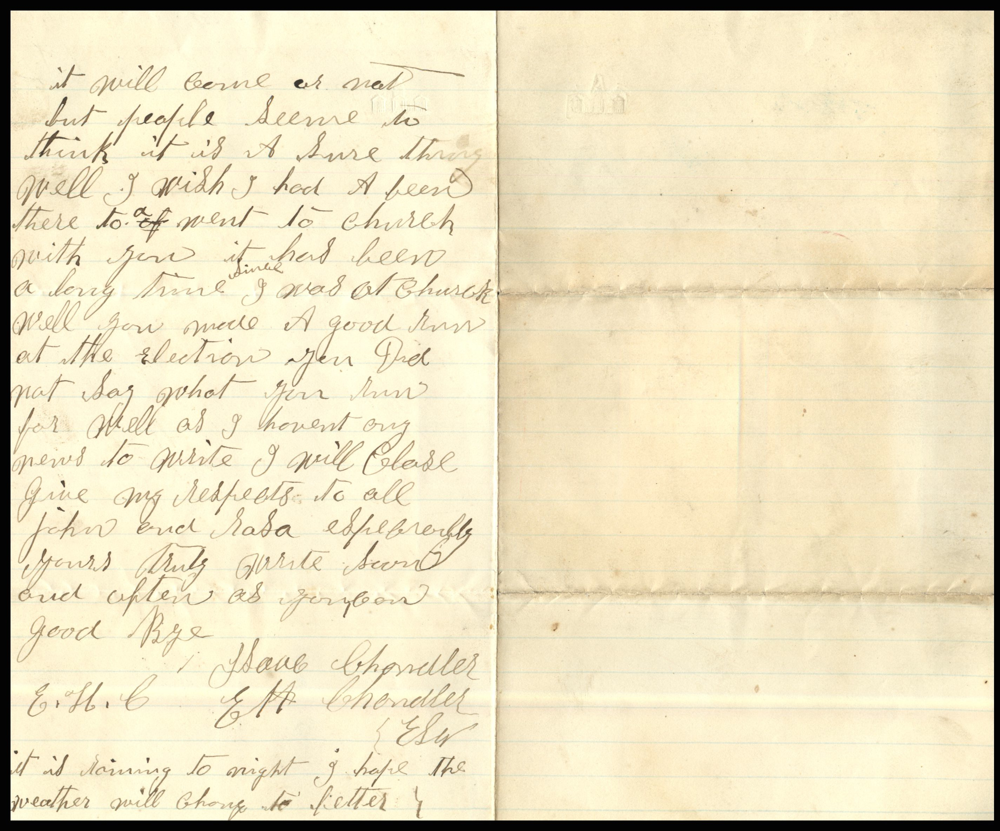

 From: Elijah H. and J. Saul Chandler, To: Unknown Chandler  
Mailed From: Creek on May 12, 1886

From Creek, May the 12 1886  
Dear Brother,  
Yours of April the 27 is received. Was glad to hear from you and hear that all was well. I am not in very good health just at present. I have not been doing anything for two weeks. I have the rheumatism in my knee but it is getting better. Everybody has been under the weather. Hear this spring the weather has been so changeable is the cause I suppose.  
Nothing new going on hear at present everything is dull. If the rail road comes it will help some but it is not certain yet whether it will come or not but people seem to think it is a sure thing. Well I wish I had been there to a went to church with you. It had been a long time since I was at church . Well you made a good run at the election. You did not say what you run for. Well as I haven’t any news to write I will close. Give my regards to all John and Sasha especially yours truly. Write soon and often as you can.  
Goodbye  
J.Saul Chandler  
E.H. Chandler  
it is rainy tonight I hope the weather will change to better.