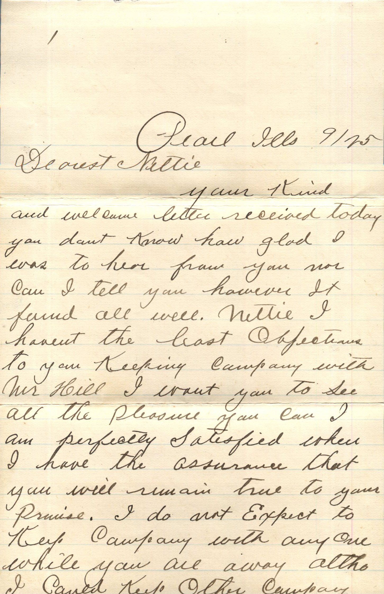
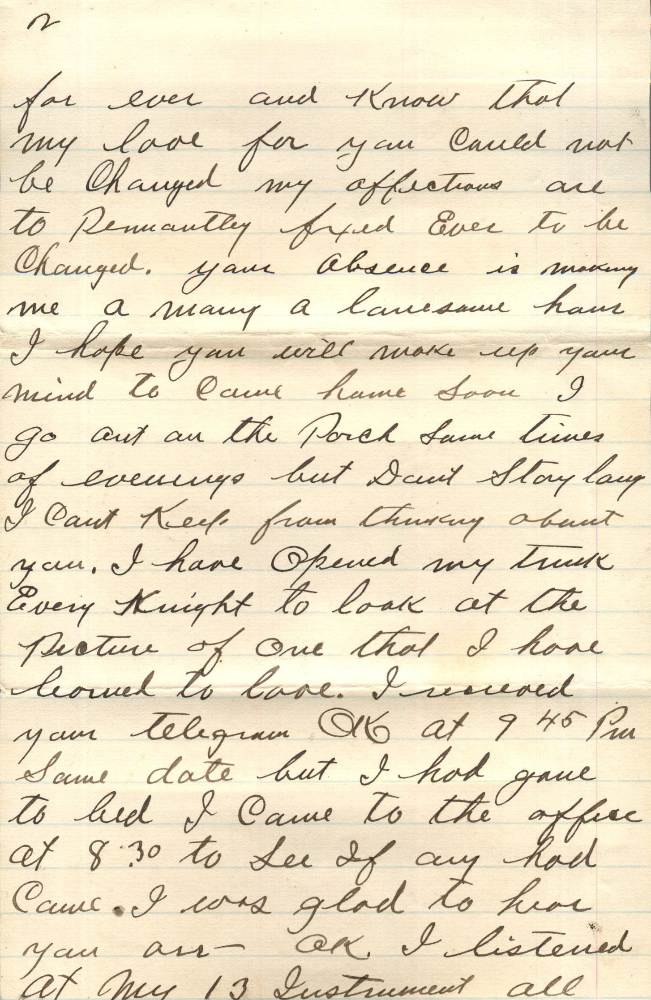
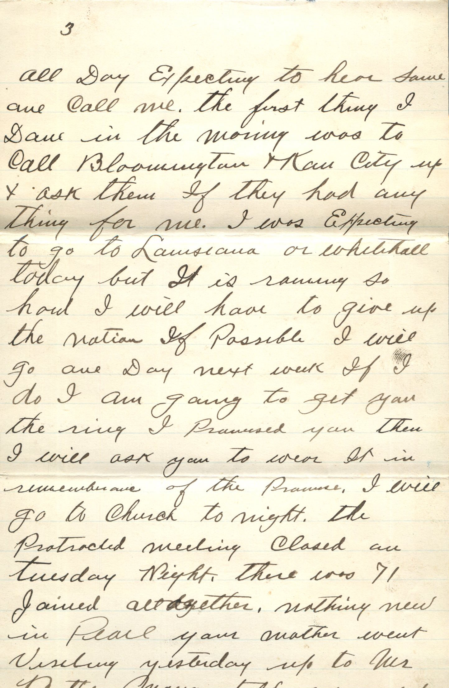
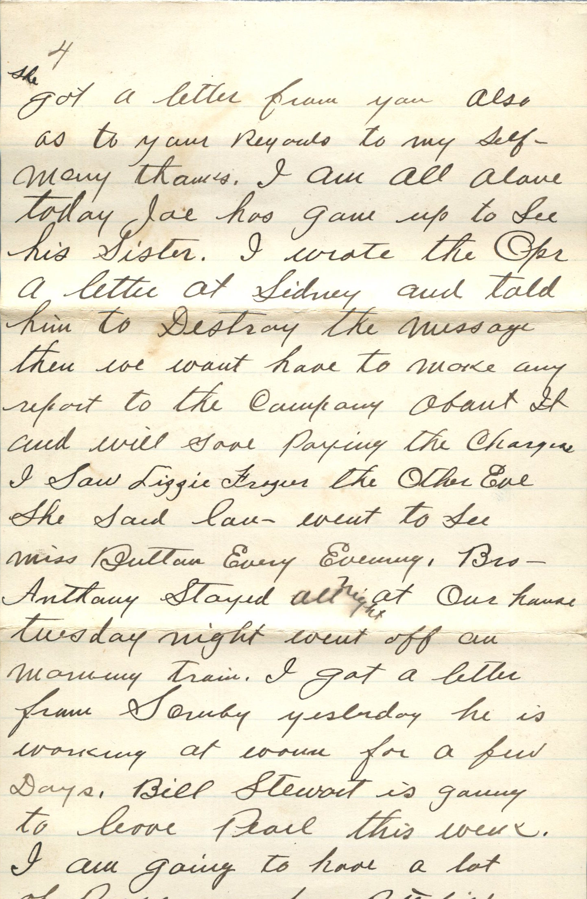
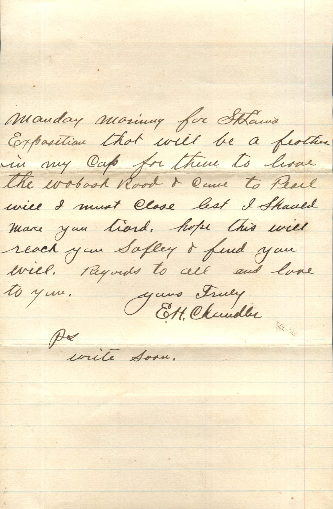
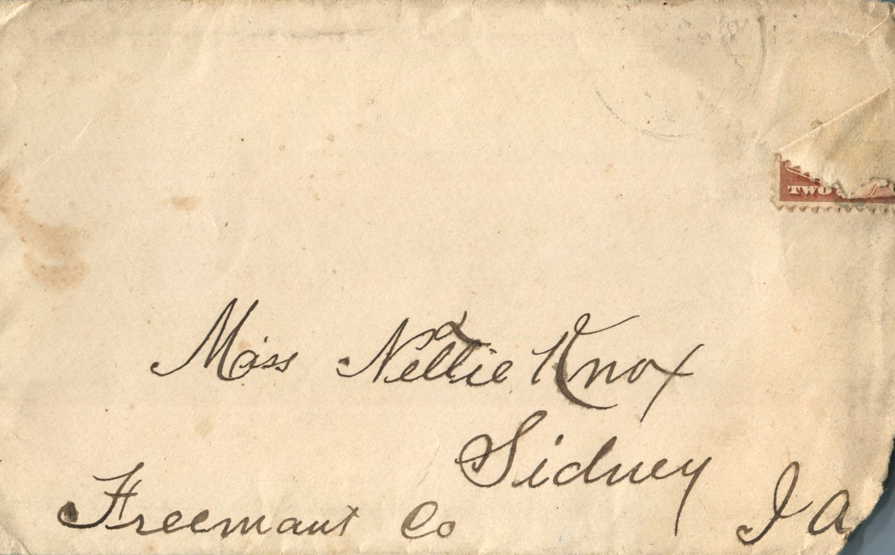
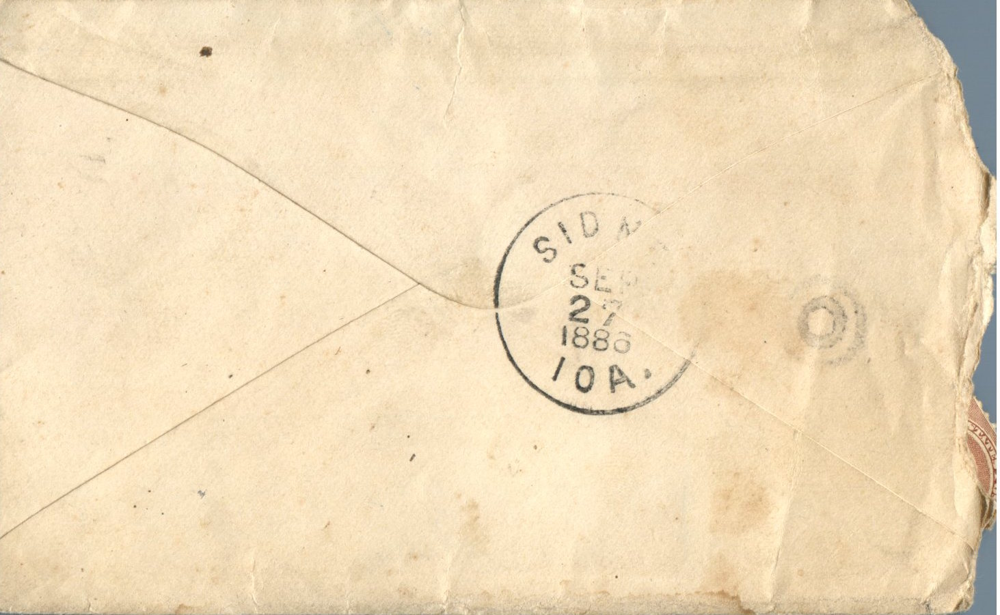

      

From: Elijah H. Chandler, To: Jeanette Knox Chandler  
Mailed From: Pearl, Illinois on September 25, 1886

Miss Nettie Knox  
Sidney, Ia  
Freemont Co.

Pearl, Ills 9/25  
Dearest Nettie,  
Your kind and welcome letter received today. You don’t know how glad I was to hear from you nor can I tell you however it found all wall. Nettie I haven’t the least objection to you keeping company with Mr. Hill. I want you to see all the pleasure you can. I am perfectly satisfied when I have the assurance that you will remain true to your promise. I do not expect to keep company with any one while you are away altho I could keep other company for ever and know that my love for you could not be changed. My affections are to prematurely fixed ever to be changed. Your absence is making me a many a lonesome hour. I hope you will make up your mind to come home soon. I go out on the porch same times of evenings but don’t stay long. I can’t keep from thinking about you. I have opened my trunk every night to look at the picture of one that I have learned to love. I received your telegram OK at 9:45 pm. Same date but I had gone to bed. I came to the office at 8:30 to see if any had came. I was glad to hear your answer. OK I listened at My 13 Instrument all day expecting to hear some one call me. The first thing I done in the morning was to call Bloomington and Kansas City up and ask them if they had anything for me. I was expecting to go to Louisiana or White Hall today but it is raining so hard I will have to give up the notion. If possible I will go one day next week. If I do I am going to get you the ring I promised you. Then I will ask you to wear it in remembrance of the promise. I will go to church tonight. The protracted meeting closed on Tuesday night. There was 71 joined all together, nothing new in Pearl. Your mother went visiting yesterday up to Mr. Betts. Maggie told me yesterday she got a letter from you also as to your regards to my self – many thanks. I am all alone today. Jae has gone up to see his sister. I wrote the Opr a letter at Sidney and told him to destroy the message. Then we wont have to make any report to the company about it will save paying the charges. I saw Lizzie Frogen the other eve. She said Lau want to see Miss Button every evening. Bro Anthony stayed all night at our house Tuesday night. Went off on morning train. I got a letter from Soruby yesterday. He is working at railroad for a few days. Bill Stewart is going to leave Pearl this week. I am going to have a lot of passengers from Pittsfield Monday morning for St. Louis exposition that will be a feather in my cap for them to leave the Wabash Road and come to Pearl. Well I must close lest I should make you tired. Hope this will reach you safely and find you well. Regards to all and love to all.  
Yours Truly,  
E.H. Chandler  
P.S. Write Soon