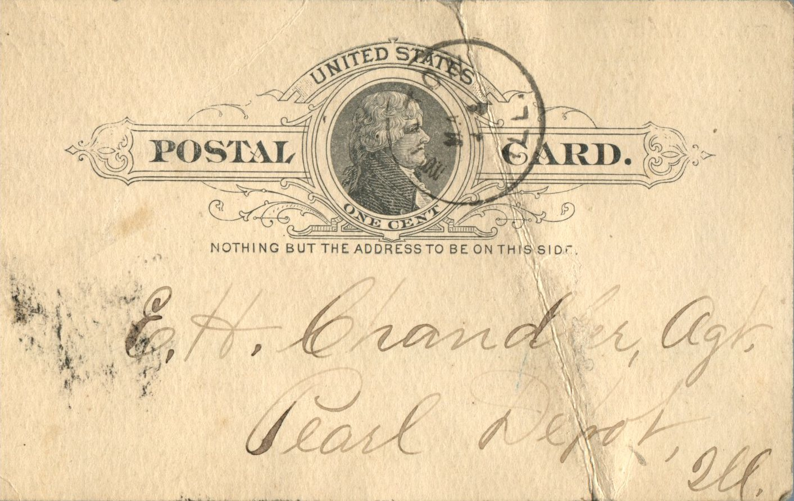
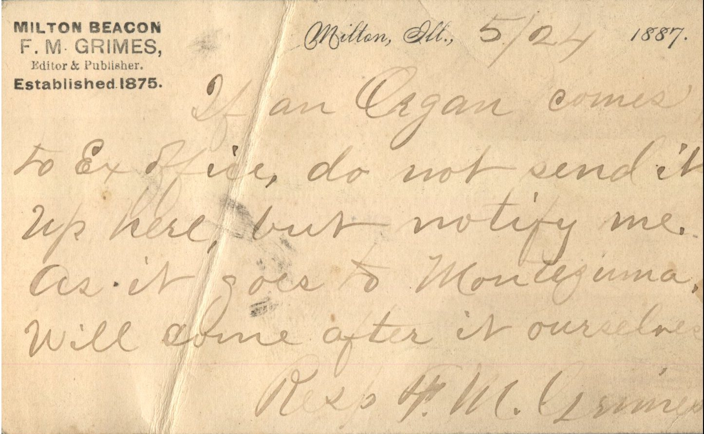

 

From: F.M. Grimes, To: Elijah H. Chandler  
Mailed From: Milton, Illinois on May 24, 1887

E.H. Chandler, Agt.  
Pearl Depot, Illinois

Milton Beacon  
F.M. Grimes,  
Editor &amp; Publisher  
Established 1875.

Milton, Ill., 5/24 1887  
If an organ comes to the Ex office, do not send it up here, but notify me as it goes to Monteguma. Will come after it ourselves.  
Resp. F.M. Grimes