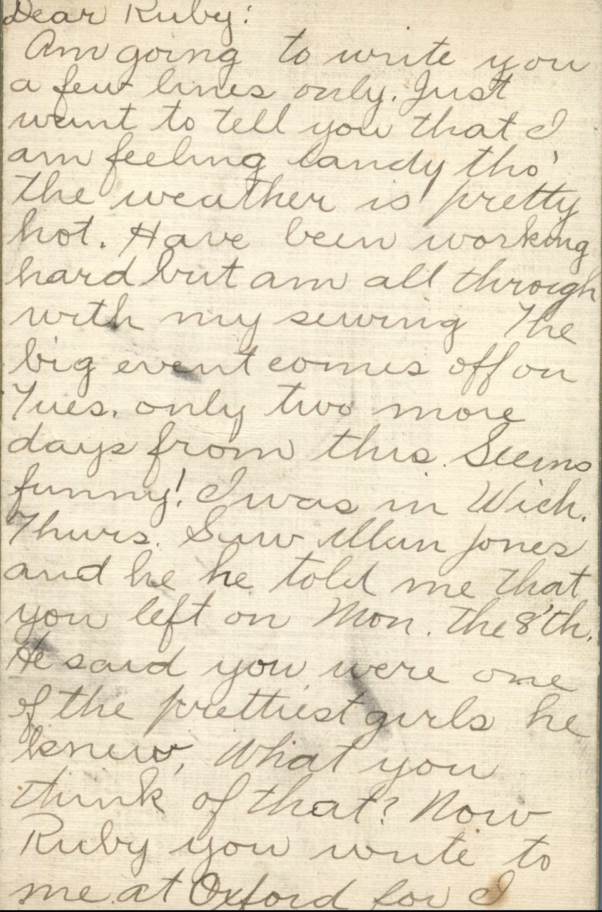
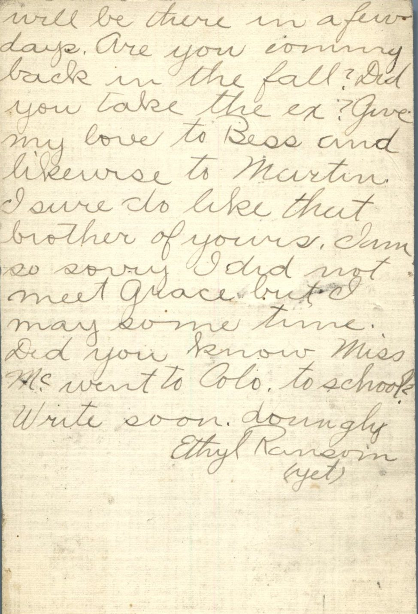

From: Ethyl Ransom, To: Ruby Chandler

Dear Ruby,  
Am going to write you a few lines only. Just want to tell you that I am feeling dandy though the weather is pretty hot. Have been working hard but am all through with my sewing. The big event comes off on Tuesday. Only two more days from this. Seems funny! I was in Wichita Thursday. Saw Allan Jones and he told me that you left on Monday the 8th. He said you were one of the prettiest girls he knew. What you think of that? Now Ruby you write to me at Oxford for will be there in a few days. Are you coming back in the fall? Did you take the exam? Give my love to Bess and likewise to Martin. I sure do like that brother of yours. I am sorry I did not meet Grace but I may some time. Did you know Miss M went to Colorado to school? Write soon.  
Lovingly,  
Ethyl Ransom (yet)