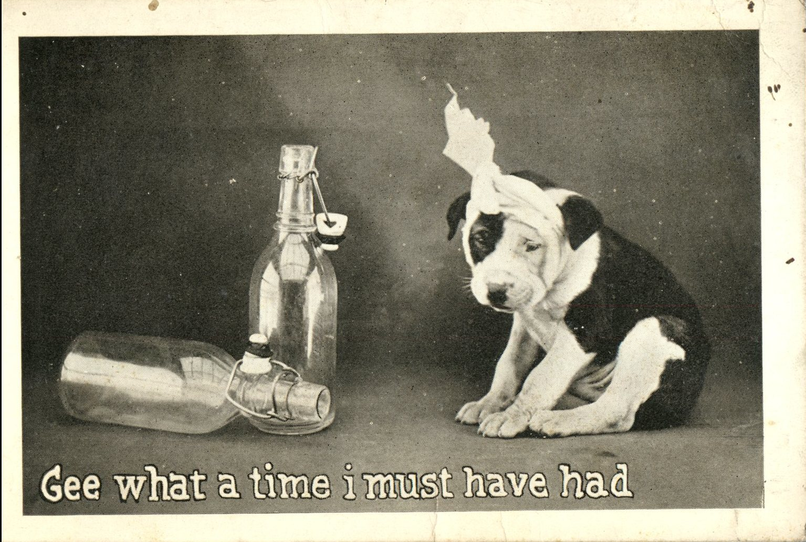
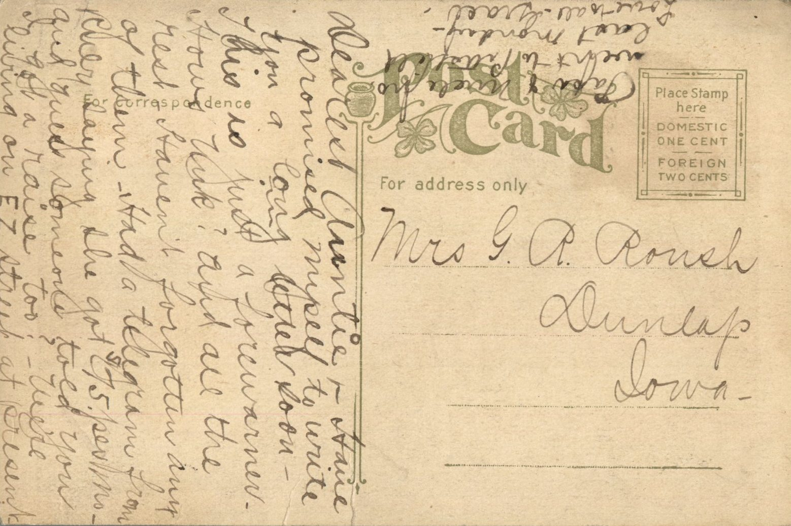

 From: Grace Chandler, To: G.R. Roush

Mrs. G.R. Roush  
Dunlap, Iowa

Dearest Auntie,  
Have promised myself to write you a long letter soon. This is just a forewarner. Hows Uncle? and all the rest. Haven’t forgotten any of them. Had a telegram from Ruby saying she got $75 per month and guess someone told you I got a raise too? We’re living on EZ street at present. Papa and Mama went to Pittsfield last Monday.  
Love to all  
Grace