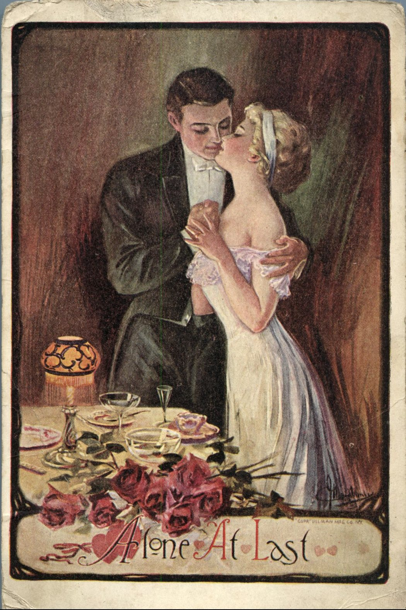
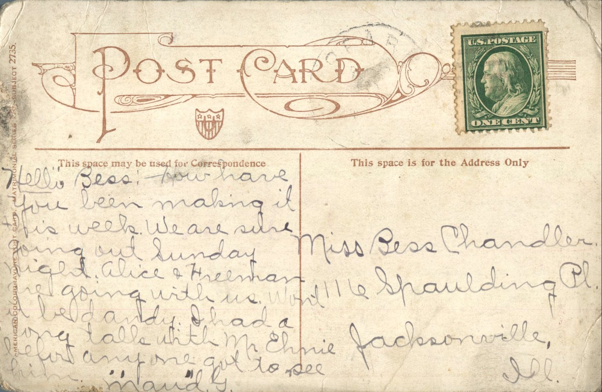

 From: Maud G., To: Bess Chandler  
Mailed From: Pearl, Illinois

Miss Bess Chandler  
116 Spaulding Pl.  
Jacksonville, Illinois

Hello Bess –  
How have you been making it this week. We are sure going out Sunday night. Alice and Hreenham are going with us. Won’t it he dandy. I had a long talk with Mr. Ehnie before anyone got to see him.  
Maud G.