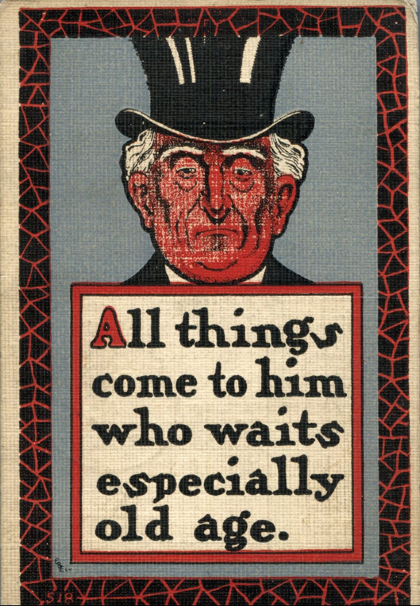
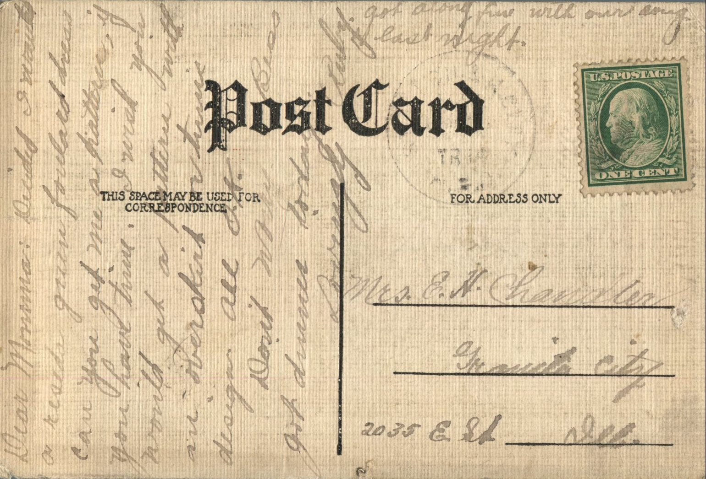

 From: Ruby Chandler, To: Jeanette Knox Chandler

Mrs. E.H. Chandler  
2035 E. St.  
Granite City, Ill.

Dear Mamma,  
Decided I wanted a resido green foulard dress. Can you get me a pattern, if you have time. I wish you would get a pattern with an overskirt or tunic design. All ok.  
Don’t worry Bess got dinner today  
Lovingly,  
Ruby  
Got along fine with our song last night.