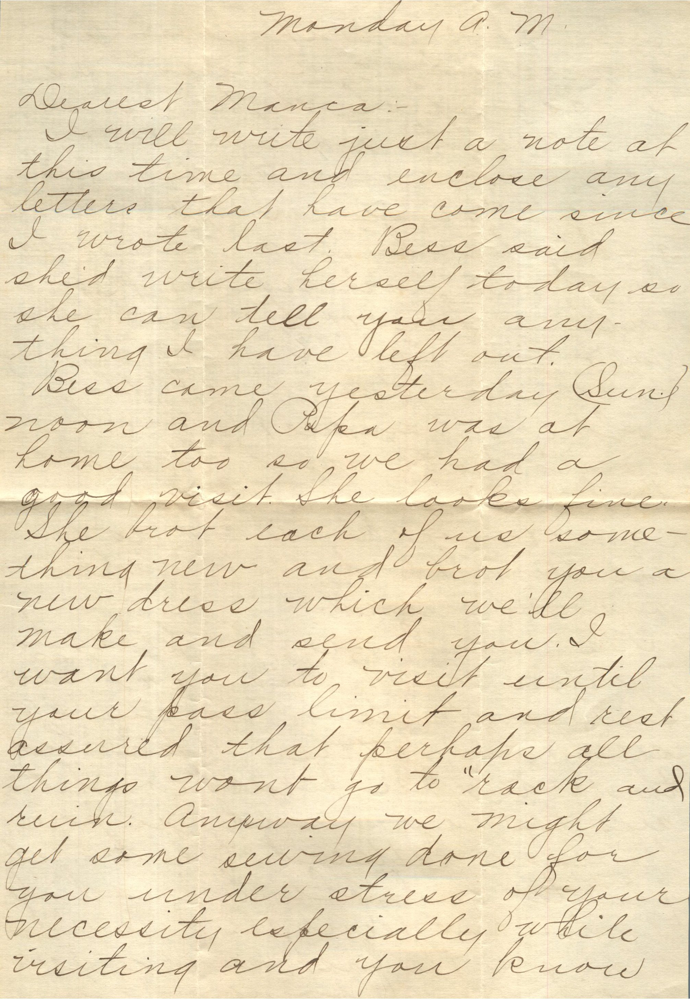
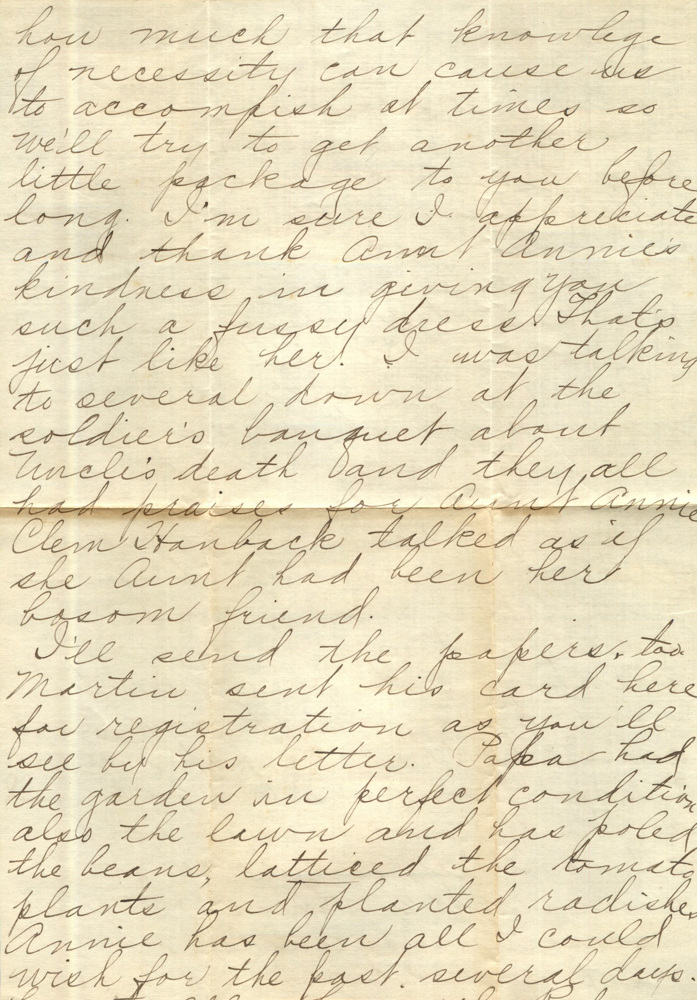

 

From: Ruby Chandler, To: Manca

Monday A.M.  
Dearest Manca,  
I will write just a note at this time and enclose any letters that have come since I wrote last. Bess said she’d write herself today so she can tell you anything I have left out.  
Bess came yesterday (Sun.) noon and Papa was at home too so we had a good visit. She looks fine. She brought each of us something new and brought you a new dress which we’ll make and send you. I want you to visit until your pass limit and rest assured that perhaps all things wont go to “rack and ruin.” Anyway we might get some sewing done for you under stress of your necessity especially while visiting and you know how much that knowledge of necessity can cause us to accomplish at times so we’ll try to get another little package to you before long. I’m sure I appreciate and thank Aunt Annie’s kindness in giving you such a fussy dress. That’s just like her. I was talking to several down at the soldier’s banquet about Uncle’s death and they all had praises for Aunt Annie. Clem Hanback talked as if she Aunt had been her bosom friend.  
I’ll send you the papers, too. Martin sent his card here for registration as you’ll see by his letter. Papa had the garden in perfect condition also the lawn and has poled the beans, latticed the tomato plants and planted radishes. Annie has been all I could wish for the past several days. Love to all.  
Lovingly,  
Ruby