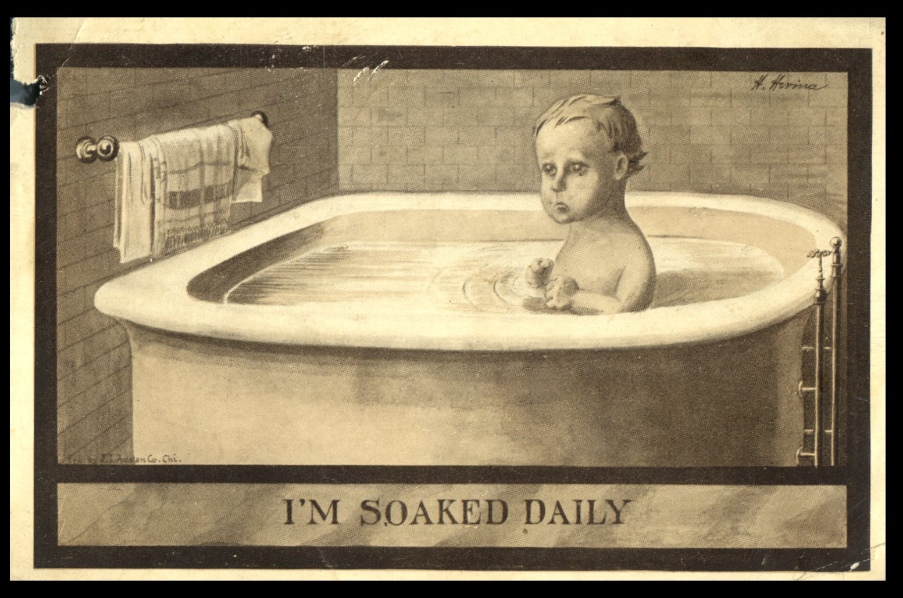
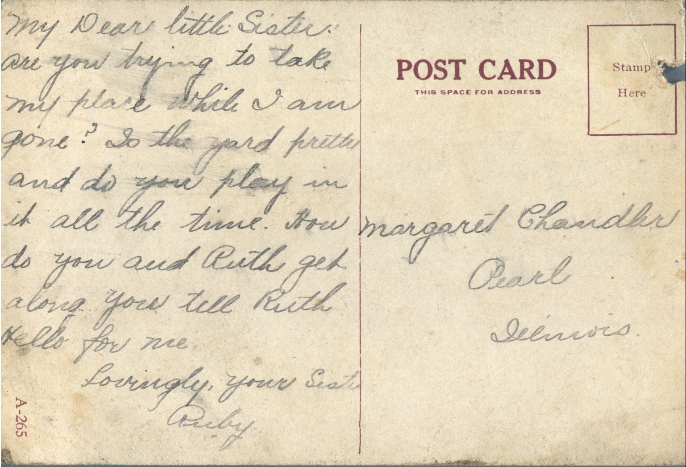

 

From: Ruby Chandler, To: Margaret Chandler  
Mailed From: Unknown

Margaret Chandler  
Pearl, Illinois

My Dear Little Sister,  
Are you trying to take my place while I am gone? So the yard looks pretty and do you play in it all the time? How do you and Ruth get along? You tell Ruth hello for me.  
Lovingly, your Sister,  
Ruby