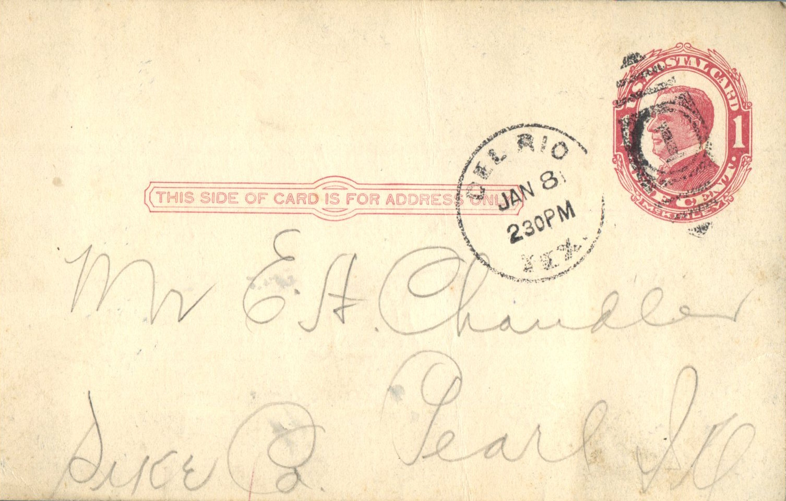
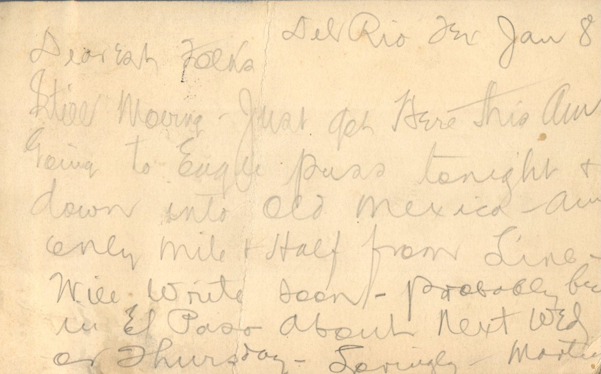

 

From: Martin Chandler, To: Elijah H. Chandler and Family  
Mailed From: Del Rio, Texas on January 8

Mr. E.H. Chandler  
Pearl, Ill.  
Pike Co

Del Rio Tex Jan 8  
Dearest Folks,  
Still moving. Just got here this am. Going to Eagle puss tonight and down into Old Mexico. Am only mile and half from line. Will write soon. Probably be in El Paso about next Wed or Thursday.  
Lovingly,  
Martin