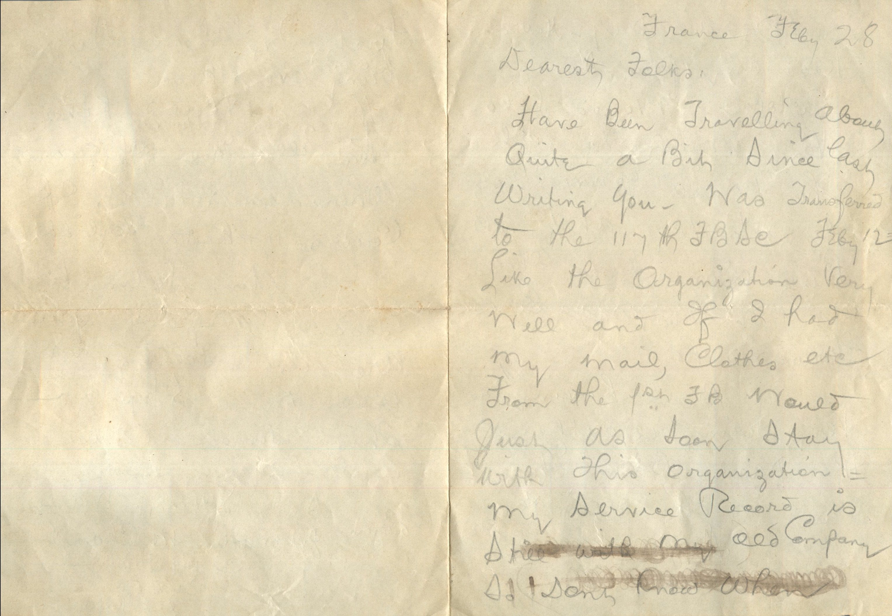
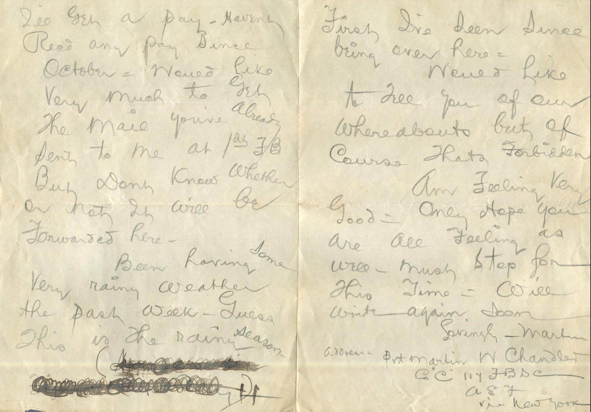

 From: Martin Chandler, To: Elijah H. Chandler and Family  
Mailed From: France on February 28

Dearest Folks,  
Have been traveling about quite a bit since last writing you. Was transferred to the 117th F.B.S.C. Feb 12. Like the organization very well and if I had my mail, clothes, etc from the 1st FB would just as soon stay with this organization. My service record is still with my old company. Don’t know when I’ll get a pay. Haven’t received any pay since October. Would like very much to get the mail you’ve already sent to me at 1st FB. But don’t know whether or not it will be forwarded here.  
Been having some very rainy weather the past week. Guess this is the rainy season. First I’ve seen since being over here.  
Would like to tell you of our whereabouts but of course that’s forbidden.  
Am feeling very good. Only hope you are all feeling as well. Must stop for this time. Will write again soon.  
Lovingly,  
Martin  
Address: Pvt. Martin W. Chandler  
Co ‘C” 117 F.B.D.C.  
A.E.F.  
Via New York