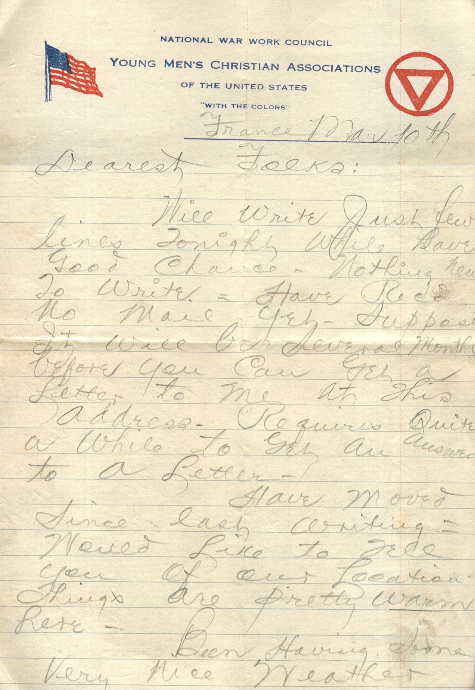
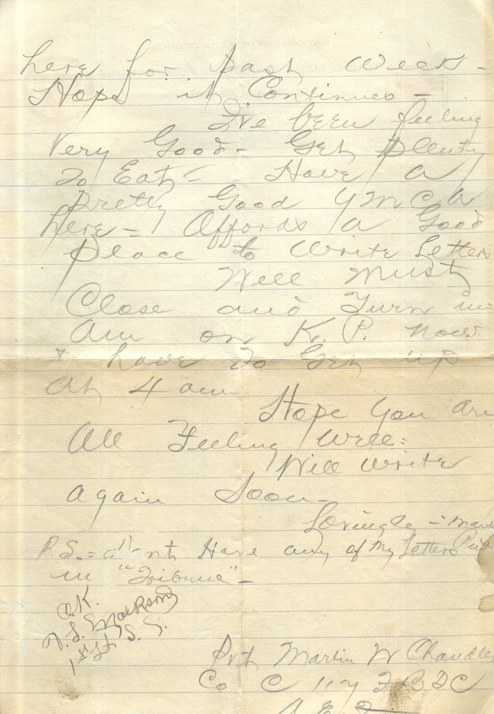

 

From: Martin Chandler, To: Elijah H. Chandler and Family  
Mailed From: France on March 10

France Mar 10th  
Dearest Folks,  
Will write just few lines tonight while have good chance. Nothing new to write. Have received no mail yet. Suppose it will be several months before you can get a letter to me at this address. Requires quite a while to get an answer to a letter.  
Have moved since last writing. Would like to tell you of our locations. Things are pretty warm here.  
Been having some very nice weather here for past week. Hope it continues.  
I’ve been feeling very good. Get plenty to eat. Have a pretty good YMCA here. Affords a good place to write letters.  
Well must close and turn in. Am on K.P. now and have to get up at 4 am.  
Hope you are all feeling well.  
Will write again soon.  
Lovingly,  
Martin  
P.S. Dont have any of my letters put in “Tribune.”