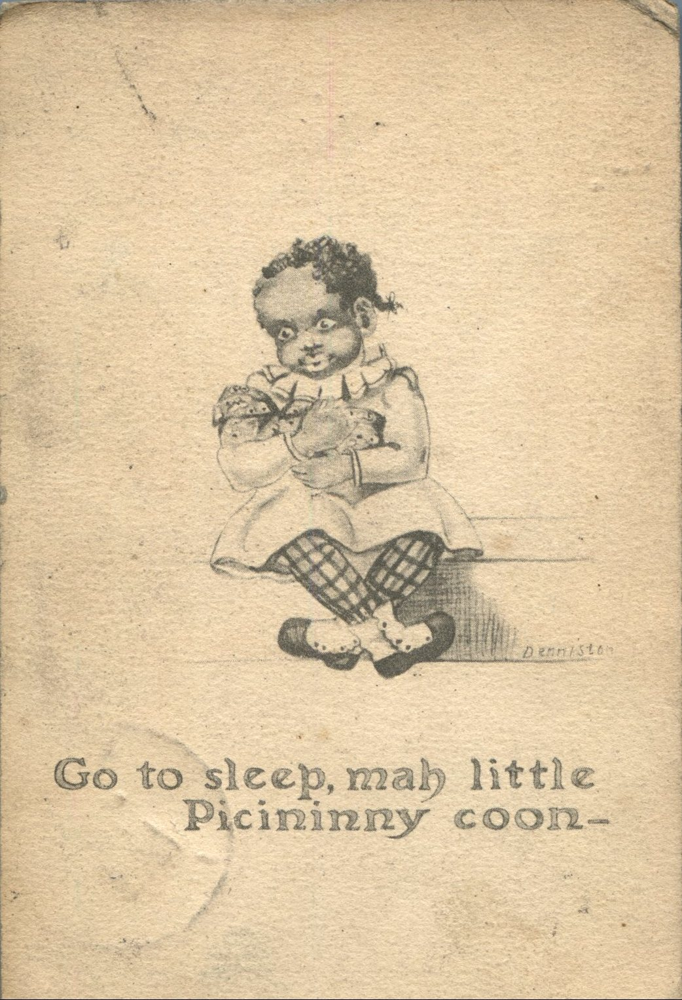
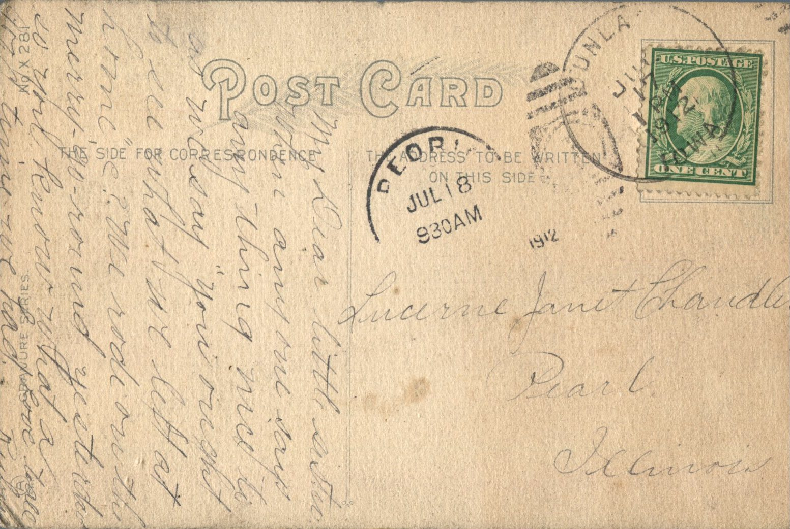

 From: Ruby Chandler, To: Lucerne Chandler  
Mailed from: Peoria, Illinois on July 18

Lucerne Janet Chandler  
Pearl, Illinois

My Dear Little Sister,  
When any one says anything nice to us we sat “You should see what we left at home” e? We rode the merry-go-round yesterday so you know what a good time we had.  
Love to All,  
Ruby