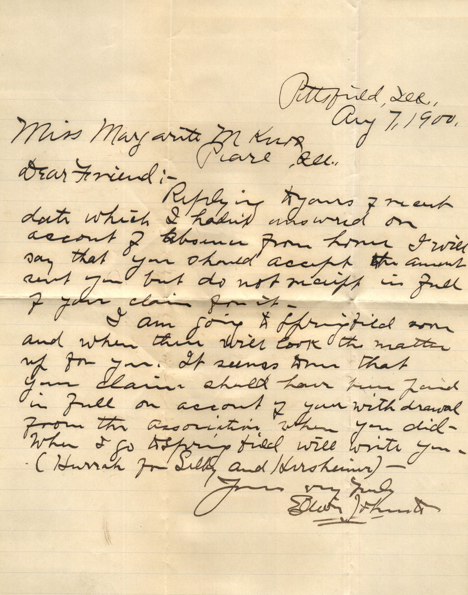

From: Elijah L. Fhurst, To: Margaret M. Knox  
Mailed From: Pittsburg, Ill. on August 7, 1900

Miss Margaret M Knox  
Pearl, Ill.

Dear Friend,  
Replying to your freight data which I hadn’t answered on account of absence from home. I will say that you should accept the amount sent you but do not receipt in full of your claim for it.  
I am going to Springfield soon and when there will look the matter up for you. It seems that your claims should have been paid in full on account of your with drawl from the association when you did. When I go to Springfield will write you. (Hurrah for Libby and Horrshumin) –  
Yours very truly,  
Elijah L. Fhurst